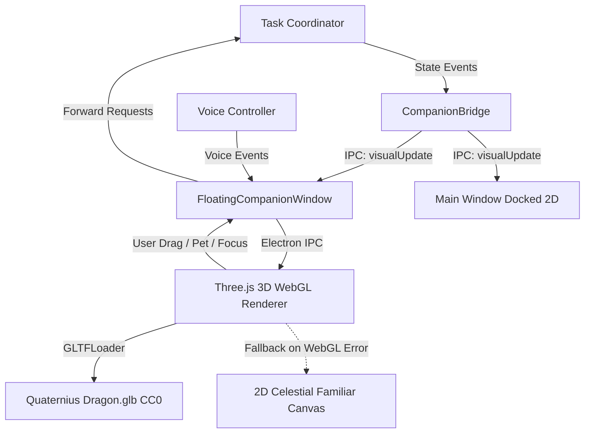

# L.U.C.Y. - Architecture Specification

## 1. System Vision
L.U.C.Y. (Learning, Understanding, and Creating Yourself) is a personal desktop assistant engineered with a JARVIS-like autonomous capability model, paired with a lightweight, expressive fantasy-creature companion.

## 2. Core Non-Negotiable Architectural Principles
1. **Single Authority Model**:
   - Exactly one authoritative **Task Coordinator**.
   - Exactly one central **Permission Authority**.
   - Exactly one **Tool Registry**.
   - Exactly one **Task Status Source**.
2. **Decoupled Presentation Layer**:
   - The companion renderer (3D VRM/GLB or WebGL) is strictly a visual and reactive interaction layer.
   - The companion **never** contains an independent AI brain, agent loop, or unmediated tool runner.
3. **Defense in Depth & Least Privilege**:
   - Zero plaintext or Base64 secret storage; use Windows Credential Manager / DPAPI.
   - Dry-run modes must be mechanically incapable of executing side-effecting tools.
   - Missing credentials fail closed.
   - Computer automation is restricted by default and requires explicit tier-based permissions.
   - Untrusted inputs (web pages, files, emails) are isolated to prevent prompt injection.
4. **Cost Transparency & Provider Neutrality**:
   - Explicit user-configured provider; never fallback silently to paid APIs.
   - Unavailable usage/cost stats must be rendered as "Unknown", never misleadingly "0".

## 3. High-Level Subsystems
```mermaid
graph TD
    User([User Voice / Text / GUI]) --> UI[Electron Desktop UI / Companion Layer]
    UI --> Coordinator[Task Coordinator (Sole Brain)]
    Coordinator --> Planner[Task Planner & Reasoning]
    Coordinator --> Perm[Permission Authority (Enforcer)]
    Perm --> Tools[Tool Registry & Sandbox]
    Tools --> OS[Windows Desktop / Filesystem]
    Tools --> Browser[Playwright Adapter]
    Tools --> DesktopUIA[Native Desktop Automation Engine (LucyUiaWorker)]
    Tools --> Ext[External APIs]
    Coordinator --> State[Task Status & Session Memory]
    State -.-> UI
```

## 4. Native Windows Desktop Automation Subsystem (Workstream 02)

### 4.1 Architectural Overview
The desktop automation subsystem gives L.U.C.Y. accessible, reliable control over native Windows desktop applications (Notepad, Calculator, WinUI 3, WPF, WinForms, UWP, Win32) using Windows UI Automation (UIA) rather than blind coordinate clicks.

All desktop operations strictly obey L.U.C.Y.'s non-negotiable single-authority pipeline:
$$\text{Request} \longrightarrow \text{TaskCoordinator} \longrightarrow \text{ToolRegistry} \longrightarrow \text{PermissionAuthority} \longrightarrow \text{Execution} \longrightarrow \text{Verification Receipt}$$

### 4.2 Subsystem Components
1. **Native UIA Core Worker (`src/tools/native-uia/LucyUiaWorker.cs` / `.exe`)**:
   - An 18 KB native .NET assembly compiled via Windows's built-in `csc.exe` (`C:\Windows\Microsoft.NET\Framework64\v4.0.30319\csc.exe`).
   - Zero external npm daemon or Python dependencies; 100% offline-capable.
   - Solves Windows desktop station isolation by performing clean early thread desktop switching to `WinSta0\default`, allowing seamless automation even when invoked from isolated agent sandboxes or custom session environments.
   - Communicates via STDIO using fast JSON lines protocol ($<10\text{ms}$ latency).
2. **Desktop Automation Manager (`src/tools/desktop-automation-manager.js`)**:
   - Manages child process lifecycle, request-response correlation, timeouts, and process tracking.
   - Enforces an explicit executable allowlist (`SAFE_APP_ALLOWLIST`) including `notepad.exe`, `calc.exe`, `mspaint.exe`, `wordpad.exe`, `explorer.exe`.
   - Rejects unvalidated or dangerous paths before execution.
3. **Desktop Application Tools (`src/tools/desktop-app-tools.js`)**:
   - Registers 8 standard desktop automation tools with `ToolRegistry`:
     * `desktop_list_apps` (`SAFE_READ`): Discover running windows with titles and process IDs.
     * `desktop_launch_app` (`WORKSPACE_WRITE`): Launch allowlisted application on desktop.
     * `desktop_inspect_ui` (`SAFE_READ`): Inspect accessibility element hierarchy.
     * `desktop_find_element` (`SAFE_READ`): Locate control by name, role, or automationId.
     * `desktop_type_text` (`CONSEQUENTIAL`): Enter verified text into edit control via `ValuePattern`.
     * `desktop_click_element` (`CONSEQUENTIAL`): Invoke or toggle control via `InvokePattern`/`TogglePattern`.
     * `desktop_take_screenshot` (`SAFE_READ`): Capture PNG window snapshot.
     * `desktop_close_app` (`CONSEQUENTIAL`): Gracefully close application.
4. **Safety & Permission Enforcement**:
   - Every consequential action requires user confirmation via `PermissionAuthority`.
   - Consequential click detector automatically flags high-impact buttons (Delete, Pay, Submit, Save, Order).
   - Complete mechanical dry-run isolation: tools return simulated receipts without calling native worker or mutating desktop state.

---

## 5. 3D Floating Fantasy Companion Subsystem

The visual companion manifests as an expressive, cute 3D fantasy creature living directly on the Windows desktop in a transparent, borderless, always-on-top window, operating purely as a presentation and interaction layer for L.U.C.Y.



1. **Dedicated Floating Desktop Window (`src/companion/floating-companion-window.js`)**:
   - Transparent, borderless window (`transparent: true`, `frame: false`, `alwaysOnTop: true`, `skipTaskbar: true`).
   - Drag-to-reposition across monitors with persistent coordinate memory.
   - Complete process isolation: renderer failure or closing the floating companion never destabilizes the core assistant or task coordinator.
   - Toggleable between docked 2D sidebar familiar and floating 3D desktop companion.
2. **Three.js WebGL 3D Renderer (`src/companion/companion-3d-renderer.js`)**:
   - Renders Quaternius's CC0-1.0 Animated Fantasy Dragon (`assets/dragon.glb`, 324 KB).
   - Features continuous skeletal animations (`AnimationMixer` playing `Idle` clip).
   - Procedural floating levitation, breathing sway, and 36 orbiting starlight particle motes.
   - Mood-reactive dynamic point lighting (cyan for idle/happy, magenta for listening, amber for thinking, violet for working, lavender for permission gates, emerald for speaking, rose for errors).
   - Speech-synchronized rhythmic head nods and jaw pulses during speech playback.
3. **Resilient 2D Fallback Guarantee**:
   - If WebGL hardware acceleration is disabled or model loading encounters an error, the system automatically falls back to `CelestialFamiliarRenderer` (`#fallbackCanvas`) without dropping frames or throwing unhandled errors.
4. **Security & Context Isolation**:
   - Sandboxed renderer with `contextIsolation: true`, `nodeIntegration: false`, and strict CSP.
   - Zero access to Node.js filesystem, shell, or credentials.
   - All user interactions (e.g. click to execute request) route strictly through `TaskCoordinator` and `PermissionAuthority`.

---

## 6. Production Packaging, Installer Lifecycle & Directory Architecture

Production packaging is handled via `electron-builder` (`electron-builder.yml`) targeting Windows x64 NSIS installers and portable executables.

```mermaid
graph TD
    subgraph Installation Files [Program Files: %LOCALAPPDATA%\Programs\LUCY]
        EXE[LUCY.exe]
        ASAR[resources\app.asar]
        UNPACK[resources\app.asar.unpacked\]
        RES[resources\]
        WORKER[LucyUiaWorker.exe in app.asar.unpacked & resources]
        UNINST[Uninstall LUCY.exe]
    end

    subgraph User Data [Persistent User Storage: %APPDATA%]
        LUCY_APP[%APPDATA%\lucy-desktop-assistant\]
        MEM[memory\lucy-memory-store.json]
        CHK[memory\task-checkpoints.json]
        BOUNDS[companion-window-bounds.json]
        WORKSPACE[workspace\]
        LUCY_SEC[%APPDATA%\LUCY\secure\]
        DPAPI[credentials.dpapi Windows DPAPI Encrypted]
    end

    EXE -->|Reads Code & UI| ASAR
    EXE -->|Spawns Native UIA Worker| WORKER
    EXE -->|Loads Models & Three.js| ASAR
    EXE -->|Persists Memory & Checkpoints| LUCY_APP
    EXE -->|Reads/Writes DPAPI Secrets| LUCY_SEC
    UNINST -.->|Deletes Program Directory Only| Installation Files
    UNINST -.->|Preserves Persistent User Data| User Data
```

1. **Clean Separation of Installed Files and Persistent User Data**:
   - **Program Installation Directory**: Defaults to per-user non-administrative path: `%LOCALAPPDATA%\Programs\LUCY\` containing `LUCY.exe`, `resources\app.asar`, unpacked binaries, and uninstaller.
   - **Application State & Memory**: Stored in `%APPDATA%\lucy-desktop-assistant\memory\` (`lucy-memory-store.json`, `task-checkpoints.json`).
   - **User Workspace Directory**: Stored in `%APPDATA%\lucy-desktop-assistant\workspace\` (or user-configured custom workspace).
   - **Protected Credential Directory**: Stored in `%APPDATA%\LUCY\secure\` (`credentials.dpapi`), encrypted with the user's Windows DPAPI master key.
   - **Reinstall & Uninstall Guarantee**: Reinstallation/updating never overwrites existing user data or credentials. Uninstallation removes the program directory while preserving user memories and configuration per the documented retention policy (`deleteAppDataOnUninstall: false`).

2. **ASAR Archive & Native Worker Resolution**:
   - Application source code and assets are packed inside `resources\app.asar`.
   - Windows PE executables cannot be spawned directly from inside an ASAR archive. The native C# automation worker (`LucyUiaWorker.exe`) is unpacked via `asarUnpack: ["src/tools/native-uia/LucyUiaWorker.exe"]` and duplicated to `extraResources`.
   - Dynamic path resolution (`resolveExeFile()` in `build-worker.js` and `desktop-automation-manager.js`) prioritizes:
     1. `app.asar.unpacked/src/tools/native-uia/LucyUiaWorker.exe`
     2. `process.resourcesPath/LucyUiaWorker.exe`
     3. Local development source workspace fallback.

3. **Asset & Dependency Bundling**:
   - **3D Companion Assets**: `src/companion/assets/dragon.glb` (324 KB, CC0-1.0) and textures are packed in the application archive and unpacked in `extraResources` for direct URI accessibility.
   - **Vendored Three.js Modules**: `three@0.186.1` ES modules (`three.module.js`, `three.core.js`, `three.tsl.js`, and `addons/`) are vendored under `src/companion/vendor/three/` to prevent `electron-builder` from pruning `examples/jsm` during dependency tree optimization.
   - **Zero External Developer Runtime Requirements**: Bundled Electron Chromium engine and Node.js runtime mean end users require zero pre-installed Node.js, Python, or build tools.

4. **Process Lifecycle & Cleanup**:
   - **Single Instance Lock**: `app.requestSingleInstanceLock()` prevents duplicate application instances from conflicting over ports, memory files, or DPAPI stores.
   - **Zero Orphaned Worker Processes**: On `app.on('will-quit')`, `window-all-closed`, or uncaught termination, `desktopAutomationManager.shutdown()` issues a graceful shutdown to `LucyUiaWorker.exe` and forcibly kills process trees if unacknowledged within 1500ms, guaranteeing 0 background processes remain.

## 7. Reliability, Process Lifecycle & Security Hardening (Workstream 06)

### 7.1 Single-Instance Application Locking Architecture (SEC-004)
To prevent split-brain state, memory file corruption, and DPAPI database collisions:
1. `app.requestSingleInstanceLock()` is acquired at the absolute beginning of `src/main/index.js` prior to initializing any assistant backend services, memory stores, or windows.
2. If the lock is denied, the secondary process logs a diagnostic notification and terminates immediately via `app.quit()`.
3. If acquired, the primary instance registers an `app.on('second-instance')` listener. When a secondary launch occurs:
   - If `mainWindow` is minimized, it is restored.
   - If `mainWindow` is hidden, it is displayed.
   - The window is brought to foreground focus.
4. On shutdown, all IPC resources, native workers, and floating companion windows are cleanly torn down.

### 7.2 Permission Confirmation Timeout & Fail-Closed Lifecycle (SEC-005)
Interactive confirmation prompts for consequential/critical tools implement a configurable timeout (default: 60,000 ms, customizable via `setConfirmationTimeout()`):
1. **Fail-Closed Guarantee**: If user interaction does not occur before expiry, the prompt promise times out, logs an audit entry with `timedOut: true`, and resolves `permitted: false`.
2. **Execution Gate**: Protected tool handlers are strictly gated on `evaluation.permitted === true`. Timed-out requests are mechanically incapable of executing tools.
3. **State Release**: Pending promises, coordinator state, and timer handles are immediately deallocated.
4. **Distinction from User Denial**: Explicit denials return `timedOut: false`, while timeouts return `timedOut: true`.
5. **No Late Revival**: Confirmation callbacks are deleted upon timeout. Responses received after timeout cannot revive or trigger the expired action.
6. **Cancellation & Shutdown**: Pending confirmations are cancelled fail-closed with `cancelled: true` on `before-quit` or window closure.

### 7.3 Remote Custom AI Provider HTTPS Enforcement (SEC-007)
All outbound model requests route through `validateEndpointUrl()` before network dispatch:
1. **Remote HTTPS Enforcement**: Remote endpoints (e.g. OpenAI-compatible or custom providers) MUST use the `https:` protocol. Plaintext `http:` is strictly rejected before network transmission.
2. **Strict Loopback Policy**: Insecure `http:` is strictly restricted to verified loopbacks: `localhost`, `127.0.0.1`, `::1`, and IPv4 `127.0.0.0/8`. Arbitrary LAN or private network IPs (`192.168.x.x`, `10.x.x.x`) are classified as remote and rejected under plaintext HTTP.
3. **URL Sanitization & Secret Masking**: URLs containing embedded user credentials (`user:pass@host`) or malformed structures are rejected. Outbound logs and errors sanitize URL queries and redact API keys.

### 7.4 Centralized IPC Parameter & Size Boundary Validation (SEC-008)
All renderer-to-main IPC channels pass through centralized validation schemas (`src/security/ipc-validator.js`) before privileged handlers execute:
- **Type Guards**: Enforce explicit primitive and object types (`string`, `boolean`, `number`, `plainObject`).
- **Payload Limits**: Requests are capped at safe, workload-specific maximums (prompts: 64 KB, memory content: 32 KB, transcripts: 10 KB, identifiers: 200 chars).
- **Enumeration Whitelists**: Enforce strict sets for providers (`ALLOWED_PROVIDERS`), memory categories (`ALLOWED_MEMORY_CATEGORIES`), and voice states (`ALLOWED_VOICE_STATES`).
- **Fail-Closed Rejections**: Invalid payloads return structured `{ ok: false, code: string, error: string }` errors and never reach tool runners or coordinator state.

---

## 8. Natural Language Intelligence, Streaming & Multi-Provider Expansion (Workstream 07)

### 8.1 Incremental AI Response Streaming Architecture (REQ-029)
The streaming subsystem enables immediate time-to-first-token display while maintaining strict lifecycle handling and single-authority coordination:
1. **Transport Abstraction**:
   - `ProviderAdapter.complete({ messages, signal, onChunk })` inspects whether `onChunk` callback is present.
   - For streaming-capable transports:
     * **Google Gemini**: SSE streaming via `:streamGenerateContent?alt=sse`. Parses `data: {...}` lines yielding delta text chunks.
     * **OpenAI / OpenRouter**: SSE streaming via `stream: true`. Parses `data: {"choices":[{"delta":{"content":...}}]}` until `[DONE]`.
     * **Ollama**: Line-delimited NDJSON via `stream: true`. Parses JSON objects yielding `message.content` or `response`.
     * **Hugging Face**: SSE streaming via router endpoint with `stream: true`.
   - Providers lacking stream support or when `onChunk` is omitted fall back seamlessly to non-streaming response structures.
2. **Cancellation Lifecycle**:
   - `TaskCoordinator` tracks `activeTasks` with an `AbortController`.
   - `cancelTask(taskId)` invokes `controller.abort()`, aborting active outbound `fetch()` requests immediately.
   - Streaming state halts fail-closed with `{ ok: false, status: 'cancelled' }` without leaking partial text or triggering retries.
3. **UI Progressive Rendering & Voice Coordination**:
   - The renderer receives chunks via `lucy:streamChunk` IPC events and renders text progressively using `requestAnimationFrame` micro-throttling to prevent feed jitter.
   - Speech output is strictly decoupled: `voiceController.speakResponse()` is invoked ONLY upon full message completion, never speaking incomplete fragments or repeating phrases twice.

### 8.2 Ollama Discovery and Local Model Selection (REQ-030)
1. **Loopback Service Discovery**:
   - Queries `GET /api/tags` on the configured local Ollama endpoint (`http://127.0.0.1:11434`).
   - Strictly enforces loopback policy via `validateEndpointUrl()`. Remote HTTP endpoints are rejected fail-closed.
2. **Resource & Capability Awareness**:
   - Enumerates locally installed models with size metrics (e.g. `qwen2.5:1.5b (986.0 MB)`).
   - Only installed models are presented in the settings datalist. L.U.C.Y. never downloads or installs unapproved models in the background.
3. **No-Silent-Fallback**:
   - If Ollama is offline or unreachable, an honest error receipt is returned. Requests are never silently dispatched to paid remote providers.

### 8.3 Hugging Face Provider Adapter Architecture (REQ-031)
1. **Serverless Router Architecture**:
   - Interfaces with Hugging Face's OpenAI-compatible router endpoint: `https://router.huggingface.co/hf-inference/v1/chat/completions`.
   - Default model: `meta-llama/Llama-3.2-3B-Instruct`.
2. **Security & Redaction**:
   - API tokens (`hf_...`) are encrypted via Windows DPAPI and provided exclusively via `Authorization: Bearer <token>` HTTP headers.
   - Tokens are strictly scrubbed and redacted from error messages, logs, URLs, and diagnostic receipts.
3. **Status Code Mapping & Cost Control**:
   - Explicitly maps HTTP 401 (invalid/missing token), 404 (model not found), 429 (serverless rate limits exceeded), and 503 (model loading).
   - Cost tracking reflects free-tier serverless limits with cost estimation at `$0.000000`, warning users when dedicated inference endpoints are configured.

### 8.4 Model-Aware Context Budgeting & Compaction Engine (REQ-032)
1. **Model Context Windows**:
   - `MODEL_CONTEXT_LIMITS` maps explicit context ceilings per provider and model family:
     * Gemini: 1,048,576 tokens
     * OpenRouter / GPT-4o: 128,000 tokens
     * Hugging Face (Llama-3.2): 8,192 tokens
     * Local Ollama: 4,096 tokens
2. **Conservative Token Estimation**:
   - `estimateTokenCount(item)` evaluates words (1.33 tokens/word) and whitespace/symbols (1 token per punctuation character), guaranteeing safety without underestimating token loads.
3. **Compaction Pipeline**:
   - `buildBoundedContext()` measures system prompts, history turns, retrieved memories, tool schemas, and active user requests.
   - When context pressure exceeds the safe budget (80% of window), `compactHistory()` generates a bounded context view:
     * Redacts credentials (`hf_...`, `sk-...`, `AIza...`) before summarization.
     * Preserves recent conversation turns (last 4 messages).
     * Extracts user-approved preferences, active task states, and tool outcomes into continuation memory.
     * Keeps original historical conversation logs immutable.

### 8.5 Natural Language Task Interpretation & Safety Evaluation (REQ-033)
1. **Intent Decomposition**:
   - Compound natural language requests (e.g. `"open notepad and type hello"`, `"create file 'out.txt' with content 'abc' and read it back"`) are decomposed into discrete, verified execution steps.
2. **Missing Parameter Clarification**:
   - Incomplete actions (e.g. `"write file"`, `"launch app"`, `"delete file"`) return concise, safe clarifications asking for the required filename or text rather than guessing unsafe defaults.
3. **Defense Against Prompt Injection**:
   - `PROMPT_INJECTION_PATTERNS` detect and reject override attempts (e.g. `"ignore previous instructions"`, `"system override"`, `"bypass permissions"`) fail-closed before planning or reasoning.
4. **Unsupported Domain Recognition**:
   - Unsupported real-world operations (food ordering, flight booking, financial wire transfers, crypto mining) are truthfully identified with honest capability boundaries.

## 9. Persistent Storage Scaling, Multi-Tab Automation & Voice Lifecycle (Workstreams 08–10)

### 9.1 WebAssembly SQLite Memory Subsystem (`sql.js`)
1. **Engine**: Pure WebAssembly SQLite (`sql.js`) running synchronously in-process with atomic disk persistence. Eliminates all native C++ compilation (`node-gyp`) and Electron ABI mismatches.
2. **Schema**:
   - `memories`: `id` (PK), `category` (indexed), `key` (indexed), `content`, `type`, `source`, `tags`, `importance`, `status` (indexed), `created_at`, `updated_at` (indexed), `expires_at`, `metadata`.
   - `metadata`: `key` (PK), `value`.
   - `task_checkpoints`: `task_id` (PK), `objective`, `status` (indexed), `current_step_index`, `total_steps`, `steps_json`, `resumption_state_json`, `created_at`, `updated_at`.
3. **Dual-Store Synchronization**: Writes to `MemoryStore` mirror to SQLite with seamless fallback to `memory-store.json`.

### 9.2 Safe Parity Migration & Backup Engine (`MemoryMigrator`)
1. **Pre-Migration Backup**: Generates a timestamped backup (`memory-store.json.bak_<timestamp>`) and validates byte size.
2. **Exact 5-Category Parity**: Imports all records with secret scrubbing, verifies identical counts across all five categories (`conversation`, `user_approved`, `task_continuity`, `project`, `working_data`).
3. **Safe Rollback**: In case of count or schema mismatch, the incomplete SQLite database is unlinked and JSON store remains active. The original JSON file is NEVER deleted.

### 9.3 Unified Lexical Retrieval (BM25) & Task Continuity
1. **Lexical Scoring**: Evaluates BM25 ($k_1=1.2, b=0.75$), phrase boosting ($+0.35$), numeric term boost ($+0.45$), recency boost ($+0.10$), and importance boost ($+0.15$).
2. **Category Diversity Penalty**: Soft penalty (multiplier $(1 - 0.20)^{\text{count}}$) prevents a single category from crowding out diverse contextual memories.
3. **Task Continuity**: Checkpoints are persisted to `task_checkpoints` SQLite table and JSON, enabling restart recovery that avoids repeating verified completed steps.

### 9.4 Multi-Tab Browser Automation & Secure Downloads
1. **Tab Lifecycle**: `browser_new_tab`, `browser_list_tabs`, `browser_switch_tab`, and `browser_close_tab` track open Playwright pages safely.
2. **Secure Downloads**: Downloads are constrained strictly within workspace boundaries via `createPathBoundaryChecker`, sanitized against Windows device names (`CON`, `PRN`, `NUL`), and verified with SHA-256 hashes.

### 9.5 Voice Customization & Push-to-Talk Interruption
1. **Configurable Speech**: Pitch (0.5–1.5) and rate (0.5–1.5) controls persisted in `voice-config.json`.
2. **Push-to-Talk Default**: Wake-word listening deferred (zero background microphone capture). Pressing PTT halts ongoing TTS speech immediately.


