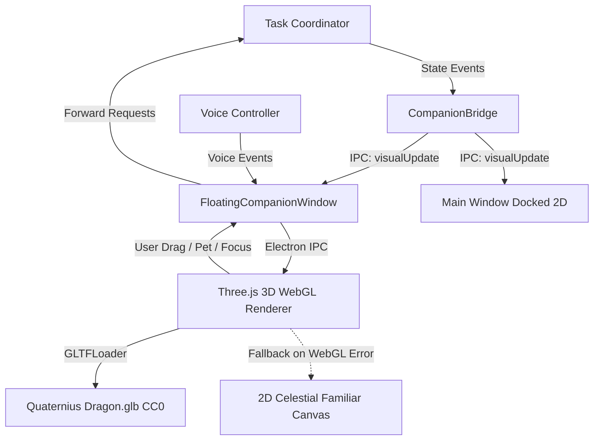

# L.U.C.Y. - Architecture Specification

## 1. System Vision
L.U.C.Y. (Learning, Understanding, and Creating Yourself) is a personal desktop assistant engineered with a JARVIS-like autonomous capability model, paired with a lightweight, expressive fantasy-creature companion.

## 2. Core Non-Negotiable Architectural Principles
1. **Single Authority Model**:
   - Exactly one authoritative **Task Coordinator**.
   - Exactly one central **Permission Authority**.
   - Exactly one **Tool Registry**.
   - Exactly one **Task Status Source**.
2. **Decoupled Presentation Layer**:
   - The companion renderer (3D VRM/GLB or WebGL) is strictly a visual and reactive interaction layer.
   - The companion **never** contains an independent AI brain, agent loop, or unmediated tool runner.
3. **Defense in Depth & Least Privilege**:
   - Zero plaintext or Base64 secret storage; use Windows Credential Manager / DPAPI.
   - Dry-run modes must be mechanically incapable of executing side-effecting tools.
   - Missing credentials fail closed.
   - Computer automation is restricted by default and requires explicit tier-based permissions.
   - Untrusted inputs (web pages, files, emails) are isolated to prevent prompt injection.
4. **Cost Transparency & Provider Neutrality**:
   - Explicit user-configured provider; never fallback silently to paid APIs.
   - Unavailable usage/cost stats must be rendered as "Unknown", never misleadingly "0".

## 3. High-Level Subsystems
```mermaid
graph TD
    User([User Voice / Text / GUI]) --> UI[Electron Desktop UI / Companion Layer]
    UI --> Coordinator[Task Coordinator (Sole Brain)]
    Coordinator --> Planner[Task Planner & Reasoning]
    Coordinator --> Perm[Permission Authority (Enforcer)]
    Perm --> Tools[Tool Registry & Sandbox]
    Tools --> OS[Windows Desktop / Filesystem]
    Tools --> Browser[Playwright Adapter]
    Tools --> DesktopUIA[Native Desktop Automation Engine (LucyUiaWorker)]
    Tools --> Ext[External APIs]
    Coordinator --> State[Task Status & Session Memory]
    State -.-> UI
```

## 4. Native Windows Desktop Automation Subsystem (Workstream 02)

### 4.1 Architectural Overview
The desktop automation subsystem gives L.U.C.Y. accessible, reliable control over native Windows desktop applications (Notepad, Calculator, WinUI 3, WPF, WinForms, UWP, Win32) using Windows UI Automation (UIA) rather than blind coordinate clicks.

All desktop operations strictly obey L.U.C.Y.'s non-negotiable single-authority pipeline:
$$\text{Request} \longrightarrow \text{TaskCoordinator} \longrightarrow \text{ToolRegistry} \longrightarrow \text{PermissionAuthority} \longrightarrow \text{Execution} \longrightarrow \text{Verification Receipt}$$

### 4.2 Subsystem Components
1. **Native UIA Core Worker (`src/tools/native-uia/LucyUiaWorker.cs` / `.exe`)**:
   - An 18 KB native .NET assembly compiled via Windows's built-in `csc.exe` (`C:\Windows\Microsoft.NET\Framework64\v4.0.30319\csc.exe`).
   - Zero external npm daemon or Python dependencies; 100% offline-capable.
   - Solves Windows desktop station isolation by performing clean early thread desktop switching to `WinSta0\default`, allowing seamless automation even when invoked from isolated agent sandboxes or custom session environments.
   - Communicates via STDIO using fast JSON lines protocol ($<10\text{ms}$ latency).
2. **Desktop Automation Manager (`src/tools/desktop-automation-manager.js`)**:
   - Manages child process lifecycle, request-response correlation, timeouts, and process tracking.
   - Enforces an explicit executable allowlist (`SAFE_APP_ALLOWLIST`) including `notepad.exe`, `calc.exe`, `mspaint.exe`, `wordpad.exe`, `explorer.exe`.
   - Rejects unvalidated or dangerous paths before execution.
3. **Desktop Application Tools (`src/tools/desktop-app-tools.js`)**:
   - Registers 10 standard desktop automation tools with `ToolRegistry`:
     * `desktop_list_apps` (`SAFE_READ`): Discover running windows with titles and process IDs.
     * `desktop_launch_app` (`WORKSPACE_WRITE`): Launch allowlisted application on desktop.
     * `desktop_inspect_ui` (`SAFE_READ`): Inspect accessibility element hierarchy.
     * `desktop_find_element` (`SAFE_READ`): Locate control by name, role, or automationId.
     * `desktop_inspect_control` (`SAFE_READ`): Check top-level window responsiveness and control readiness without mutating state.
     * `desktop_resolve_target` (`SAFE_READ`): Deterministically resolve UIA target through 5-level hierarchy with ambiguity rejection.
     * `desktop_type_text` (`CONSEQUENTIAL`): Enter verified text into edit control with postcondition readback verification.
     * `desktop_click_element` (`CONSEQUENTIAL`): Invoke or toggle control with postcondition state change verification.
     * `desktop_take_screenshot` (`SAFE_READ`): Capture PNG window snapshot.
     * `desktop_close_app` (`CONSEQUENTIAL`): Gracefully close application.
4. **Safety & Permission Enforcement**:
   - Every consequential action requires user confirmation via `PermissionAuthority`.
   - Target resolution and action authorization remain strictly separated stages.
   - Consequential click detector automatically flags high-impact buttons (Delete, Pay, Submit, Save, Order).
   - Complete mechanical dry-run isolation: tools return simulated receipts without calling native worker or mutating desktop state.

### 4.3 Target Resolution Pipeline & 5-Level Hierarchy
Desktop target identification follows a deterministic, evidence-based pipeline in `LucyUiaWorker.cs` and `DesktopAutomationManager.js`:
1. **Target Window & Process Isolation**:
   - The target top-level window handle (`HWND`) is verified to belong to the authorized target Process ID (`PID`).
   - Elements belonging to external processes or outside the validated top-level window bounding rectangle are rejected fail-closed.
2. **5-Level Resolution Hierarchy**:
   - **Level 1 (Exact AutomationId)**: Match element by exact `AutomationId` within the validated target window scope. If multiple candidates exist, verify uniqueness or scope.
   - **Level 2 (Semantic Match)**: Match element constrained by `ControlType`, `Name` (including localized UTF-8 names), and optionally `ClassName`. Ambiguous matches (>1 candidate) fail closed with `AMBIGUOUS_TARGET` to prevent guessing.
   - **Level 3 (Parent/Ancestor Structural Context)**: Constrain element search to children/descendants of a specified parent `AutomationId`, `Name`, or `ControlType`.
   - **Level 4 (Constrained Visual & Geometric Recovery)**: Only when semantic evidence matches, calculate fresh bounding rectangles from live UIA geometry. Candidates intersecting expected bounds are accepted; stale cached coordinates are never trusted.
   - **Level 5 (Explicit Failure)**: If no candidates satisfy confidence and safety criteria, fail closed with structured error codes (`AMBIGUOUS_TARGET`, `ELEMENT_DISABLED`, `CONTROL_INCOMPATIBLE`, `OUTSIDE_WINDOW_BOUNDS`, `ELEMENT_NOT_FOUND`).

### 4.4 Dynamic Anchor Recovery
When a target control is not immediately found or has become stale due to UI virtualization, scrolling, or dynamic layout updates:
1. The target window is re-validated to ensure process continuity and live ownership.
2. A bounded retry loop (up to 2 retries, 150ms backoff) refreshes element information from the live UIA desktop tree.
3. If a unique candidate matches structural and semantic criteria across retries, it is recovered with strategy `dynamic_anchor_recovered`.
4. Desktop-wide unconstrained searches and silent substitutions are strictly prohibited.
5. A structured recovery receipt is generated recording strategy, attempts, candidate count, and matching evidence.

### 4.5 Action-Specific Compatibility & Safety Gates
1. **Control Compatibility Check**:
   - `click`: Requires `Button`, `CheckBox`, `RadioButton`, `MenuItem`, `TabItem`, `Hyperlink`, `ListItem`, `Custom`, or presence of `InvokePattern` / `TogglePattern` / `SelectionItemPattern`.
   - `type_text`: Requires `Edit`, `Document`, `ComboBox`, `Spinner`, or presence of `ValuePattern`. Read-only controls are rejected with `CONTROL_INCOMPATIBLE`.
2. **Interactability & Enabled State**:
   - Disabled elements (`IsEnabled == false`) are rejected fail-closed with `ELEMENT_DISABLED` for interactive actions.
3. **Secret Redaction**:
   - Sensitive inputs tagged with `isSecret: true` redact text content to `[REDACTED]` in IPC messages, receipts, and diagnostics, preventing credential leakage in logs.

### 4.6 Postcondition Verification & Uncertainty Handling
Executing a native UIA pattern or method does not prove action success. The result verification layer performs active postcondition checks:
1. **Toggle Actions**: Verify observable change in `ToggleState` (e.g. `On` vs `Off`).
2. **Selection Actions**: Verify `SelectionItemPattern.IsSelected` reflects true.
3. **Text Entry**: Read back text via `ValuePattern.Current.Value` and verify match against intended input (redacted if secret).
4. **Close Actions**: Poll for window or dialog closure within bounded timeout.
5. **Unverifiable Outcomes**: When an application exposes no UIA postcondition property, return `postconditionStatus: 'UNVERIFIABLE'`. `ResultVerifier` maps this to `INCONCLUSIVE` (never false success).
6. **Consequential Uncertainty Preservation**: If a consequential action yields an inconclusive outcome or timeout, the task coordinator halts with `uncertain: true` and preserves `AWAITING_RECONCILIATION`. Blind retries or fallback execution of uncertain consequential actions are strictly prohibited.

### 4.7 Verified End-to-End Desktop Workflows & Structured Execution Observability

Phase 3 extends isolated desktop automation into multi-step, verified desktop execution workflows:

1. **Reference Workflow Models**:
   - **Workflow A (Open & Inspect Readiness)**: Launches an allowlisted target (e.g. Notepad), validates top-level window responsiveness and PID ownership, discovers ready editable controls via `desktop_inspect_control` without typing or mutating application state, and returns truthful readiness.
   - **Workflow B (Enter & Verify Harmless Text)**: Launches an application, targets the verified process/window, enters text, performs readback verification via UIA (`ValuePattern`), and truthfully returns `status: INCONCLUSIVE` when readback is unobservable without manufacturing false success.
   - **Workflow C (Multi-step DAG Execution with Recovery)**: Decomposes into a deterministic directed acyclic graph (Launch -> Type -> Inspect/Read), persists step checkpoints to disk, allows resumption of only safe remaining steps, performs bounded recovery on transient failures, and prevents blind retry on uncertain timeout.

2. **Unverified Dependency Gating in TaskCoordinator**:
   - In dynamic template parameter resolution (`{{step_N.output}}`), downstream steps cannot execute if prerequisite step `step_N` failed verification or returned unverified output.
   - Attempting to satisfy dependencies from unverified steps throws a hard safety error (`Prerequisite step failed verification or produced unverified output; cannot satisfy dependency`), halting execution fail-closed.

3. **Structured Workflow Execution Record (`getWorkflowExecutionRecord`)**:
   - Provides a comprehensive, structured audit record for every workflow execution:
     * `taskId`: Unique task identifier.
     * `requestedOutcome`: The sanitized user intent.
     * `plannedSteps`: Planned steps with topological dependencies and verification strategies.
     * `targetApp`: Discovered target application identity (`appId`, `pid`, `windowHandle`, `windowTitle`, `executable`).
     * `actionAttempts`: Step execution receipts including tool identifiers, status, verification, errors, and tiers.
     * `verifiedPostconditions`: Postconditions validated by independent verification strategies with evidence.
     * `recoveryDecisions`: Bounded retry and dynamic recovery receipts.
     * `uncertainOutcomes`: Preserved uncertain steps awaiting human reconciliation.
     * `finalStatus`: Terminal task state (`completed`, `failed`, `interrupted`, `awaiting_reconciliation`).
     * `remainingLimitations`: Clear explanations of unverified or constrained elements.
     * `summary`: Compact, truthful execution summary.
   - **Privacy & Secret Sanitization**:
     * Automatically scrubs API keys (`sk-...`, `ghp_...`, `AIza...`, `glpat-...`), bearer tokens, passwords, and sensitive text.
     * Completely replaces bulky base64 screenshots and image strings (> 256 characters) with `[SCREENSHOT_BASE64_OMITTED]`, keeping log files compact and secret-free.

---

## 5. 3D Floating Fantasy Companion Subsystem

The visual companion manifests as an expressive, cute 3D fantasy creature living directly on the Windows desktop in a transparent, borderless, always-on-top window, operating purely as a presentation and interaction layer for L.U.C.Y.



1. **Dedicated Floating Desktop Window (`src/companion/floating-companion-window.js`)**:
   - Transparent, borderless window (`transparent: true`, `frame: false`, `alwaysOnTop: true`, `skipTaskbar: true`).
   - Drag-to-reposition across monitors with persistent coordinate memory.
   - Complete process isolation: renderer failure or closing the floating companion never destabilizes the core assistant or task coordinator.
   - Toggleable between docked 2D sidebar familiar and floating 3D desktop companion.
2. **Three.js WebGL 3D Renderer (`src/companion/companion-3d-renderer.js`)**:
   - Renders Quaternius's CC0-1.0 Animated Fantasy Dragon (`assets/dragon.glb`, 324 KB).
   - Features continuous skeletal animations (`AnimationMixer` playing `Idle` clip).
   - Procedural floating levitation, breathing sway, and 36 orbiting starlight particle motes.
   - Mood-reactive dynamic point lighting (cyan for idle/happy, magenta for listening, amber for thinking, violet for working, lavender for permission gates, emerald for speaking, rose for errors).
   - Speech-synchronized rhythmic head nods and jaw pulses during speech playback.
3. **Resilient 2D Fallback Guarantee**:
   - If WebGL hardware acceleration is disabled or model loading encounters an error, the system automatically falls back to `CelestialFamiliarRenderer` (`#fallbackCanvas`) without dropping frames or throwing unhandled errors.
4. **Security & Context Isolation**:
   - Sandboxed renderer with `contextIsolation: true`, `nodeIntegration: false`, and strict CSP.
   - Zero access to Node.js filesystem, shell, or credentials.
   - All user interactions (e.g. click to execute request) route strictly through `TaskCoordinator` and `PermissionAuthority`.

---

## 6. Production Packaging, Installer Lifecycle & Directory Architecture

Production packaging is handled via `electron-builder` (`electron-builder.yml`) targeting Windows x64 NSIS installers and portable executables.

```mermaid
graph TD
    subgraph Installation Files [Program Files: %LOCALAPPDATA%\Programs\LUCY]
        EXE[LUCY.exe]
        ASAR[resources\app.asar]
        UNPACK[resources\app.asar.unpacked\]
        RES[resources\]
        WORKER[LucyUiaWorker.exe in app.asar.unpacked & resources]
        UNINST[Uninstall LUCY.exe]
    end

    subgraph User Data [Persistent User Storage: %APPDATA%]
        LUCY_APP[%APPDATA%\lucy-desktop-assistant\]
        MEM[memory\lucy-memory-store.json]
        CHK[memory\task-checkpoints.json]
        BOUNDS[companion-window-bounds.json]
        WORKSPACE[workspace\]
        LUCY_SEC[%APPDATA%\LUCY\secure\]
        DPAPI[credentials.dpapi Windows DPAPI Encrypted]
    end

    EXE -->|Reads Code & UI| ASAR
    EXE -->|Spawns Native UIA Worker| WORKER
    EXE -->|Loads Models & Three.js| ASAR
    EXE -->|Persists Memory & Checkpoints| LUCY_APP
    EXE -->|Reads/Writes DPAPI Secrets| LUCY_SEC
    UNINST -.->|Deletes Program Directory Only| Installation Files
    UNINST -.->|Preserves Persistent User Data| User Data
```

1. **Clean Separation of Installed Files and Persistent User Data**:
   - **Program Installation Directory**: Defaults to per-user non-administrative path: `%LOCALAPPDATA%\Programs\LUCY\` containing `LUCY.exe`, `resources\app.asar`, unpacked binaries, and uninstaller.
   - **Application State & Memory**: Stored in `%APPDATA%\lucy-desktop-assistant\memory\` (`lucy-memory-store.json`, `task-checkpoints.json`).
   - **User Workspace Directory**: Stored in `%APPDATA%\lucy-desktop-assistant\workspace\` (or user-configured custom workspace).
   - **Protected Credential Directory**: Stored in `%APPDATA%\LUCY\secure\` (`credentials.dpapi`), encrypted with the user's Windows DPAPI master key.
   - **Reinstall & Uninstall Guarantee**: Reinstallation/updating never overwrites existing user data or credentials. Uninstallation removes the program directory while preserving user memories and configuration per the documented retention policy (`deleteAppDataOnUninstall: false`).

2. **ASAR Archive & Native Worker Resolution**:
   - Application source code and assets are packed inside `resources\app.asar`.
   - Windows PE executables cannot be spawned directly from inside an ASAR archive. The native C# automation worker (`LucyUiaWorker.exe`) is unpacked via `asarUnpack: ["src/tools/native-uia/LucyUiaWorker.exe"]` and duplicated to `extraResources`.
   - Dynamic path resolution (`resolveExeFile()` in `build-worker.js` and `desktop-automation-manager.js`) prioritizes:
     1. `app.asar.unpacked/src/tools/native-uia/LucyUiaWorker.exe`
     2. `process.resourcesPath/LucyUiaWorker.exe`
     3. Local development source workspace fallback.

3. **Asset & Dependency Bundling**:
   - **3D Companion Assets**: `src/companion/assets/dragon.glb` (324 KB, CC0-1.0) and textures are packed in the application archive and unpacked in `extraResources` for direct URI accessibility.
   - **Vendored Three.js Modules**: `three@0.186.1` ES modules (`three.module.js`, `three.core.js`, `three.tsl.js`, and `addons/`) are vendored under `src/companion/vendor/three/` to prevent `electron-builder` from pruning `examples/jsm` during dependency tree optimization.
   - **Zero External Developer Runtime Requirements**: Bundled Electron Chromium engine and Node.js runtime mean end users require zero pre-installed Node.js, Python, or build tools.

4. **Process Lifecycle & Cleanup**:
   - **Single Instance Lock**: `app.requestSingleInstanceLock()` prevents duplicate application instances from conflicting over ports, memory files, or DPAPI stores.
   - **Zero Orphaned Worker Processes**: On `app.on('will-quit')`, `window-all-closed`, or uncaught termination, `desktopAutomationManager.shutdown()` issues a graceful shutdown to `LucyUiaWorker.exe` and forcibly kills process trees if unacknowledged within 1500ms, guaranteeing 0 background processes remain.

## 7. Reliability, Process Lifecycle & Security Hardening (Workstream 06)

### 7.1 Single-Instance Application Locking Architecture (SEC-004)
To prevent split-brain state, memory file corruption, and DPAPI database collisions:
1. `app.requestSingleInstanceLock()` is acquired at the absolute beginning of `src/main/index.js` prior to initializing any assistant backend services, memory stores, or windows.
2. If the lock is denied, the secondary process logs a diagnostic notification and terminates immediately via `app.quit()`.
3. If acquired, the primary instance registers an `app.on('second-instance')` listener. When a secondary launch occurs:
   - If `mainWindow` is minimized, it is restored.
   - If `mainWindow` is hidden, it is displayed.
   - The window is brought to foreground focus.
4. On shutdown, all IPC resources, native workers, and floating companion windows are cleanly torn down.

### 7.2 Permission Confirmation Timeout & Fail-Closed Lifecycle (SEC-005)
Interactive confirmation prompts for consequential/critical tools implement a configurable timeout (default: 60,000 ms, customizable via `setConfirmationTimeout()`):
1. **Fail-Closed Guarantee**: If user interaction does not occur before expiry, the prompt promise times out, logs an audit entry with `timedOut: true`, and resolves `permitted: false`.
2. **Execution Gate**: Protected tool handlers are strictly gated on `evaluation.permitted === true`. Timed-out requests are mechanically incapable of executing tools.
3. **State Release**: Pending promises, coordinator state, and timer handles are immediately deallocated.
4. **Distinction from User Denial**: Explicit denials return `timedOut: false`, while timeouts return `timedOut: true`.
5. **No Late Revival**: Confirmation callbacks are deleted upon timeout. Responses received after timeout cannot revive or trigger the expired action.
6. **Cancellation & Shutdown**: Pending confirmations are cancelled fail-closed with `cancelled: true` on `before-quit` or window closure.

### 7.3 Remote Custom AI Provider HTTPS Enforcement (SEC-007)
All outbound model requests route through `validateEndpointUrl()` before network dispatch:
1. **Remote HTTPS Enforcement**: Remote endpoints (e.g. OpenAI-compatible or custom providers) MUST use the `https:` protocol. Plaintext `http:` is strictly rejected before network transmission.
2. **Strict Loopback Policy**: Insecure `http:` is strictly restricted to verified loopbacks: `localhost`, `127.0.0.1`, `::1`, and IPv4 `127.0.0.0/8`. Arbitrary LAN or private network IPs (`192.168.x.x`, `10.x.x.x`) are classified as remote and rejected under plaintext HTTP.
3. **URL Sanitization & Secret Masking**: URLs containing embedded user credentials (`user:pass@host`) or malformed structures are rejected. Outbound logs and errors sanitize URL queries and redact API keys.

### 7.4 Centralized IPC Parameter & Size Boundary Validation (SEC-008)
All renderer-to-main IPC channels pass through centralized validation schemas (`src/security/ipc-validator.js`) before privileged handlers execute:
- **Type Guards**: Enforce explicit primitive and object types (`string`, `boolean`, `number`, `plainObject`).
- **Payload Limits**: Requests are capped at safe, workload-specific maximums (prompts: 64 KB, memory content: 32 KB, transcripts: 10 KB, identifiers: 200 chars).
- **Enumeration Whitelists**: Enforce strict sets for providers (`ALLOWED_PROVIDERS`), memory categories (`ALLOWED_MEMORY_CATEGORIES`), and voice states (`ALLOWED_VOICE_STATES`).
- **Fail-Closed Rejections**: Invalid payloads return structured `{ ok: false, code: string, error: string }` errors and never reach tool runners or coordinator state.

---

## 8. Natural Language Intelligence, Streaming & Multi-Provider Expansion (Workstream 07)

### 8.1 Incremental AI Response Streaming Architecture (REQ-029)
The streaming subsystem enables immediate time-to-first-token display while maintaining strict lifecycle handling and single-authority coordination:
1. **Transport Abstraction**:
   - `ProviderAdapter.complete({ messages, signal, onChunk })` inspects whether `onChunk` callback is present.
   - For streaming-capable transports:
     * **Google Gemini**: SSE streaming via `:streamGenerateContent?alt=sse`. Parses `data: {...}` lines yielding delta text chunks.
     * **OpenAI / OpenRouter**: SSE streaming via `stream: true`. Parses `data: {"choices":[{"delta":{"content":...}}]}` until `[DONE]`.
     * **Ollama**: Line-delimited NDJSON via `stream: true`. Parses JSON objects yielding `message.content` or `response`.
     * **Hugging Face**: SSE streaming via router endpoint with `stream: true`.
   - Providers lacking stream support or when `onChunk` is omitted fall back seamlessly to non-streaming response structures.
2. **Cancellation Lifecycle**:
   - `TaskCoordinator` tracks `activeTasks` with an `AbortController`.
   - `cancelTask(taskId)` invokes `controller.abort()`, aborting active outbound `fetch()` requests immediately.
   - Streaming state halts fail-closed with `{ ok: false, status: 'cancelled' }` without leaking partial text or triggering retries.
3. **UI Progressive Rendering & Voice Coordination**:
   - The renderer receives chunks via `lucy:streamChunk` IPC events and renders text progressively using `requestAnimationFrame` micro-throttling to prevent feed jitter.
   - Speech output is strictly decoupled: `voiceController.speakResponse()` is invoked ONLY upon full message completion, never speaking incomplete fragments or repeating phrases twice.

### 8.2 Ollama Discovery and Local Model Selection (REQ-030)
1. **Loopback Service Discovery**:
   - Queries `GET /api/tags` on the configured local Ollama endpoint (`http://127.0.0.1:11434`).
   - Strictly enforces loopback policy via `validateEndpointUrl()`. Remote HTTP endpoints are rejected fail-closed.
2. **Resource & Capability Awareness**:
   - Enumerates locally installed models with size metrics (e.g. `qwen2.5:1.5b (986.0 MB)`).
   - Only installed models are presented in the settings datalist. L.U.C.Y. never downloads or installs unapproved models in the background.
3. **No-Silent-Fallback**:
   - If Ollama is offline or unreachable, an honest error receipt is returned. Requests are never silently dispatched to paid remote providers.

### 8.3 Hugging Face Provider Adapter Architecture (REQ-031)
1. **Serverless Router Architecture**:
   - Interfaces with Hugging Face's OpenAI-compatible router endpoint: `https://router.huggingface.co/hf-inference/v1/chat/completions`.
   - Default model: `meta-llama/Llama-3.2-3B-Instruct`.
2. **Security & Redaction**:
   - API tokens (`hf_...`) are encrypted via Windows DPAPI and provided exclusively via `Authorization: Bearer <token>` HTTP headers.
   - Tokens are strictly scrubbed and redacted from error messages, logs, URLs, and diagnostic receipts.
3. **Status Code Mapping & Cost Control**:
   - Explicitly maps HTTP 401 (invalid/missing token), 404 (model not found), 429 (serverless rate limits exceeded), and 503 (model loading).
   - Cost tracking reflects free-tier serverless limits with cost estimation at `$0.000000`, warning users when dedicated inference endpoints are configured.

### 8.4 Model-Aware Context Budgeting & Compaction Engine (REQ-032)
1. **Model Context Windows**:
   - `MODEL_CONTEXT_LIMITS` maps explicit context ceilings per provider and model family:
     * Gemini: 1,048,576 tokens
     * OpenRouter / GPT-4o: 128,000 tokens
     * Hugging Face (Llama-3.2): 8,192 tokens
     * Local Ollama: 4,096 tokens
2. **Conservative Token Estimation**:
   - `estimateTokenCount(item)` evaluates words (1.33 tokens/word) and whitespace/symbols (1 token per punctuation character), guaranteeing safety without underestimating token loads.
3. **Compaction Pipeline**:
   - `buildBoundedContext()` measures system prompts, history turns, retrieved memories, tool schemas, and active user requests.
   - When context pressure exceeds the safe budget (80% of window), `compactHistory()` generates a bounded context view:
     * Redacts credentials (`hf_...`, `sk-...`, `AIza...`) before summarization.
     * Preserves recent conversation turns (last 4 messages).
     * Extracts user-approved preferences, active task states, and tool outcomes into continuation memory.
     * Keeps original historical conversation logs immutable.

### 8.5 Natural Language Task Interpretation & Safety Evaluation (REQ-033)
1. **Intent Decomposition**:
   - Compound natural language requests (e.g. `"open notepad and type hello"`, `"create file 'out.txt' with content 'abc' and read it back"`) are decomposed into discrete, verified execution steps.
2. **Missing Parameter Clarification**:
   - Incomplete actions (e.g. `"write file"`, `"launch app"`, `"delete file"`) return concise, safe clarifications asking for the required filename or text rather than guessing unsafe defaults.
3. **Defense Against Prompt Injection**:
   - `PROMPT_INJECTION_PATTERNS` detect and reject override attempts (e.g. `"ignore previous instructions"`, `"system override"`, `"bypass permissions"`) fail-closed before planning or reasoning.
4. **Unsupported Domain Recognition**:
   - Unsupported real-world operations (food ordering, flight booking, financial wire transfers, crypto mining) are truthfully identified with honest capability boundaries.

## 9. Persistent Storage Scaling, Multi-Tab Automation & Voice Lifecycle (Workstreams 08–10)

### 9.1 WebAssembly SQLite Memory Subsystem (`sql.js`)
1. **Engine**: Pure WebAssembly SQLite (`sql.js`) running synchronously in-process with atomic disk persistence. Eliminates all native C++ compilation (`node-gyp`) and Electron ABI mismatches.
2. **Schema**:
   - `memories`: `id` (PK), `category` (indexed), `key` (indexed), `content`, `type`, `source`, `tags`, `importance`, `status` (indexed), `created_at`, `updated_at` (indexed), `expires_at`, `metadata`.
   - `metadata`: `key` (PK), `value`.
   - `task_checkpoints`: `task_id` (PK), `objective`, `status` (indexed), `current_step_index`, `total_steps`, `steps_json`, `resumption_state_json`, `created_at`, `updated_at`.
3. **Dual-Store Synchronization**: Writes to `MemoryStore` mirror to SQLite with seamless fallback to `memory-store.json`.

### 9.2 Safe Parity Migration & Backup Engine (`MemoryMigrator`)
1. **Pre-Migration Backup**: Generates a timestamped backup (`memory-store.json.bak_<timestamp>`) and validates byte size.
2. **Exact 5-Category Parity**: Imports all records with secret scrubbing, verifies identical counts across all five categories (`conversation`, `user_approved`, `task_continuity`, `project`, `working_data`).
3. **Safe Rollback**: In case of count or schema mismatch, the incomplete SQLite database is unlinked and JSON store remains active. The original JSON file is NEVER deleted.

### 9.3 Unified Lexical Retrieval (BM25) & Task Continuity
1. **Lexical Scoring**: Evaluates BM25 ($k_1=1.2, b=0.75$), phrase boosting ($+0.35$), numeric term boost ($+0.45$), recency boost ($+0.10$), and importance boost ($+0.15$).
2. **Category Diversity Penalty**: Soft penalty (multiplier $(1 - 0.20)^{\text{count}}$) prevents a single category from crowding out diverse contextual memories.
3. **Task Continuity**: Checkpoints are persisted to `task_checkpoints` SQLite table and JSON, enabling restart recovery that avoids repeating verified completed steps.

### 9.4 Multi-Tab Browser Automation & Secure Downloads
1. **Tab Lifecycle**: `browser_new_tab`, `browser_list_tabs`, `browser_switch_tab`, and `browser_close_tab` track open Playwright pages safely.
2. **Secure Downloads**: Downloads are constrained strictly within workspace boundaries via `createPathBoundaryChecker`, sanitized against Windows device names (`CON`, `PRN`, `NUL`), and verified with SHA-256 hashes.

### 9.5 Voice Customization & Push-to-Talk Interruption
1. **Configurable Speech**: Pitch (0.5–1.5) and rate (0.5–1.5) controls persisted in `voice-config.json`.
2. **Push-to-Talk Default**: Wake-word listening deferred (zero background microphone capture). Pressing PTT halts ongoing TTS speech immediately.

## 10. Authoritative Task Continuity, Resumption & Timeout Execution Engine (Workstream 11)

### 10.1 Single Authority Model for Resumption
Resuming an interrupted or checkpointed task must strictly obey the Single Authority Model. Rather than delegating tool execution to storage or memory layers:
1. `TaskContinuityStore.resumeTask(taskId, coordinator, options)` unconditionally delegates execution to `TaskCoordinator._resumeTaskInternal(taskId, options)`.
2. Resumed steps flow through the identical authoritative validation and execution pipeline as fresh requests:
   $$\text{Resume} \longrightarrow \text{Duplicate Prevention} \longrightarrow \text{State Transition (READY } \to \text{RUNNING)} \longrightarrow \text{DAG Verification} \longrightarrow \text{Condition Evaluation} \longrightarrow \text{Param Interpolation} \longrightarrow \text{Execution} \longrightarrow \text{Result Verification} \longrightarrow \text{Intelligent Recovery} \longrightarrow \text{Checkpoint Update}$$

### 10.2 Duplicate & Concurrent Execution Prevention
- Tasks actively in-flight in `TaskCoordinator.activeTasks` or non-terminal states in `TaskStatusManager` cannot be concurrently re-executed or resumed.
- Attempting concurrent execution throws `DuplicateTaskExecutionError(activeTaskId, attemptedTaskId)` to eliminate race conditions and double side-effects.

### 10.3 Cross-Boundary Parameter Resolution & Conditional Branching
- **Template Interpolation**: Steps pending in a resumed task dynamically resolve parameters referencing prior completed steps (e.g., `{{step_1.result.outputPath}}`) using the full verified receipts stored in the checkpoint.
- **Conditional Branching**: Steps with `condition: { ref, op, value }` are evaluated against prior receipts. Unmet conditions trigger configured actions (`onFalse: 'skip' | 'fail'`) with formal skipped receipts and event emissions (`stepSkipped`), allowing downstream dependent steps to proceed cleanly without stall.

### 10.4 Checkpoint Data Integrity & Partial Completion
- Cancellation or mid-flight failure during both fresh execution (`executeRequest`) and resumption (`_resumeTaskInternal`) preserves all already-verified completed steps in `completedSteps`.
- Checkpoints are saved with `partiallyCompleted: true` and `status: 'partially_completed'` whenever at least one prior step verified successfully, preventing historical data loss.

### 10.5 Bounded Step & Task Timeout Lifecycle
- Each step is bounded by `options.stepTimeoutMs` or `step.timeoutMs`. Exceeding this bound aborts the step-specific `AbortController` without aborting the parent task coordinator controller.
- Timeouts return structured errors with `code: 'ETIMEDOUT'` and `timedOut: true`, which `TaskRecoveryEngine.classifyFailure` identifies as `FAILURE_TYPES.TRANSIENT`.
- Transient timeouts are automatically retried with exponential backoff and recorded in the step receipt's `recovery` audit block. If retries are exhausted, the step fails closed and reports truthful, actionable timeout errors.

### 10.6 Timeout, Cancellation & Retry Safety Guarantees
1. **Prompt Timeout Unblocking**: When a step times out, the coordinator does not wait for a stalled or uncooperative tool handler. Tool execution is raced against an immediate timeout promise; when the timeout expires, the coordinator unblocks promptly, records the failure, and triggers recovery/cancellation without hanging.
2. **Attempt Concurrency Prevention**: An attempt's underlying asynchronous handler may continue running in the background after a timeout or abort. Before launching any retry attempt, the coordinator checks `activeHandlerSettled()`. If the previous attempt's handler remains active after a bounded drain window, the coordinator refuses to launch a racing concurrent attempt and fails closed safely.
3. **Non-Idempotent Timeout Protection**: If a non-idempotent or consequential action (`step.isConsequential || step.idempotent === false`) times out, `TaskRecoveryEngine.canRecover()` strictly forbids automatic retries. The outcome is flagged as `uncertain: true`, explicitly warning that the side effect may have already occurred on the target system.
4. **Verified Checkpoint Filtering**: Completed step tracking (`completedSteps`) only records steps that achieved verified success (`verified === true && result.ok !== false`). Interrupted, failed, or timed-out steps remain in `pendingSteps`, ensuring that subsequent resumptions never re-execute verified prior steps or skip failed steps.
5. **Defensive Timeout Parameter Normalization**: Missing, zero, negative, or invalid non-numeric timeouts are defensively normalized to `0` (unbounded), preventing premature 1ms aborts or `TimeoutNaNWarning` crashes.

### 10.7 Uncertain Outcome Lifecycle, Reconciliation & Safe Resumption Architecture
1. **Uncertain Outcome Invariant**:
   - If a consequential non-idempotent tool operation (`isConsequential === true || idempotent === false`) encounters a timeout or ambiguous error, the external system may have executed the action.
   - The coordinator records a sanitized `uncertainStep` record with input parameters scrubbed of sensitive secrets (API keys, passwords, tokens).
   - The task transitions to `TASK_STATES.AWAITING_RECONCILIATION` (`awaiting_reconciliation`).
2. **Fail-Closed Resumption Gate**:
   - `TaskCoordinator._resumeTaskInternal` and `TaskContinuityStore.resumeTask` inspect the task for unresolved uncertain steps.
   - When an unresolved uncertain step is present, automatic re-execution is strictly prohibited fail-closed: direct store resumption throws `UncertainOutcomeError`, and coordinator resumption blocks with `uncertain_outcome_blocked`.
3. **Active Handler Drain & Concurrency Guard**:
   - The coordinator tracks live attempt execution promises in `activeHandlers`.
   - If a task resumption is attempted while a background handler from a previous attempt or timeout is still in-flight, resumption rejects immediately with `still_running_blocked`.
4. **Automated Tool Reconciliation Protocol**:
   - Tools can declare an optional `reconcile: async (params, context) => ({ reconciled, confirmedState, receipt })` method in `ToolRegistry`.
   - On resumption of an uncertain step, if the tool provides reconciliation, the coordinator queries external state non-intrusively.
   - If reconciliation confirms success (`confirmedState: 'success'`), the step is recorded as verified without re-executing side effects, and execution advances.
   - If reconciliation confirms failure with no side effects (`confirmedState: 'failed_no_side_effect'`), the step is safely re-executed.
5. **Explicit Verifiable Resolution with Concurrency Locks**:
   - If automated reconciliation is unavailable or inconclusive, an external authoritative caller or user can invoke `resolveUncertainStep(taskId, { outcome, justification, evidence })`.
   - Valid outcomes: `assumed_success` (marks step verified with resolution receipt) or `safe_to_retry` (clears uncertainty, allowing controlled re-execution).
   - Requires valid caller identity validated by `PermissionAuthority`.
   - Serialized via `resolutionLocks` to reject concurrent racing resolutions with `CONCURRENCY_CONFLICT`.
6. **Stale Settlement Isolation**:
   - Handlers that finish after timeout or explicit resolution are intercepted by `_handleLateSettlement`.
   - Late results for already-resolved, cancelled, or terminal tasks are discarded with structured audit logs and cannot overwrite checkpoint or memory state.
7. **Durability Across Restarts & Crash Consistency**:
   - `uncertainStep` and resolution receipts are persisted synchronously in both JSON checkpoints (`task-checkpoints.json`) and SQLite `task_checkpoints` table (`resumption_state_json`).
   - If a crash or split-write occurs between JSON and SQLite, startup reconciliation preserves the store with unresolved uncertainty fail-closed, ensuring that no stale checkpoint can ever permit premature or duplicate execution.
8. **Reconciliation Trust Boundary & Replay Guard**:
   - `ToolRegistry.reconcile` strictly enforces a status whitelist (`confirmed_success`, `confirmed_failure`, `indeterminate`). Arbitrary or unrecognized statuses fall back to `indeterminate` fail-closed.
   - For `confirmed_failure`, `canReplay: true` is strictly permitted only when the tool or external check provides explicit verifiable proof that no side effect occurred (`sideEffectOccurred: false`).
9. **Authoritative Human Attestation Boundary**:
   - `resolveUncertainStep` enforces the coordinator's authoritative `PermissionAuthority`, rejecting caller-supplied bypass authorities.
   - Evidence is validated for non-empty meaningful content and scrubbed of embedded credentials before disk storage.
   - Because L.U.C.Y. cannot independently verify arbitrary human-supplied claims against third-party systems, manual resolution is formally modeled as an authorized human attestation with audit logging rather than external cryptographic proof.

### 10.8 Adaptive Replanning & Context-Aware Fallback Tool Routing
1. **Granular Failure Taxonomy**:
   - `TaskRecoveryEngine.classifyFailure()` distinguishes 8 distinct execution outcomes:
     - `TOOL_UNAVAILABLE`: Missing registration, deactivated tool, or platform binary missing.
     - `PROVIDER_OUTAGE`: Remote upstream service unreachable or returning 5xx.
     - `TIMEOUT_CONFIRMED`: Timeout where handler process is confirmed terminated and idempotent.
     - `TIMEOUT_UNCERTAIN`: Timeout of non-idempotent or consequential action with lingering/unverified handler.
     - `INCOMPATIBLE_PARAMS`: Schema argument violation or parameter mismatch solvable by adapter.
     - `PERMISSION_DENIED`: Authorization refusal or missing user approval.
     - `OUTPUT_INVALID`: Output schema mismatch or failed result verification check.
     - `PERMANENT_UNRECOVERABLE`: Target resource fundamentally missing or fatal execution error.
   - Failures marked `replanEligible: false` (uncertain timeouts, permission denials, cancellations, and fatal unrecoverable errors) strictly bypass replanning and fail closed.
2. **Context-Aware Fallback Tool Routing Rules**:
   - `ToolRegistry.findFallbackCandidates()` deterministically ranks registered tools against 7 mandatory conditions:
     - **Operation Match**: `_inferOperation()` matches specific operation semantics (`read`, `write`, `delete`, `list`, `stat`, `search`, `mkdir`, `copy`, `move`, `launch`, `navigate`, `interact`), preventing cross-operation substitution (e.g. read replacing write).
     - **Capability Compatibility**: Candidates must provide required capability tags. Generic `'general'` tools cannot match without explicit shared capability tags.
     - **Schema Compatibility**: Parameters are validated against the candidate's JSON schema; parameter transformation is supported if the tool registers a `parameterAdapter`.
     - **Output Contract Compatibility**: Downstream parameter template dependencies (`{{step_X.result...}}`) are extracted and matched against the candidate's `outputContract.provides` or `outputSchema.properties`.
     - **Environment Availability**: Evaluated via `tool.availabilityCheck(context)` to verify OS, binaries, and runtime constraints.
     - **Permission Authority Boundary**: Evaluated independently via `permissionAuthority.evaluate()`. Fallback tools cannot bypass authorization or silently elevate privilege.
     - **Anti-Looping & State Isolation**: Excludes already attempted/failed tools, prior verified step tools (`completedStepTools`), and other steps in the DAG (`planStepTools`).
3. **Bounded DAG Repair & State Machine Integration**:
   - `TaskCoordinator._attemptAdaptiveReplanning()` handles plan revisions during execution and resumption.
   - Enforces a configurable replan budget (`maxReplans`, default 2).
   - Replaces the failed step while preserving its stable `id`, allowing downstream dependency lists and references to remain intact.
   - Validates the revised plan through `_validatePlanDAG()` (cycle detection, duplicate IDs, missing prerequisites) before executing any revised step.
   - Preserves verified prior steps and their receipts; downstream step prerequisite checks prioritize verified step executions even when preceding failed attempts exist in `executedSteps`.
4. **Audit Observability & Durable Persistence**:
   - `TaskRecoveryEngine.createReplanReceipt()` generates structured receipts capturing original step, failed tool, failure category, candidates considered, rejected reasons, selected fallback, remaining budget, and confirmation status with sensitive values redacted.
   - Checkpoint persistence in `TaskContinuityStore` persists `replanHistory` and revised plan steps across both JSON and SQLite stores, guaranteeing full durability across process restarts.

### 10.9 Desktop UIA Target Verification, Coordinate Safety & Secret Sanitization Gate
1. **Strict AutomationId Ambiguity Defense**:
   - In `LucyUiaWorker.cs`, Level 1 exact resolution strictly searches for unique matches. If multiple elements in the target window share the same `AutomationId`, resolution aborts with `AMBIGUOUS_TARGET` to prevent arbitrary first-element selection.
   - When an `AutomationId` is provided by the caller or planner, the resolution pipeline strictly prohibits silent fall-through to Level 2 (Name match), preventing target substitution.
   - Level 3 scoped parent-child resolution utilizes `FindAll` for container resolution and fails closed on duplicate parents (`AMBIGUOUS_TARGET`).
2. **Pre-Execution Revalidation & Coordinate Safety**:
   - Before invoking or typing into a control, `LucyUiaWorker` revalidates the target window handle (`IsWindow`) and owning process identity (`GetWindowThreadProcessId`), rejecting window replacement with `TARGET_WINDOW_SUBSTITUTION`.
   - Element `IsEnabled` and `IsReadOnly` properties are checked immediately before state mutation, failing closed on disabled (`CONTROL_DISABLED`) or read-only (`CONTROL_READ_ONLY`) controls.
   - For coordinate-based physical mouse fallback, bounding rectangles are recomputed immediately before click dispatch. Empty, non-finite (NaN/Infinity), zero-sized, and complete out-of-bounds coordinates are rejected (`INVALID_GEOMETRY`, `COORDINATE_OUT_OF_BOUNDS`). Clicks must fall strictly within both element and window bounds.
3. **Truthful Postcondition Verification**:
   - Native method invocation (e.g. `InvokePattern.Invoke()` or `BM_CLICK`) alone is never treated as proof of user-intended success.
   - General button clicks report `postconditionStatus: UNVERIFIABLE`, which `ResultVerifier` maps to `INCONCLUSIVE`. Close buttons verify target window closure; failure to close returns `FAILED`.
   - Inconclusive results are never promoted to `VERIFIED` by tool handlers, wrappers, or coordinators.
4. **End-to-End Secret Sanitization & Auto-Detection**:
   - Password fields are automatically classified via UIA `IsPasswordProperty` and keyword heuristics (`password`, `passwd`, `pwd`, `pin`, `secret`, `credential`, `token`, `auth`), treating `isSecret` as an untrusted caller hint.
   - Sensitive text is stripped from error details, receipts, readback (`readText: [REDACTED]`), coordinator condition values, and persistent `TaskContinuityStore` checkpoints across JSON and SQLite storage.
5. **Consequential Uncertainty & Anti-Retry Guard**:
   - When a consequential action returns inconclusive or unverifiable, `TaskRecoveryEngine` classifies it as `TIMEOUT_UNCERTAIN` (`AWAIT_RECONCILIATION`) with `recoverable: false` and `replanEligible: false`, strictly preventing blind retries and unsafe downstream result propagation.

### 10.10 Release Integrity Gate: Clean Packaging, Binary Identity & Packaged Runtime Verification
1. **Cryptographic Worker Identity & Parity**:
   - `src/tools/native-uia/LucyUiaWorker.exe` is force-rebuilt from source via `build-worker.js`.
   - The compiled binary is verified for valid PE header structure, architecture (`0x014c` x86), non-virtual path resolution, and SHA-256 hash.
   - When packaged into `dist-release` via `electron-builder`, exact 1-to-1 SHA-256 hash parity is confirmed between the source worker, the unpacked worker (`dist-release/win-unpacked/resources/native-uia/LucyUiaWorker.exe`), and the ASAR-unpacked worker (`resources/app.asar.unpacked/src/tools/native-uia/LucyUiaWorker.exe`).
2. **IPC Boundary Serialization & Structured Clone Isolation**:
   - Internal execution state symbols, non-cloneable Promises (`handlerPromise`), and status query functions (`isHandlerSettled`) attached to tool results are stripped prior to crossing the Electron IPC boundary.
   - `ipcMain.handle('lucy:executeRequest')` enforces clean JSON serialization to prevent structured clone exceptions (`Error: An object could not be cloned`).
3. **Packaged Runtime Automated Verification**:
   - Automated CDP smoke testing (`scripts/smoke-test-packaged-app.js`) validates the real packaged binary in an isolated sandbox (`LUCY.exe` over remote debugging port).
   - Verifies clean startup, single-instance mutex enforcement, main and companion window canvas rendering with the canonical Celestial Familiar Fairy renderer, isolated workspace root path containment, offline direct intent execution (`system_info`), mechanical dry-run permission isolation, native UI automation worker communication (`list running apps`), and zero-orphan process termination.

## 11. Context-Aware Intelligence, Dynamic Tool Matching & Goal-Driven Execution (Phase 4)

### 11.1 Architectural Overview & Mission
Phase 4 transforms L.U.C.Y. from a reactive command executor into a coherent, context-aware autonomous desktop assistant. While preserving the non-negotiable **Single Authority Model** (`TaskCoordinator` as sole brain) and **Defense in Depth** (`PermissionAuthority` gating, DPAPI storage), Phase 4 establishes:
1. **Context-Aware Request Understanding**: Interprets intents, differentiates informational queries from action requests, decomposes compound goals, detects ambiguity or missing parameters, and flags consequential actions before planning.
2. **Dynamic Capability-Based Tool Matching**: Decouples hardcoded tool names from planning by querying semantic capabilities, inspecting JSON parameter schemas, pre-validating arguments, and enforcing permission boundaries before execution.
3. **Grounded Answer Synthesis**: Returns verified execution receipts back to the language model (or deterministic fallback) to synthesize factual, grounded natural language responses directly derived from tool outputs.
4. **Bounded Reasoning & Safe Reconciliation**: Enforces turn, tool, and elapsed time limits; distinguishes idempotent transient errors (bounded retry with backoff) from non-idempotent consequential timeouts (fail-closed transition to `AWAITING_RECONCILIATION` without blind replay).
5. **Privacy-Preserving Context Pipeline**: Sanitizes credentials (`sk-`, `ghp_`, tokens, passwords), excludes bulky base64 screenshots from LLM prompts, and strictly separates authoritative user-confirmed facts from non-authoritative inferences.
6. **Local-First Provider Orchestration**: Prefers local models (LM Studio, Ollama, Jan) when available, enforces explicit fallback boundaries, and guarantees zero silent paid cloud escalation.

### 11.2 Structured Intent Classification Pipeline
In `TaskPlanner.classifyIntent(userRequest, context)`:
Every incoming request is classified into one of seven formal intent types (`INTENT_TYPES`):
- `DIRECT_ANSWER`: Informational, conceptual, factual, or creative queries (e.g., "What is photosynthesis?") requiring zero desktop tools.
- `TOOL_ACTION`: Single-goal operational requests (e.g., "What is my current system status?") mapped to candidate tool capabilities (`system_inspection`).
- `COMPOUND_WORKFLOW`: Multi-step goals requiring DAG decomposition with data dependencies across sequential steps.
- `CLARIFICATION`: Underspecified, ambiguous, or contradictory requests (e.g., "Write file" without path, "Delete test.txt and keep test.txt") prompting concise user inquiry rather than arbitrary guessing.
- `CONSEQUENTIAL_APPROVAL`: Potentially destructive or high-impact actions (disk formatting, system reboot, bulk file deletion) requiring explicit user confirmation before any tool execution.
- `UNSUPPORTED`: Requests exceeding assistant capabilities (physical real-world actions, pizza ordering) truthfully rejected without hallucination.
- `SECURITY_VIOLATION`: Prompt injection or boundary escape attempts halted fail-closed.

### 11.3 Dynamic Tool Discovery & Capability Matching
In `ToolRegistry`:
- `findToolsByCapability(requiredCapabilities, options)`: Queries registered tools matching capability tags (`system_inspection`, `system_status`, `file_read`, etc.), categories, or risk tiers, evaluating environmental availability (`availabilityCheck`).
- `selectToolForCapability(capability, params, options)`: Evaluates matching candidate tools, validates parameters against the tool's JSON schema before dispatch, and checks permission authority status, preventing invalid or unauthorized execution attempts.

### 11.4 Grounded Natural Language Answer Synthesis
In `TaskCoordinator.executeRequest()`:
When tools execute (such as `system_info` or file reads), execution receipts and verified output facts are preserved.
1. If an AI provider adapter is configured and active, `TaskCoordinator` constructs a synthesis prompt containing user instructions and execution receipts, generating a natural language response grounded directly in verified facts.
2. If offline, unconfigured, or in fallback mode, `TaskCoordinator` deterministically generates a grounded summary from output contract properties (platform, architecture, memory percentage, uptime hours) prefixed with verified step completion receipts.

### 11.5 Bounded Recovery & Consequential Uncertainty Defense
1. **Idempotent Transient Failures**: Transient network or socket errors (`ECONNRESET`, `socket reset`) undergo bounded retry (maximum 2 retries) with exponential backoff, producing structured recovery receipts (`TaskRecoveryEngine.createRecoveryReceipt`).
2. **Non-Idempotent Consequential Actions**: Consequential tools (`RISK_TIERS.CONSEQUENTIAL`, `WORKSPACE_WRITE`, `CRITICAL`) that encounter in-flight timeouts (`ETIMEDOUT`) transition to `TASK_STATES.AWAITING_RECONCILIATION` (`TASK_STATUSES.AWAITING_RECONCILIATION`). Automatic retries are strictly blocked until state reconciliation establishes whether side effects occurred.

### 11.6 Privacy-Preserving Context Formatting
In `TaskCoordinator.formatRetrievedContext()`:
- **Secret Token Scrubbing**: API keys (`sk-`, `AIza`, `ghp_`, `glpat-`, `Bearer`, `password:`) and previously redacted tokens (`[REDACTED_SECRET]`) are uniformly normalized to `[REDACTED]`.
- **Binary & Base64 Exclusion**: Heavy screenshots (`data:image/`, raw base64 >256 bytes) are excluded from textual LLM context injection to protect context budgets.
- **Authoritative Fact Partitioning**: Context items are strictly divided into `[User-Provided Facts & Preferences (Authoritative)]` vs `[Inferred Assumptions & Context (Non-Authoritative)]`, ensuring model reasoning never treats inferences as user mandates.

## 12. Reliable Voice Interaction & End-to-End Voice-Driven Task Execution (Phase 5)

### 12.1 Mission & Architectural Principles
Phase 5 establishes a reliable, production-grade voice interaction pipeline for L.U.C.Y., connecting natural speech capture directly to the autonomous intelligence core and returning concise, grounded spoken feedback:
1. **Push-to-Talk (PTT) First**: Explicit user activation and deactivation prevents accidental eavesdropping, ambient background triggers, and runaway microphone loops.
2. **Single Authority Model**: Neither the Electron companion renderer (`src/companion/companion-app.js`) nor the voice controller (`src/voice/voice-controller.js`) ever executes unmediated tools. Every voice request flows through the single authoritative brain:
   $$\text{Voice Input} \longrightarrow \text{VoiceController (STT)} \longrightarrow \text{TaskCoordinator} \longrightarrow \text{TaskPlanner} \longrightarrow \text{ToolRegistry} \longrightarrow \text{PermissionAuthority} \longrightarrow \text{ResultVerifier} \longrightarrow \text{TTS}$$
3. **Local-First Privacy**: Speech recognition prioritizes offline whisper.cpp (`WhisperOfflineRecognitionEngine`) using local quantized models with zero cloud streaming; speech synthesis prioritizes Kokoro-82M ONNX (`KokoroTtsEngine`) with offline Windows SAPI5 as fallback.
4. **Grounded Spoken Response**: Speech synthesis speaks only concise answers grounded in verified tool outputs or direct conversational responses.
5. **Secret Defense in Depth**: Sensitive credentials (API keys `sk-`, `ghp_`, `Bearer`, `AIza`, passwords, and `[REDACTED]` tokens) are strictly scrubbed by `speech-text-cleaner.js` before reaching the TTS engine, ensuring secrets are never pronounced aloud into physical environments.

### 12.2 Push-to-Talk & Speech Lifecycle Pipeline
1. **Explicit Session State Machine**:
   - `startListening()`: Checks microphone support, ensures no concurrent recording session exists, transitions state to `LISTENING`, and begins PCM audio capture. Repeated start attempts during an active session are safely rejected without resource duplication.
   - `stopListening()`: Terminates recording, transitions state to `TRANSCRIBING` (`VOICE_STATES.TRANSCRIBING` / `VOICE_STATES.PROCESSING`), and passes the recorded buffer to the transcription provider.
2. **Handling Empty Audio & Whisper Silence Tokens**:
   - Audio buffers with zero bytes or empty recording streams do not throw false offline failure exceptions; they emit an empty transcript and transition directly to `IDLE`.
   - Whisper silence and acoustic artifacts (e.g. `[BLANK_AUDIO]`, `[inaudible]`, `(silence)`, isolated punctuation) are sanitized to an empty string.
   - When a transcript is empty or unintelligible, the UI provides polite user feedback ("I didn't catch that. Could you please repeat?") and speech bubble notification without submitting an empty task to the coordinator.
3. **Provider Fallback & Error Resilience**:
   - Whisper offline engine is tried first; Web Speech API acts as secondary fallback.
   - If both providers fail or required binary/model files are missing, an explicit error is surfaced (`Offline speech transcription failed`) without attempting unauthorized cloud transmissions.

### 12.3 Defense in Depth & Consequential Authorization
1. **Spoken Credential Redaction**:
   - `cleanTextForSpeech` applies `SECRET_TOKEN_PATTERNS` to replace OpenAI keys (`sk-[A-Za-z0-9_-]{20,}`), GitHub PATs (`ghp_[A-Za-z0-9]{30,}`), Bearer tokens, Google API keys (`AIza[0-9A-Za-z-_]{35}`), passwords, and redacted markers (`[REDACTED_SECRET]`, `***REDACTED***`) with `[secret key omitted]` or `[password omitted]` before TTS audio generation.
2. **Consequential Permission Boundary**:
   - Spoken commands cannot bypass L.U.C.Y.'s `PermissionAuthority`.
   - Actions with consequential risk tiers (such as system modifications or external operations) halt in `AWAITING_CONFIRMATION` until explicit user confirmation (verbal or UI click) is granted.
   - Low-confidence or ambiguous transcripts never authorize consequential execution.

### 12.4 UI & Companion State Synchronization
The complete voice interaction lifecycle is synchronized across the main window (`src/ui/app.js`), floating companion familiar (`src/companion/companion-app.js`), and Electron main IPC validator (`src/security/ipc-validator.js`):
- `IDLE`: Normal standby state; companion displays ambient fairy breathing glow.
- `LISTENING`: Microphone is actively recording user speech; mic button pulses with cyan listening wave; companion displays active listening ring.
- `TRANSCRIBING`: Speech recognition is converting audio to text; mic button displays "Transcribing...".
- `UNDERSTANDING`: `TaskPlanner` is classifying intent and decomposing the goal into workflow steps.
- `AWAITING_CONFIRMATION`: High-risk or consequential tool execution requires explicit user authorization.
- `EXECUTING`: `TaskCoordinator` is executing verified tool steps via desktop automation or system tools.
- `SPEAKING`: Speech synthesis (Kokoro-82M or SAPI5) is actively speaking the grounded response; companion animates mouth and speech bubbles.
- `CANCELLED`: Voice task was explicitly cancelled by the user; resources reset to idle.
- `ERROR`: An error occurred; honest feedback is displayed and companion signals warning glow.

### 12.5 Interruption, Barge-In & In-Flight Cancellation
1. **User Barge-In & Speech Interruption**:
   - Calling `VoiceController.stopSpeaking()` or `VoiceController.stop()` immediately terminates active audio playback, kills the Kokoro audio process, aborts pending synthesis requests, and clears queued utterances.
   - Allows users to interrupt long responses by pressing push-to-talk or clicking Stop.
2. **In-Flight Voice Request Cancellation**:
   - Pressing Cancel or invoking `TaskCoordinator.cancelTask(taskId)` halts unstarted workflow steps, triggers `AbortController` signals on running operations, releases microphone streams, and transitions the voice pipeline to `CANCELLED` before resetting to `IDLE`.

### 12.6 Three Verified End-to-End Voice Workflows
- **Workflow A (Informational Direct Question)**:
  - User speaks: "What is photosynthesis?"
  - PTT captures audio -> Whisper/Web Speech transcribes -> `TaskPlanner.classifyIntent` identifies `DIRECT_ANSWER` -> `TaskCoordinator` synthesizes concise explanation without invoking desktop tools -> `VoiceController.speak()` speaks answer via Kokoro-82M -> resets to `IDLE`.
- **Workflow B (Desktop Automation Execution)**:
  - User speaks: "Open Notepad, type 'Lucy voice workflow test 123', and verify that the text is present"
  - PTT captures audio -> transcribes -> `TaskPlanner` maps request to desktop automation workflow -> `TaskCoordinator` executes `desktop_launch_app`, `desktop_type_text`, and `desktop_inspect_control` / `desktop_read_text` -> `ResultVerifier` confirms postconditions -> `TaskCoordinator` synthesizes grounded completion summary -> `VoiceController.speak()` announces verified outcome.
- **Workflow C (Failure & Cancellation Handling)**:
  - *Scenario 1 (Unintelligible speech)*: User speaks silence or garbled audio -> transcribed as empty -> UI politely asks user to repeat without fabricating success.
  - *Scenario 2 (Provider outage)*: STT engine fails or binary is missing -> cleanly handled with clear error feedback without crashing the app.
  - *Scenario 3 (In-flight cancellation)*: User cancels during execution -> unstarted steps are aborted, active UIA handles are safely cleaned up, and voice state resets cleanly.

## 13. Persistent Memory, Task Continuity & Reliable Recovery (Phase 6)

### 13.1 Architectural Principles & Invariants
Phase 6 establishes production-grade long-term memory and uninterrupted task continuity across conversations, application restarts, and recoverable system failures:
1. **Single Authority Model**: `TaskCoordinator` (`src/core/task-coordinator.js`) remains the sole authoritative brain. Tool execution, intent classification, memory persistence, and task recovery route strictly through the central coordinator.
2. **Provenance & Category Separation**: Memory is partitioned into five distinct categories (`user_approved`, `conversation`, `task_continuity`, `project`, `working_data`). Inferences and working data are never conflated with authoritative user-confirmed facts.
3. **Exact-ID Deletion Protection**: Deleting individual memory records prioritizes exact unique ID (`mem_*`) matching. Records with identical or empty keys (common in raw conversation history) cannot be wiped by key collision.
4. **Active Negative User Instructions**: When a user explicitly mandates negative constraints (e.g., "Do not remember my credit cards" or "Do not remember passwords"), a `MEMORY_TYPES.USER_INSTRUCTION` record is stored with `metadata.isNegativeInstruction: true`. All subsequent `addMemory` calls inspect active negative instructions and reject matching records fail-closed.
5. **Truthful Startup Reconciliation & Interrupted Resumption**: On application restart, `TaskContinuityStore.reconcileStartupTasks()` scans persisted task checkpoints and transitions any dangling `in_progress` tasks to `TASK_STATUSES.INTERRUPTED` (or `AWAITING_RECONCILIATION` if an unresolved consequential step exists). Interrupted tasks resume seamlessly without re-executing already verified and completed steps.
6. **Corruption Quarantine & SQLite Recovery**: Corrupted JSON persistence files are immediately quarantined into timestamped `.corrupt_*` backup files. `loadFailed` is set to block destructive overwrites fail-closed. If a valid `SqliteMemoryAdapter` is active, intact persistent records are restored directly from SQLite.
7. **Strict Secret Redaction**: All API keys, passwords, and sensitive credentials are automatically redacted (`[REDACTED_SECRET]`) prior to persistent disk storage in JSON or SQLite.

### 13.2 Memory Subsystem Architecture
- **`MemoryStore` (`src/memory/memory-store.js`)**:
  - Implements in-memory indexing with dual persistence to JSON and SQLite.
  - Enforces negative user instruction matching via `_matchesNegativeInstruction(content, key)`.
  - Supports exact-ID deletion via `deleteMemory(idOrKey, { exactIdOnly: true })`.
  - Quarantines corrupt JSON files to `memory-store.json.corrupt_<timestamp>` and recovers from SQLite.
- **`SqliteMemoryAdapter` (`src/memory/sqlite-adapter.js`)**:
  - WebAssembly-powered SQLite database (`sql.js`) with zero native build dependencies.
  - Executes schema initialization, BM25 indexing, and atomic disk writes.
  - `deleteMemory(idOrKey, options)` enforces exact ID deletion when `mem_` prefix or `exactIdOnly: true` is present, eliminating unintended batch deletions of empty-key records.
- **`TaskContinuityStore` (`src/memory/task-continuity-store.js`)**:
  - Manages durable checkpoints for multi-step task execution.
  - Prevents stale or cancelled tasks from being resurrected.
  - Implements `reconcileStartupTasks()` to sweep abandoned tasks on startup and synchronize status to SQLite.
  - Sets `this.loadFailed = true` upon JSON corruption to prevent overwriting invalid files with empty state.

### 13.3 Model-Facing Memory Tools & Intent Routing
- **Registered Model Tools (`src/tools/memory-tools.js`)**:
  - `memory_search`: BM25 lexical ranking across categories.
  - `memory_get`: Retrieve record by ID or key.
  - `memory_list`: List memories filtered by category and project.
  - `memory_store`: Store confirmed facts, preferences, and project decisions (`RISK_TIERS.LOW_IMPACT`).
  - `memory_delete`: Delete specific memory by exact ID.
  - `memory_forget`: Remove memories by topic and register an active negative instruction.
- **Natural Language Intent Routing (`src/core/task-planner.js`)**:
  - `classifyIntent()` recognizes memory storage, retrieval, and negative constraint intents.
  - Direct intent handling in `_detectDirectIntent()` maps natural language phrases ("remember that...", "do not remember...", "forget...") directly to executable plans targeting `memory_store` and `memory_forget`.

### 13.4 Five Verified Acceptance Workflows
- **Workflow A (Approved Memory Restart & Negative Constraints)**: Explicit user preferences survive application restart; provenance between facts and inferences is preserved; exact-ID deletion removes target record without touching empty-key conversation records; negative user instructions actively reject prohibited memory storage.
- **Workflow B (Interrupted Task Resumption)**: Tasks interrupted mid-execution resume at the exact pending step; previously completed and verified side-effects are never re-executed.
- **Workflow C (Uncertain Outcome Quarantine & Safe Resolution)**: Consequential actions encountering uncertain execution states are quarantined in `AWAITING_RECONCILIATION`; automated resumption is blocked until authoritative resolution receipt is provided.
- **Workflow D (In-Flight Cancellation Defense)**: Cancellation mid-step immediately halts subsequent steps; late-arriving results from detached handlers are dropped and cannot overwrite the terminal `CANCELLED` status.
- **Workflow E (Corruption Resilience & SQLite Recovery)**: Malformed JSON files on disk create `.corrupt_*` backups, block destructive saves fail-closed, and restore clean state from SQLite.

---

## 14. Unified Fairy Companion Architecture & Desktop Interaction Subsystem (Phase 7)

### 14.1 Architectural Foundations & Authority Invariants
1. **Presentation & Reactive Boundary (Single Authority Model)**:
   - The desktop companion (`src/companion/companion-app.js`, `src/ui/companion-renderer.js`) is strictly a reactive presentation layer.
   - It possesses **zero** autonomous brain, unmediated tool execution loop, or competing state machine.
   - All desktop actions, queries, and operations initiated via the companion interface are dispatched strictly to `TaskCoordinator.executeRequest()` via the centralized IPC channel (`companion:submitRequest` -> `lucy:executeRequest`).
2. **Context Isolation & Security Isolation**:
   - `FloatingCompanionWindow` (`src/companion/floating-companion-window.js`) runs with full context isolation (`contextIsolation: true`, `nodeIntegration: false`, `sandbox: true`).
   - The preload script (`src/companion/companion-preload.js`) exposes only explicit `window.companionIpc` methods via `contextBridge`.
   - IPC arguments are validated through `src/security/ipc-validator.js` (`validateMoveWindow`, `validateSendVoiceState`, `validateExecuteRequest`).

### 14.2 Authoritative State Synchronization
The companion reflects the true runtime state of the application without divergence or artificial delay:
- **Voice States**: Synchronized via `floatingCompanion.sendVoiceUpdate(voiceData)`:
  - `IDLE`: Calm floating hover, cyan glow (`#70d6ff`), serene smile.
  - `LISTENING`: Recognition animation, pink accent glow (`#ff70a6`), listening bubble.
  - `TRANSCRIBING` / `PROCESSING`: Thinking posture, lavender accent glow (`#e0aaff`).
  - `UNDERSTANDING`: Focused cognition, purple accent glow (`#c77dff`).
  - `AWAITING_CONFIRMATION`: Inquiring posture, amber accent glow (`#ffd166`), prompt indicator.
  - `EXECUTING`: Active working animation, sky blue accent glow (`#38bdf8`), step description.
  - `SPEAKING`: Procedural lip-sync mouth opening synchronized to audio playback.
  - `RECOVERING` / `AWAITING_RECONCILIATION`: Diagnostic thinking posture, amber status (`#f59e0b`), truthful recovery description without false success.
  - `CANCELLED`: Execution stop, pink status (`#ff70a6`), clean return to idle.
  - `ERROR`: Concerned expression (`worried`), red status (`#ef476f`).
- **Task Execution Lifecycle**: `statusManager.on('stateChanged')` in `src/main/index.js` simultaneously updates `mainWindow`, `companionBridge.handleStateEvent()`, and `floatingCompanion.sendTaskUpdate()`, ensuring background and minimized operations retain 100% synchronized desktop state.

### 14.3 Desktop Window Lifecycle, Pinning, and Bounds Clamping
- **Non-Distorting Bounds**: Default footprint of 160 × 190 px, strictly bounded between 140 × 170 (min) and 520 × 600 (max).
- **Movement Stability**: Delta drag movements clamp to the active display work area + 8px margins; dragging never causes progressive dimensional drift.
- **Hover Expansion & Side Panel**: Hovering reveals the 3-button dock (`Talk`, `Pin`, `Return`) and side conversation panel with typewriter presentation; temporary expansion (`isTemporary = true`) never alters or corrupts the persistent base window dimensions.
- **Topmost Stacking & Pinning**:
  - `isPinned: true`: Configures window level to `'screen-saver'` ensuring persistent visibility above full-screen browsers and external desktop applications.
  - `isPinned: false`: Reverts window level to `'normal'` adhering to standard OS window stacking order.
- **Persistence**: Saved bounds (`companion-window-bounds.json`) persist `x`, `y`, `width`, `height`, and `isPinned` across application restarts with fail-safe fallback to 160 × 190.

### 14.4 Facial Animation, Speech Synchronization & Petting Personality
- **Facial Dynamics (`CelestialFamiliarRenderer`)**:
  - Eyes: Natural blinking (interval 2.8–6.0s), saccadic micro-movements, directional gaze tracking.
  - Cheeks: Gentle emotional flush matching current affective state.
  - Mouth: Sine-modulated dynamic lip opening (`Math.abs(Math.sin(t * 0.016)) * 3.5 + 1.8`) active exclusively when `isSpeaking` (`emotion === 'speaking'`), immediately halting upon speech completion, cancellation, or error.
- **Petting & Stunts (`PetInteractionManager`)**:
  - Non-repeating affection dialogue rotation across 10 curated phrases.
  - 350ms cooldown throttling preventing rapid-click speech flooding.
  - Protected against interrupting active safety confirmation prompts (`isAwaitingConfirmation` guard in `src/ui/app.js`).
  - Stunts support (`spin`, `jump`, `fly`, `bounce`, `somersault`, `dance`) with procedural physics and graceful return to idle.
  - Keyboard dismissal via `Escape` key cleanly closes open menus and collapses side panel.

## 15. Computer-Use Intelligence, Workflow Reliability & Cross-Application Automation (Phase 8)

### 15.1 Architectural Foundations & Invariants
Phase 8 advances L.U.C.Y. from executing rigid predefined actions to autonomous, state-aware computer-use capable of operating, navigating, and verifying real desktop applications, web interfaces, and local filesystems:
1. **Single Authority Model**:
   - `TaskCoordinator` (`src/core/task-coordinator.js`) remains the sole authoritative brain.
   - Every computer-use step flows through: `Request -> TaskPlanner -> ToolRegistry -> PermissionAuthority -> Execution -> ResultVerifier -> RecoveryEngine`.
   - Desktop and browser tools act strictly as mediated capability executors; neither contains an unmediated tool loop.
2. **State-Aware Observe-Before-Act Pattern**:
   - Rather than blindly issuing keystrokes or mouse clicks, L.U.C.Y. observes application readiness before dispatching state-changing actions.
   - Applications launched or focused are inspected via Windows UI Automation (`LucyUiaWorker.exe`) to verify the existence of keyboard-focusable, enabled interactive controls (e.g. `Edit`, `Document`).
3. **Cross-Application Data Pipelines**:
   - Data can flow securely across domains: Web extraction (`browser_extract`, `browser_inspect_page`) $\longrightarrow$ Local workspace filesystem (`file_write`, `file_read`) $\longrightarrow$ Native desktop applications (`desktop_launch_app`, `desktop_type_text`, `desktop_save_document`).
   - Dynamic template parameter interpolation (`{{step_N.result.field}}`) resolves outputs of verified prerequisite steps to feed subsequent dependent actions.
4. **Adaptive Failure Classification & Recovery**:
   - Transient failures (slow application launches, unexpected cookie banners, modal overlays) undergo bounded retry with proactive and reactive DOM/UIA dismissal.
   - Consequential actions with uncertain outcomes (e.g., interrupted dialog saves) are immediately quarantined in `AWAIT_RECONCILIATION` and never blindly retried.
5. **Grounded Outcome Verification**:
   - Postconditions verify real-world changes: physical file creation, byte length $> 0$, readback content matching, and process lifecycle state changes.
   - Distinguishes action attempted vs executed vs verified vs blocked vs uncertain.
6. **Prompt Injection & Untrusted Content Isolation**:
   - Webpage content and document text are treated as strictly non-authoritative data payloads.
   - Untrusted instructions embedded in external content (e.g. "Ignore previous instructions", "Elevate privileges") cannot override planner rules or authorize high-risk actions.

### 15.2 Desktop Control Readiness & Safe Document Saving
- **Active Control Readiness (`src/tools/desktop-automation-manager.js`)**:
  - `launchApp` and `findWindow` verify the active window handle.
  - Native worker `find_element` inspects the target control tree, confirming `isEnabled: true` and `isKeyboardFocusable: true` before typing.
- **Native Document Saving (`LucyUiaWorker.cs` & `desktop_save_document`)**:
  - Implements the `save_document` native command handler in `LucyUiaWorker.cs`.
  - Resolves target window and verifies task authorization grants.
  - Invokes `SaveDocumentSafely(...)` using non-intrusive UIA Menu pattern (`File -> Save`) or keyboard shortcut (`Ctrl+S`), handles Save As dialogs safely, applies overwrite conflict prevention, and verifies disk persistence.
  - Enforces `DANGEROUS_BLOCKED_BINARIES` security allowlists and workspace path boundary validation.
  - Returns a verified receipt containing `{ saved: true, saveSuccess: true, path, status, saveMethod, verifiedContentMatch }`.

### 15.3 Browser Inspection & Adaptive Overlay Recovery
- **Page Inspection (`browser_inspect_page`)**:
  - Registered under `RISK_TIERS.SAFE_READ` in `src/tools/browser-tools.js`.
  - Returns page title, sanitized URL, security gates, interactive element counts (inputs, buttons, links), and modal/cookie dialog presence.
- **Adaptive Overlay Dismissal (`src/tools/browser-manager.js`)**:
  - `_dismissSafeOverlayIfPresent(page)` proactively and reactively detects common cookie banners and consent modals (`[aria-modal="true"]`, `.cookie-banner`, `#consent-banner`, `[aria-label*="close" i]`).
  - Safely clicks consent/close buttons and verifies removal before proceeding with interactive actions, returning `recoveredFromOverlay: true`.
- **Extraction Text Aliasing**:
  - `browserManager.extract` exposes both `content` and `text` to guarantee deterministic resolution of `{{step_N.result.text}}` across multi-step plans.

### 15.4 Consequential Dialog Detection & Application Lifecycle
- **Dialog Detection & Safe Dismissal**:
  - `desktop_detect_dialog` scans UIA trees for confirmation, warning, or prompt dialogs.
  - `desktop_handle_dialog` executes safe dismissal (`save`, `dont_save`, `cancel`), verifying whether the action results in process exit.
- **Lifecycle Synchronization**:
  - When a dialog action causes an application to terminate, `DesktopAutomationManager` automatically transitions `lifecycleState = 'closed'` and unregisters the application from `trackedApps`.

### 15.5 Six Verified Acceptance Workflows
- **Workflow A (Native Application Automation & Document Verification)**:
  - Launches Notepad, verifies window presence, inspects the active `Edit` control for focusability and readiness, types text via non-intrusive UIA, saves the document via `desktop_save_document`, and deterministically verifies file creation and exact content readback on disk.
- **Workflow B (Browser Interaction & Overlay Recovery)**:
  - Serves a local web page containing a full-viewport consent overlay, inspects the page via `browser_inspect_page`, detects the obstructing overlay, adaptively dismisses the banner, and successfully interacts with the target button with `recoveredFromOverlay: true`.
- **Workflow C (Cross-Application Web-to-Desktop Data Transfer)**:
  - Extracts text from a web page via `browser_extract`, saves the extracted content to a local workspace file via `file_write`, and verifies file presence and exact content integrity via `file_read` and `ResultVerifier`.
- **Workflow D (Unexpected Desktop Dialog Handling & Lifecycle Tracking)**:
  - Launches an application, simulates typing unsaved edits, detects an unexpected confirmation dialog via `desktop_detect_dialog`, dismisses the dialog safely with `dont_save`, verifies application exit, and confirms cleanup from tracked application state.
- **Workflow E (Cancellation, Checkpoint Preservation & Uncertain Outcome Defense)**:
  - Cancelling an in-flight workflow immediately halts execution, aborts unstarted steps, and preserves completed step progress in `TaskContinuityStore`. Non-idempotent consequential actions encountering uncertain outcomes transition to `AWAIT_RECONCILIATION` and strictly block automated replay.
- **Workflow F (Permission Authority Gates & Untrusted Content Isolation)**:
  - Verifies that consequential desktop actions halt fail-closed without explicit user approval in `STRICT` permission mode, and that untrusted instructions embedded in web content (prompt injections) are rejected fail-closed and cannot override safety policies.

---

## 16. Reliable Autonomous Workflows & Real-World Task Completion (Phase 9)

### 16.1 Architectural Overview & Mission
Phase 9 completes L.U.C.Y.'s evolution into an autonomous, resilient desktop assistant capable of orchestrating complex real-world tasks end-to-end across web, desktop, and filesystem domains without human handholding, while maintaining fail-closed safety and complete transparency.

```
       +-----------------------------------------------------------+
       |                  User Natural Language Goal                |
       +-----------------------------------------------------------+
                                     |
                                     v
                       +---------------------------+
                       |    Missing Parameter?     |
                       +---------------------------+
                        /                         \
                 YES   /                           \   NO
                      v                             v
       +-----------------------------+   +------------------------------+
       | Focused Clarification Prompt |   | Multi-Step DAG Task Planner  |
       +-----------------------------+   +------------------------------+
                                                        |
                                                        v
                                         +------------------------------+
                                         |  Topological Step Execution  |
                                         +------------------------------+
                                           |               ^
                          Transient Delay? |               | Reobservation
                                           v               | Confirms Ready
                                         +------------------------------+
                                         | _reobserveStateBeforeRetry   |
                                         | (REOBSERVE_AND_RETRY)        |
                                         +------------------------------+
                                                        |
                                                        v
                                         +------------------------------+
                                         |    ResultVerifier Gate       |
                                         +------------------------------+
                                                        |
                                                        v
                                         +------------------------------+
                                         | getTaskProgress Transparency |
                                         +------------------------------+
```

### 16.2 Core Capabilities
1. **Goal-Directed Task Planning with Focused Clarification (Capability A)**:
   - Evaluates user goal completeness via `_checkMissingParameters`.
   - When essential parameters are absent, requests focused user clarification instead of guessing or hallucinating parameters.
   - Decomposes complete goals into deterministic DAGs with explicit inputs, outputs, conditions, and parameter interpolation.
2. **End-to-End Multi-Step Execution (Capability B)**:
   - Orchestrates multi-domain operations: Research and Save, Cross-App Information Transfer (Web $\rightarrow$ Notepad $\rightarrow$ File), and Workspace Task Organization & File Audit.
   - Dynamic parameter interpolation (`{{step_N.result.field}}`) maps outputs between disparate tools.
3. **Obstacle Recovery via Active Reobservation (Capability C)**:
   - Transient readiness errors (window initialization delays, control unreadiness) trigger `REOBSERVE_AND_RETRY`.
   - Re-inspects environment state via `_reobserveStateBeforeRetry` before executing retries.
   - Strictly enforces the Zero Replay Invariant: completed and verified steps are never re-executed.
4. **Deterministic Tool Selection (Capability D)**:
   - Routes structured compound intents locally without incurring cloud LLM latencies or costs.
5. **Transparent Task Continuity & Progress Inspection (Capability E)**:
   - `getTaskProgress(taskId)` provides real-time structured metrics and human-readable progress summaries with zero secret leakage.
6. **Consequential Action Safety & Immediate Cancellation (Capability F)**:
   - Consequential steps require target-bound authorization.
   - Authorization timeouts fail closed with `AWAITING_RECONCILIATION`.
   - Cancellation immediately halts execution while preserving verified progress.

