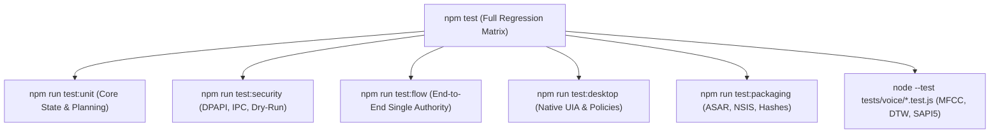

# L.U.C.Y. — Verification, Testing & Quality Assurance Guide

> **Authoritative Document:** `docs/TESTING.md`  
> **Last Updated:** October 29, 2026

---

## 1. Test Architecture & Harness

L.U.C.Y. uses the native Node.js test runner (`node:test` and `node:assert/strict`) for deterministic, fast, zero-dependency testing. All test suites run locally without requiring third-party testing frameworks (Jest, Mocha).



---

## 2. Test Execution Matrix & Commands

| Suite Name | Execution Command | Scope & Invariants Verified |
| :--- | :--- | :--- |
| **Unit Test Suite** | `npm run test:unit` | TaskCoordinator single authority, TaskPlanner intent classification, ResultVerifier, RecoveryEngine replanning, ContextBudget token compaction. |
| **Security Test Suite** | `npm run test:security` | Windows DPAPI encryption at rest, secret redaction, dry-run mechanical isolation, IPC schema validation, path traversal defense. |
| **Flow Integration Suite** | `npm run test:flow` | Full pipeline execution (Request $\rightarrow$ Plan $\rightarrow$ Permission $\rightarrow$ Tool $\rightarrow$ Verification $\rightarrow$ Response), Electron single-instance lock. |
| **Desktop Automation Suite**| `npm run test:desktop` | C# `LucyUiaWorker.exe` communication, `SAFE_APP_ALLOWLIST`, Notepad modal dialog save/close policies, process ownership protection. |
| **Packaging & Release Suite**| `npm run test:packaging` | `electron-builder.yml` configuration, `sql.js` ASAR inclusion, portable NSIS isolation patch (`unpackDirName: false`), cryptographic checksum verification. |
| **Voice Recovery Suite** | `node --test tests/voice/voice-recovery-execution.test.js` | SAPI5 persistence roundtrip, direct low-latency speech dispatch, listening state sequencing, acoustic landmark distance tolerance. |
| **Full Voice Regression** | `node --test tests/voice/*.test.js` | 18 voice test files covering MFCC feature extraction, DTW scoring, speech recognition, audio recorder pipeline, and SAPI5 synthesis. |
| **Full Project Suite** | `npm test` | Runs all suites across `tests/**/*.test.js` with single concurrency. |

---

## 3. Live Runtime & Acceptance Verification

In addition to headless unit and integration tests, L.U.C.Y. maintains specialized live acceptance harnesses:

### 3.1 Live Electron A/B Voice Latency & Wake Benchmark
Monitors high-resolution monotonic timestamps and acoustic MFCC-DTW scoring inside an active Electron environment:
```powershell
npx electron scratch/verify-live-ab-acceptance.js
```
* **Stage 1–3:** Synthesizes speech via Kokoro-82M on CPU (measures 17s cold load).
* **Stage 4–6:** Synthesizes speech via Windows Speech SAPI5 (measures 564 ms nominal, 48 ms offline fallback).
* **Stage 7–8:** Evaluates male and female "Hey Lucy" reference templates against calibrated landmark gates (scores 0.872 and 0.957 vs 0.58 threshold).
* **Stage 9–10:** Verifies distractor rejection ("Look see": 0.571, "Hey lucky": 0.150, "Open Notepad": 0.150).

### 3.2 Packaged Application Smoke Test
Verifies built binaries in `dist-release/win-unpacked/LUCY.exe` or portable packages:
```powershell
npm run smoke:packaged
```
Verifies 12 critical checks: window creation, 16,000+ canvas fairy pixels, single-instance mutex, native UIA worker execution, SQLite database persistence, and clean process exit without orphaned PIDs.

---

## 4. Test Classifications & Evidentiary Standards

To avoid misleading assertions, tests must strictly adhere to the following evidence categories:

| Category | Description | What It Proves | What It CANNOT Prove |
| :--- | :--- | :--- | :--- |
| **Unit / Mock** | Runs with in-memory mocks (`MockSpeechSynthesis`, synthetic buffers). | Internal state transitions, error handling, parameter parsing. | Real OS behavior, actual audio emission, physical hardware capture. |
| **Synthetic Fixture** | Evaluates mathematical algorithms against PCM vectors or pre-recorded audio files. | DTW scoring mathematics, MFCC feature extraction correctness. | Performance across diverse physical room acoustics or background noise. |
| **Integration** | Exercises multiple real subsystems in a live process (e.g. Electron main + preload + IPC). | IPC authorization, process coordination, file persistence. | Physical device perception (e.g. human ear hearing speaker sound). |
| **Live Acceptance** | Runs packaged binary or active application session. | Complete end-to-end user flows, window rendering, system tray behavior. | Unverified external hardware states (e.g. unplugged microphone). |
| **Physical Manual** | Executed by human operator on real physical hardware. | Actual audible sound pressure, real microphone array acoustics. | Automatable CI reproducibility without human intervention. |

---

## 5. Skipped Tests & Environmental Constraints

1. **Interactive Desktop GUI Tests (10 Skipped by Default):**
   In `tests/desktop/desktop-automation.test.js`, 10 tests interacting with live Notepad and Calculator windows are isolated with conditional guards (`if (!process.env.LUCY_INTERACTIVE_DESKTOP_TESTS) return;`) to prevent stealing keyboard and mouse focus during automated engineering tasks. To run them interactively:
   ```powershell
   $env:LUCY_INTERACTIVE_DESKTOP_TESTS="1"
   npm run test:desktop
   ```
2. **Environment Variable Isolation (`ELECTRON_RUN_AS_NODE`):**
   `tests/flow/single-instance.test.js` and `tests/flow/smoke-electron.test.js` explicitly delete `process.env.ELECTRON_RUN_AS_NODE` when spawning child Electron processes, ensuring reliable execution across IDE terminals.
