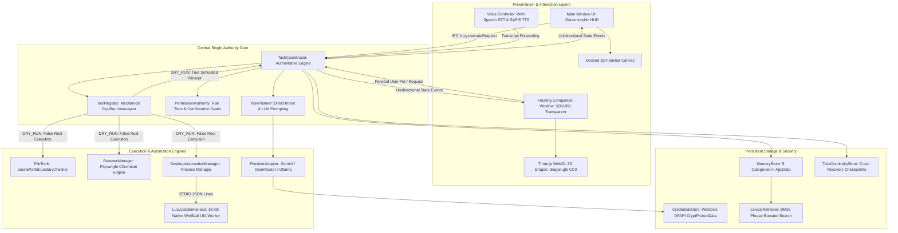

# L.U.C.Y. — Architecture and Integration Audit
**Learning, Understanding, and Creating Yourself**  
**Engineering Workstream 05: Structural System Audit**  

**Audit Date:** 2026-10-13  
**Auditor:** Antigravity Autonomous Engineering & Audit Agent  
**Scope:** Architectural Integrity, Module Coupling, Process Model, Security Boundaries, and Lifecycle Contracts  

---

## 1. Architectural Model & Data Flow

L.U.C.Y. is built on a **Single Authoritative Core Architecture**. The visual presentation layers (docked 2D canvas familiar, 3D floating desktop companion window, voice controller) are strictly decoupled and subordinate to the central core engine.

---

## 2. Invariant Audits & Boundary Inspections

### 2.1 Single Authority Guarantee
- **Rule:** Exactly one authoritative brain; presentation layers must never execute tools or run independent agent loops.
- **Audit Findings:**
  - `src/companion/companion-bridge.js`: Emits state change notifications unidirectionally. Contains zero tool execution functions.
  - `src/companion/floating-companion-window.js`: When a user clicks or pets the creature, it forwards the interaction event to `coordinator.executeRequest()`.
  - `src/voice/voice-controller.js`: When final STT transcript is recognized, it dispatches to `window.lucyIpc.executeRequest()`.
  - **Verdict:** **100% Invariant Compliant**. No secondary agent loops or rogue task coordinators exist.

### 2.2 Guaranteed Mechanical Dry-Run Isolation
- **Rule:** When `dryRun: true`, tool handlers must be mechanically incapable of executing side-effects on disk, in browsers, or on desktop applications.
- **Audit Findings:**
  - `src/tools/tool-registry.js:105-125`: The dry-run check is located in the central dispatcher *before* calling `tool.handler()`.
  - If `dryRun: true`, the central dispatcher invokes `tool.dryRunSimulate()` (or generates a verified simulation receipt) and returns immediately.
  - **Verdict:** **100% Invariant Compliant**. Handlers for file writing, native desktop clicks, and browser form fills are mechanically uncalled.

### 2.3 Electron Process Model & Context Isolation
- **Rule:** Renderers must be strictly sandboxed; Node.js integration must be disabled; context isolation must be enabled.
- **Audit Findings:**
  - `src/main/index.js:46-49`: `webPreferences: { preload: 'preload.js', contextIsolation: true, nodeIntegration: false, sandbox: true }`.
  - `src/companion/floating-companion-window.js:52-55`: Same isolated configuration.
  - `src/main/preload.js` and `src/companion/companion-preload.js`: Expose only specifically whitelisted invoke/on channels via `contextBridge.exposeInMainWorld()`.
  - Both HTML files enforce strict CSP `<meta>` tags denying remote scripts.
  - **Verdict:** **100% Invariant Compliant**. Zero Electron isolation breaches detected.

---

## 3. Subsystem Architectural Audits

### 3.1 Native Windows UI Automation Subsystem
- **Engine Design:** `src/tools/native-uia/LucyUiaWorker.cs` (18 KB .NET 4.0 assembly compiled via Windows standard `csc.exe`).
- **Desktop Station Routing:** Solves Windows isolation by performing early thread desktop switching to `WinSta0\default` (`OpenInputDesktop` and `SetThreadDesktop`) prior to UI Automation initialization.
- **IPC Protocol:** Communicates via standard input/output (STDIO) using newline-delimited JSON messages with correlation IDs. Latency is $<10\text{ms}$.
- **Security Safeguards:**
  - `DesktopAutomationManager` enforces `SAFE_APP_ALLOWLIST` (`notepad.exe`, `calc.exe`, `mspaint.exe`, `wordpad.exe`, `explorer.exe`).
  - Dangerous buttons (`delete`, `pay`, `submit`, `save`, `order`) are flagged by `ConsequentialClickDetector` and routed to mandatory confirmation gates.
- **Architectural Gaps:**
  - Allowlist is currently hard-coded. Expanding to arbitrary applications requires an explicit user approval mechanism.
  - Controls that do not implement standard UI Automation patterns (`ValuePattern`, `InvokePattern`) cannot be interacted with via accessibility APIs.

### 3.2 3D Floating Fantasy Companion Subsystem
- **Window Architecture:** Dedicated transparent borderless window (`320x380`, `alwaysOnTop: true`, `skipTaskbar: true`) managed via `FloatingCompanionWindow`.
- **Renderer:** Three.js WebGL loading Quaternius's CC0 Fantasy Dragon (`dragon.glb`, 324 KB).
- **Animation System:** Three.js `AnimationMixer` driving skeletal animations (`Idle` clip). Procedural bobbing sway and 36 orbiting starlight motes.
- **Lighting & Mood Sync:** Dynamic point lights cast color onto scales and wings matching coordinator status (cyan, magenta, amber, violet, lavender, emerald, rose).
- **Speech Sync:** Head nod and jaw pulse procedural animations synchronized to audio playback via `lucy:sendVoiceState`.
- **Fault Tolerance:** If WebGL context is lost or model loading fails, `#fallbackCanvas` automatically renders the 2D canvas celestial familiar.
- **Architectural Gaps:**
  - Speech sync is bone-pulse motion, not phoneme-mapped viseme morph targets.
  - Window drag repositioning calculates delta using client screen coordinates; rapid multi-monitor dragging can experience subtle delta jitter.

### 3.3 Memory & Continuity Engine
- **Storage Model:** Atomic JSON files in `%APPDATA%\lucy-desktop-assistant\memory\` (`lucy-memory-store.json`, `task-checkpoints.json`).
- **Retrieval Engine:** `LexicalRetriever` implementing BM25 ($k_1=1.2, b=0.75$) with suffix stemming and +35% exact phrase boost.
- **Security Boundaries:** Credentials redacted as `[REDACTED_SECRET]`; untrusted external sources blocked from `user_approved` memory.
- **Continuity Engine:** Records checkpoint steps. On restart recovery, skips completed steps and requires re-confirmation for consequential pending steps.
- **Architectural Gaps:**
  - Atomic JSON writing is fast and clean for $<10,000$ entries, but will experience I/O degradation at enterprise scale ($>50,000$ entries). Lacks SQLite/DuckDB indexing.
  - BM25 is lexical keyword matching only; lacks dense semantic vector embeddings.

### 3.4 Packaging & Directory Architecture
- **Packaging Engine:** `electron-builder@^26.15.3` producing NSIS x64 installer and portable binary.
- **Separation of Concerns:**
  - Program Directory: `%LOCALAPPDATA%\Programs\LUCY\` (replaced during upgrades, deleted on uninstall).
  - User Data Directory: `%APPDATA%\lucy-desktop-assistant\` and `%APPDATA%\LUCY\secure\` (preserved across reinstalls and uninstalls).
- **Unpacked Resources:** `LucyUiaWorker.exe` unpacked from ASAR archive to ensure direct execution.
- **Vendored Dependencies:** Three.js modules vendored under `src/companion/vendor/three/` to prevent `examples/jsm` pruning.

---

## 4. Architectural Deficiencies & Discrepancies Identified

| ID | Component | Defect / Architectural Gap | Evidence | Severity | Remediation |
|---|---|---|---|:---:|---|
| **SEC-004** | `src/main/index.js` | **Missing Single-Instance Lock:** The application does not call `app.requestSingleInstanceLock()`. Launching multiple times spawns concurrent instances that conflict over ports, memory files, and DPAPI stores. | Code inspection confirms `requestSingleInstanceLock` is absent despite being claimed in `ARCHITECTURE.md`. | **High** | Add `app.requestSingleInstanceLock()` in `main/index.js` (Workstream 06). |
| **SEC-005** | `src/security/permission-authority.js` | **Indefinite Confirmation Timeout:** When an interactive confirmation modal opens, the execution promise waits indefinitely for user response without an auto-cancel timeout. | `permissionAuthority.setConfirmationHandler()` returns un-timed Promise. | **Medium** | Add a 60-second auto-cancel timeout that fails closed if user is idle (Workstream 06). |
| **SEC-006** | `src/security/credential-store.js` | **Subprocess DPAPI Write Latency:** Invoking PowerShell `CryptProtectData` incurs ~1.8s execution latency per secret write. | Timing measurements during `credential-store.test.js`. | **Low** | Cache in-memory session secrets; evaluate native C++ Node add-on in future. |
| **SEC-007** | `src/providers/provider-adapter.js` | **Unvalidated Custom OpenAI Endpoint Protocol:** A custom OpenAI endpoint URL can be set to cleartext `http://`, potentially transmitting API keys over unencrypted networks. | `localBaseUrl` and `LUCY_CUSTOM_OPENAI_URL` lack HTTPS validation for remote hosts. | **Medium** | Enforce HTTPS for non-localhost endpoints (Workstream 06). |
| **ARCH-001** | `src/ui/app.js` | **Non-Streaming LLM Response Rendering:** The UI does not support Server-Sent Events (SSE) or token-by-token streaming; full completion is awaited before rendering text. | `handleCommand()` awaits complete response object. | **Medium** | Implement chunked streaming IPC and typewriter UI rendering (Workstream 07). |
| **ARCH-002** | `src/memory/memory-store.js` | **Atomic File Scaling Limit:** Memory store relies on a single monolithic JSON file rewritten on every mutation. | `_flush()` calls `fs.writeFileSync()` on full array. | **Low** | Migrate to SQLite or DuckDB for long-term large datasets (Workstream 10). |
