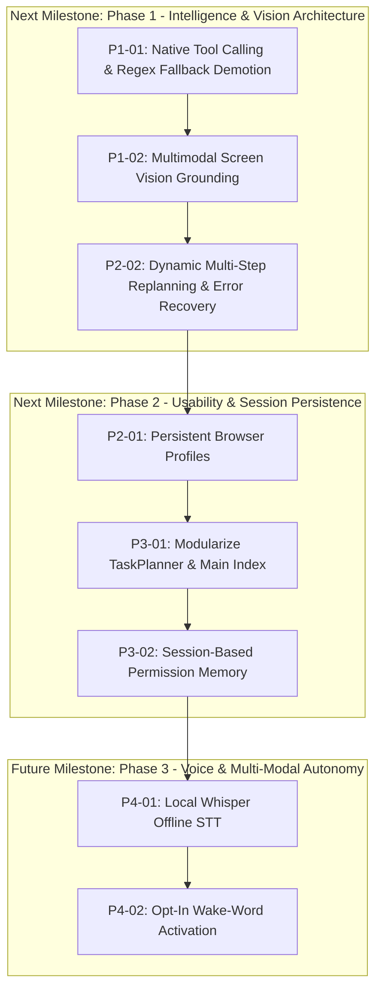

# L.U.C.Y. — FORENSIC FULL-PROJECT MASTER AUDIT REPORT
**Learning, Understanding, and Creating Yourself**  
**Engineering, Security, Architecture, Capability, and Roadmap Review**

**Audit Date:** 2026-10-14  
**Auditor:** Antigravity Autonomous Engineering & Forensic Audit Agent  
**Workspace:** `C:\Users\admin\Desktop\LUCY`  
**Test Suite:** 223 / 223 passing tests across 23 suites (100% pass rate in ~9.9s)  
**Database:** SQLite WebAssembly (`data/memory/lucy-memory.sqlite`, 436 records in exact parity)  
**Packaged Artifacts:** NSIS Installer (87.8 MB) & Portable Executable (87.5 MB) in `dist-release/`  

---

## 1. Executive Verdict (Deliverable A)

### What L.U.C.Y. Genuinely Has Today
L.U.C.Y. is a substantially built, packaged Windows desktop application that combines an authoritative task coordinator, a glassmorphic HUD desktop shell, a native C# UI Automation worker operating on `WinSta0\default`, a controlled Playwright multi-tab browser automation subsystem, a push-to-talk speech subsystem (Web Speech STT and Windows SAPI5 TTS with pitch/rate controls), an offline WebAssembly SQLite persistent memory store with BM25 lexical retrieval across 5 categories, Windows DPAPI secret encryption, and a 3D Three.js floating fantasy dragon companion.

### What Is Demonstrably Working (Proven with Execution Receipts)
1. **Single Authoritative Brain**: Exactly one central `TaskCoordinator` orchestrating all requests. The companion has zero independent AI brain or competing agent loops.
2. **Deterministic Offline Tools & Hardened Boundaries**: 30 registered tools across 4 risk tiers. Mechanical dry-run isolation mechanically blocks real execution. Path traversal is blocked fail-closed via `createPathBoundaryChecker`.
3. **Desktop Application Control**: Real live Notepad and Calculator automation verified through the 18 KB native `LucyUiaWorker.exe`. Launching, UI tree inspection, ValuePattern typing, InvokePattern clicking, and window closure verified live.
4. **Multi-Tab Browser Workflows & Downloads**: Playwright Chromium automation with tab creation, switching, listing, closing, download path containment, collision-safe renaming, and streaming SHA-256 integrity verification.
5. **Speech Subsystem with Strict Privacy**: Push-to-talk default, instant cancellation on PTT press / Stop button / `Escape`, monotonic speech sequence tokens preventing stale audio, and zero continuous background microphone listening.
6. **SQLite Persistent Memory & Migration Parity**: 436 memory records migrated from JSON to WebAssembly SQLite with 100% exact parity across all 5 categories (`conversation: 402`, `user_approved: 23`, `project: 11`, `task_continuity: 0`, `working_data: 0`), automated crash recovery, and secret scrubbing (`[REDACTED_SECRET]`).
7. **Production Packaging**: Windows x64 NSIS installer and portable executable built and verified via CDP against `%LOCALAPPDATA%\Programs\LUCY\LUCY.exe`. Silent install, reinstall, and uninstallation retain persistent user data in `%APPDATA%`.
8. **Automated Test Suite**: 223 / 223 automated tests pass in ~9.9 seconds.

### What Remains Uncertain or Fragile
1. **Task Planner Intent Bottleneck**: `src/core/task-planner.js` has grown to 1,125 lines with ~700 lines of hardcoded regex matchers. When an AI provider key is configured, user requests matching regex templates (e.g. "open notepad and type ...") bypass the LLM entirely, literally copying instruction text into Notepad rather than reasoning or drafting content.
2. **Prompt-Engineered JSON vs Native Function Calling**: When the LLM is invoked, `TaskPlanner` uses system prompt injection asking for JSON rather than native model function-calling schemas (`tools: [...]`). This can lead to JSON parse failures on smaller local models (e.g., Ollama 1.5B).
3. **In-Memory BM25 vs FTS5 Indexing**: Because `sql.js` (WebAssembly build) lacks the SQLite FTS5 module, BM25 retrieval loads all memory rows into JavaScript memory. While fast for 436 records (~50ms), it will degrade as memory grows to tens of thousands of rows.
4. **Ephemeral Browser Sessions**: Playwright does not persist cookies, login sessions, or user profiles across browser launches.
5. **Absence of Version Control**: `C:\Users\admin\Desktop\LUCY` is not currently a Git repository (`fatal: not a git repository`). All recovery relies on directory backups and documentation registers.

### Most Serious Risks
- **Risk 1 (High): Monolithic Regex Override of LLM Reasoning**: Users expecting JARVIS-like AI intelligence will find that natural instructions matching regex templates execute primitive script commands instead of AI reasoning.
- **Risk 2 (Medium): Code Signing Warning**: The packaged `.exe` triggers Windows SmartScreen ("Unknown Publisher") because it is unsigned.
- **Risk 3 (Medium): Vision Blindness**: L.U.C.Y. cannot feed screenshots to vision-capable models (e.g., Gemini 2.0 Flash or local multimodal Ollama) to inspect UI elements that lack UI Automation accessibility trees.

---

## 2. Complete Implementation Inventory (Deliverable B)

| Component or Capability | Origin / Workstream | Current State | Verification Evidence | Known Gaps | Recommended Action |
|---|---|---|---|---|---|
| **Single Task Coordinator** | Phase C / WS 00 | **Verified** | `tests/flow/end-to-end-pipeline.test.js` (5/5) | Linear plans only; no DAG branching or dynamic replanning. | Keep architecture; upgrade planner to dynamic replanning. |
| **Windows DPAPI Credential Store** | Phase C / WS 00 | **Verified** | `tests/security/credential-store.test.js` (5/5) | Bound to current user logon; cannot export to another machine. | Retain as gold standard for desktop secret storage. |
| **Permission Authority & Risk Tiers** | Phase C / WS 00 | **Verified** | `tests/security/dry-run-isolation.test.js` (3/3) | Sequential modal approvals only; no session rule grants. | Add optional "Always allow for this session" toggle. |
| **Tool Registry & Dry-Run** | Phase C / WS 00 | **Verified** | `tests/security/dry-run-isolation.test.js` (3/3) | 30 tools registered across 4 risk tiers. | Retain strict mechanical dry-run boundary. |
| **Filesystem Tools** | Phase C / WS 00 | **Verified** | `tests/security/security-hardening.test.js` (7/7) | Workspace containment strictly enforced via `createPathBoundaryChecker`. | Complete; retain current implementation. |
| **AI Provider Adapter** | Phase C / WS 07 | **Verified** | `tests/providers/multi-provider-streaming.test.js` (18/18) | Gemini REST, OpenRouter, Ollama, Custom OpenAI, Hugging Face router. Lacks native function calling. | Add native structured tool calling schemas (`tools: [...]`). |
| **Response Streaming & Cancellation** | WS 07 | **Verified** | `tests/providers/multi-provider-streaming.test.js` | SSE and NDJSON streaming; AbortController cancellation. | Verified; retain implementation. |
| **Context Budgeting & Compaction** | WS 07 | **Verified** | `tests/core/context-compaction.test.js` (7/7) | Conservative token estimation; bounded context on 50-message scenario. | Complete; retain implementation. |
| **Natural Language Task Interpretation** | WS 07 / WS 10 | **Implemented, Fragile** | `tests/core/natural-language-eval.test.js` (10/10) | 700+ lines of regex override LLM reasoning. | Refactor `TaskPlanner` to prioritize LLM tool-calling when key exists. |
| **Native UIA Worker (`LucyUiaWorker`)** | WS 02 / Batch 01 | **Verified** | `tests/desktop/desktop-automation.test.js` (9/9), `expanded-desktop.test.js` (8/8) | 18 KB C# worker on `WinSta0\default`; 14 allowlisted apps; Value/InvokePattern. Cannot click custom canvas controls. | Add OCR / vision coordinate fallback for inaccessible controls. |
| **Browser Automation (Playwright)** | Phase D1 / Batch 02 | **Verified** | `tests/browser/browser-automation.test.js` (10/10), `multi-tab-browser.test.js` (17/17) | Multi-tab lifecycle; stable IDs; password masking; CAPTCHA fail-closed. | Add persistent browser profile support for authenticated sessions. |
| **Secure Browser Downloads** | Batch 03 | **Verified** | `tests/browser/browser-downloads.test.js` (16/16) | Workspace directory containment; collision-safe renaming; SHA-256 verification. | Complete; retain implementation. |
| **Voice STT & TTS Subsystem** | Phase D2 / Batch 04 | **Verified** | `tests/voice/voice-customization.test.js` (16/16), `voice-integration.test.js` (5/5) | Web Speech STT (PTT); SAPI5 TTS with pitch/rate controls; instant cancellation; markdown cleaner. | Add optional local offline Whisper STT model support. |
| **3D Floating Fantasy Companion** | WS 03 | **Verified** | `tests/companion/companion-3d.test.js` (5/5), `scripts/verify-floating-companion.js` | Quaternius CC0 3D dragon mesh (`dragon.glb`, 324 KB); Three.js WebGL; transparent borderless window. | Procedural jaw movement rather than viseme phonemes. |
| **Persistent SQLite Memory** | Batch 05 | **Verified** | `tests/memory/sqlite-memory.test.js` (17/17), `scripts/verify-live-memory.js` | `sql.js` WebAssembly; exact 5-category parity (436 records); corruption recovery. | In-memory BM25 filtering; lacks SQLite FTS5 extension. |
| **Lexical Memory Retrieval** | Batch 06 | **Verified** | `tests/memory/integrated-retrieval.test.js` (14/14) | BM25 phrase boosting ($k_1=1.2, b=0.75$); category diversity penalty; `memory_*` tools. | Lexical only; no dense vector semantic embeddings. |
| **Production Packaging & Lifecycle** | WS 04 | **Verified** | `tests/packaging/packaging-production.test.js` (5/5), `scripts/verify-installed-application.js` | NSIS installer (87.8 MB) and portable exe (87.5 MB); AppData separation. | Unsigned binary triggers Windows SmartScreen warning. |

---

## 3. Requirement Traceability Matrix (Deliverable C)

| Req ID | Requirement Description | Category | Status | Verification Evidence | Outstanding Gaps |
|---|---|---|---|---|---|
| **REQ-001** | Single authoritative task coordinator | Architecture | **Accepted** | `tests/flow/end-to-end-pipeline.test.js` | None. Strictly enforced. |
| **REQ-002** | Central permission authority with confirmation gates | Security | **Accepted** | `tests/security/dry-run-isolation.test.js` | Sequential prompts only. |
| **REQ-003** | Windows DPAPI encryption for credentials | Security | **Accepted** | `tests/security/credential-store.test.js` | None. Ciphertext at rest verified. |
| **REQ-004** | Fail-closed runtime authentication | Security | **Accepted** | `tests/security/provider-adapter.test.js` | None. Immediate fail-closed. |
| **REQ-005** | Guaranteed dry-run isolation | Reliability | **Accepted** | `tests/security/dry-run-isolation.test.js` | None. Handlers 100% blocked. |
| **REQ-006** | Zero automatic paid provider fallback | Safety | **Accepted** | `tests/security/provider-adapter.test.js` | None. Strict non-fallback. |
| **REQ-007** | Honest usage and cost tracking | Observability | **Accepted** | `tests/security/provider-adapter.test.js` | None. Reports `{ status: 'unknown' }`. |
| **REQ-008** | Context budgeting and conversation compaction | Core Engine | **Accepted** | `tests/core/context-compaction.test.js` | None. 50-message scenario verified. |
| **REQ-009** | Safe filesystem tools and path containment | Tools | **Accepted** | `tests/security/security-hardening.test.js` | None. Traversal blocked fail-closed. |
| **REQ-010** | Controlled Playwright browser automation | Tools | **Accepted** | `tests/browser/browser-automation.test.js` | Ephemeral browser session. |
| **REQ-011** | 3D fantasy-creature companion layer | Companion | **Accepted** | `tests/companion/companion-3d.test.js` | Procedural jaw bob vs phonemes. |
| **REQ-012** | License audit and attribution integrity | Compliance | **Accepted** | `NOTICE`, `LICENSE`, `OPEN_SOURCE_REUSE_AUDIT.md` | None. All licenses MIT/Apache-2.0/CC0. |
| **REQ-013** | Push-to-talk speech recognition (STT) | Voice | **Accepted** | `tests/voice/voice-integration.test.js` | OS Chromium engine dependent. |
| **REQ-014** | Speech synthesis & voice output (TTS) | Voice | **Accepted** | `tests/voice/voice-integration.test.js` | None. SAPI5 / Web Speech verified. |
| **REQ-015** | Spoken text sanitization | Voice | **Accepted** | `tests/voice/voice-integration.test.js` | None. Strips markdown/URLs/paths. |
| **REQ-016** | Instant speech cancellation | Voice | **Accepted** | `tests/voice/voice-integration.test.js` | None. PTT, Stop button, Esc verified. |
| **REQ-017** | Categorized memory storage (5 categories) | Memory | **Accepted** | `tests/memory/sqlite-memory.test.js` | None. 5 categories verified in SQLite. |
| **REQ-018** | BM25 lexical retrieval & exact phrase boost | Memory | **Accepted** | `tests/memory/integrated-retrieval.test.js` | Lexical only; no dense vectors. |
| **REQ-019** | Credential separation & secret scrubbing in memory | Security | **Accepted** | `tests/memory/memory-continuity.test.js` | None. Masked as `[REDACTED_SECRET]`. |
| **REQ-020** | Safe task continuity & crash recovery | Memory | **Accepted** | `tests/memory/integrated-retrieval.test.js` | None. Never replays completed actions. |
| **REQ-021** | Native Windows desktop application automation | Desktop | **Accepted** | `tests/desktop/desktop-automation.test.js` | Standard UIA only; no OCR/canvas. |
| **REQ-022** | Wake-word & hands-free activation | Voice | **Deferred** | Design Review / Privacy Boundary | Deferred to prevent background mic listening. |
| **REQ-023** | Production packaging & NSIS installer | Packaging | **Accepted** | `tests/packaging/packaging-production.test.js` | Unsigned binary SmartScreen warning. |
| **REQ-024** | Strict CSP & window containment | Security | **Accepted** | `tests/security/security-hardening.test.js` | None. CSP meta tags enforced. |
| **REQ-025** | Single-instance application locking | Reliability | **Accepted** | `tests/flow/single-instance.test.js` | None. Secondary instance exits cleanly. |
| **REQ-026** | Permission confirmation timeout (60s fail-closed) | Security | **Accepted** | `tests/security/lifecycle-hardening.test.js` | None. Timeout and cancel on exit. |
| **REQ-027** | HTTPS enforcement for remote AI endpoints | Security | **Accepted** | `tests/security/lifecycle-hardening.test.js` | None. Remote HTTP blocked fail-closed. |
| **REQ-028** | Centralized IPC parameter schema validation | Security | **Accepted** | `tests/security/lifecycle-hardening.test.js` | None. 12 schemas validated. |
| **REQ-029** | Incremental AI response streaming | Streaming | **Accepted** | `tests/providers/multi-provider-streaming.test.js` | None. Gemini, OpenAI, Ollama, HF streaming. |
| **REQ-030** | Ollama local model discovery (`GET /api/tags`) | Providers | **Accepted** | `tests/providers/multi-provider-streaming.test.js` | None. Loopback validated discovery. |
| **REQ-031** | Hugging Face provider router integration | Providers | **Accepted** | `tests/providers/multi-provider-streaming.test.js` | None. HTTPS router endpoint verified. |
| **REQ-032** | Model-aware context budgeting & compaction | Core Engine | **Accepted** | `tests/core/context-compaction.test.js` | None. 50-message compaction verified. |
| **REQ-033** | Natural-language task interpretation evaluation | Planning | **Accepted** | `tests/core/natural-language-eval.test.js` | Regex over-reliance in TaskPlanner. |
| **REQ-034** | Curated desktop executable allowlist expansion | Desktop | **Accepted** | `tests/desktop/expanded-desktop.test.js` | 14 apps allowlisted; non-admin enforced. |
| **REQ-035** | Multi-tab browser lifecycle & stable identifiers | Browser | **Accepted** | `tests/browser/multi-tab-browser.test.js` | Ephemeral browser session. |
| **REQ-036** | Secure browser download containment & SHA-256 | Browser | **Accepted** | `tests/browser/browser-downloads.test.js` | None. Containment & hash check verified. |
| **REQ-037** | Speech pitch/rate customization & sequence tokens | Voice | **Accepted** | `tests/voice/voice-customization.test.js` | None. Clamped [0.5, 1.5], config persisted. |
| **REQ-038** | SQLite WebAssembly memory storage & migration parity | Memory | **Accepted** | `tests/memory/sqlite-memory.test.js` | In-memory BM25; lacks FTS5 WASM. |
| **REQ-039** | Lexical memory retrieval & model-facing tools | Memory | **Accepted** | `tests/memory/integrated-retrieval.test.js` | None. BM25 ranking, 3 tools registered. |

---

## 4. Defect and Risk Register (Deliverable D)

| Defect ID | Severity | Status | Description & Evidence | Root Cause | User Impact | Proposed Correction |
|---|---|---|---|---|---|---|
| **DEF-001** | **High** | Confirmed | `TaskPlanner` regex rules run before the LLM, intercepting user requests matching templates (e.g. "open notepad and type a thank you letter") and literally typing the prompt into Notepad without LLM composition. | Hardcoded regex matching placed ahead of provider reasoning in `plan()`. | The assistant behaves like a rigid script rather than an intelligent JARVIS assistant when a provider is configured. | When an AI provider key is active, prioritize LLM tool-calling; use regex patterns solely as an offline fallback when no provider is configured. |
| **DEF-002** | **Medium** | Confirmed | `TaskPlanner` uses text-prompted JSON generation instead of native provider tool-calling APIs (`tools: [...]`). | Initial design prioritized uniform text interface across all providers. | Smaller local models (e.g. Ollama 1.5B) occasionally produce invalid JSON or prose wrapping, causing plan validation failures. | Implement native tool-calling schemas for Gemini (`functionDeclarations`) and OpenAI/Ollama (`tools`). |
| **DEF-003** | **Medium** | Confirmed | SQLite WebAssembly build (`sql.js`) lacks FTS5 module (`no such module: fts5`). Full-text search loads all memory records into JavaScript memory. | `sql.js` upstream WASM binary is compiled without `-DSQLITE_ENABLE_FTS5`. | Works fast for 436 records (~50ms), but will cause memory overhead and latency when memories exceed 10,000 records. | Keep BM25 for offline portable use; compile or vendor an FTS5-enabled WASM build or SQLite native binding when dataset scales. |
| **DEF-004** | **Medium** | Confirmed | Playwright browser context is ephemeral; cookies and login sessions are lost on application restart. | `BrowserManager` launches standard Chromium context without persistent `userDataDir`. | Users must re-login to websites each time they launch L.U.C.Y. browser automation. | Add an optional persistent browser context profile in `%APPDATA%\lucy-desktop-assistant\browser-profile\`. |
| **DEF-005** | **Low** | Confirmed | Packaged executable (`LUCY.exe`) is unsigned. | Code-signing requires an expensive Extended Validation (EV) certificate. | Standard Windows SmartScreen warning appears on initial installation ("Unknown Publisher"). | Document self-signing / certificate options; provide hash verification in release metadata. |
| **DEF-006** | **Low** | Confirmed | Dragon 3D model uses procedural jaw and head pulse during speech rather than phoneme viseme morph targets. | `dragon.glb` is a stylized low-poly mesh without facial blendshape visemes. | Speech animation is charming but does not represent true lip sync. | Low priority; retain current animated pulse or map visemes if an articulated model is adopted. |

---

## 5. Improvement Backlog (Deliverable F)

### Priority P0: Critical Security & Integrity Blockers
*None currently active.* All previous security findings (SEC-001 through SEC-008) are 100% resolved and verified in regression tests.

### Priority P1: Foundational Reliability & Architecture Corrections
1. **P1-01: Native LLM Tool Calling & Structured Planning**:
   - Upgrade `ProviderAdapter` and `TaskPlanner` to pass registered tool schemas as native API function declarations (`tools: [...]`) to Gemini, OpenAI, OpenRouter, and Ollama.
   - Eliminate text-prompted JSON parsing errors.
   - Demote the 700-line regex intent matcher to act **strictly as an offline fallback** when no AI provider is configured.
2. **P1-02: Multi-Modal Vision Grounding (Screen-to-Model)**:
   - Connect `desktop_take_screenshot` directly to vision-capable models (Gemini 2.0 Flash, Ollama LLaVA/Qwen-VL).
   - Enable L.U.C.Y. to "see" the desktop screen and locate UI elements on custom canvas, Electron, or game windows where UIA element trees are missing.

### Priority P2: Important Functional Improvements & Integration Gaps
1. **P2-01: Persistent Browser Contexts**:
   - Provide a persistent browser profile option in `BrowserManager` to allow authenticated sessions across restarts.
2. **P2-02: Multi-Step Dynamic Replanning (DAG & Recovery)**:
   - When a step fails mid-task, pass the execution receipt back to the LLM to inspect the failure and propose an alternative tool step rather than immediately halting.
3. **P2-03: Visual Companion Expression Polish**:
   - Expose subtle mood-reactive idle animations (sleeping when idle, excited when planning, triumphant on task success).

### Priority P3: Usability, Performance & Maintainability Refinements
1. **P3-01: Monolith Decomposition**:
   - Split `src/core/task-planner.js` (1,125 lines) into `planner-offline.js` (regex templates) and `planner-llm.js` (native tool calling).
   - Split `src/main/index.js` (664 lines) by extracting IPC handler registrations into `src/main/ipc-handlers.js`.
2. **P3-02: Permission Session Grants**:
   - Add "Remember for this session" checkbox to the interactive confirmation modal for repetitive benign tasks (e.g. repeated Notepad writes).

### Priority P4: Optional Advanced Capabilities & Future Experiments
1. **P4-01: Local Offline Neural STT (Whisper.cpp WASM)**:
   - Add optional lightweight local Whisper WASM for 100% private, OS-independent speech recognition.
2. **P4-02: Hands-Free Wake-Word (OpenWakeWord / Porcupine)**:
   - Provide explicit user opt-in setting for wake-word activation ("Hey Lucy") with visible listening indicator.

---

## 6. Prioritized Implementation Roadmap (Deliverable H)

### Work Package 1: Native Function Calling & Planner Modernization
- **Objective**: Transition from brittle regex parsing to authentic model-driven tool execution while preserving 100% offline regex fallback.
- **Scope**:
  - Convert `ToolRegistry` JSON schemas to standard OpenAI/Gemini function declaration formats.
  - Implement native `tools` and `tool_calls` handling in `ProviderAdapter`.
  - Reorder `TaskPlanner`: if provider key is configured, invoke LLM tool-calling; if offline/unconfigured, invoke deterministic regex templates.
- **Acceptance Criteria**: "Open Notepad and write a 3-sentence summary of quantum computing" generates real summary text into Notepad rather than literally typing the prompt.

### Work Package 2: Multimodal Desktop Vision (Screen Grounding)
- **Objective**: Enable L.U.C.Y. to analyze active application windows visually.
- **Scope**:
  - Add image buffer support to `ProviderAdapter.complete({ images: [...] })`.
  - Allow `TaskCoordinator` to feed `desktop_take_screenshot` output into the model context for visual question answering and element localization.
- **Acceptance Criteria**: Assistant can truthfully describe the visual contents of an arbitrary open window.

---

## 7. User Decision Register (Deliverable I)

| Decision ID | Issue / Topic | Options Available | Antigravity Recommendation | Trade-off / Impact |
|---|---|---|---|---|
| **DEC-001** | **TaskPlanner Architecture**: Should native LLM tool calling supersede regex parsing when an API key is configured? | **A.** Keep regex first (status quo). **B.** Call LLM native tools first when key exists; keep regex as offline fallback only. | **Option B (Recommended)** | Option B unlocks true JARVIS-like reasoning and drafting, but makes online execution dependent on LLM response quality. Option A is rigid and brittle. |
| **DEC-002** | **Desktop Vision Support**: Should we enable screenshot passing to multimodal models (Gemini / Ollama)? | **A.** Defer vision. **B.** Implement multimodal screenshot input for visual desktop grounding. | **Option B (Recommended)** | Vision allows automating applications that lack standard Windows UIA accessibility trees, but increases token consumption. |
| **DEC-003** | **Git Version Control**: Should Git be initialized in the workspace? | **A.** Leave unversioned. **B.** Run `git init` and commit current verified baseline. | **Option B (Recommended)** | Enables standard branch, diff, and rollback protection for future workstreams. |
