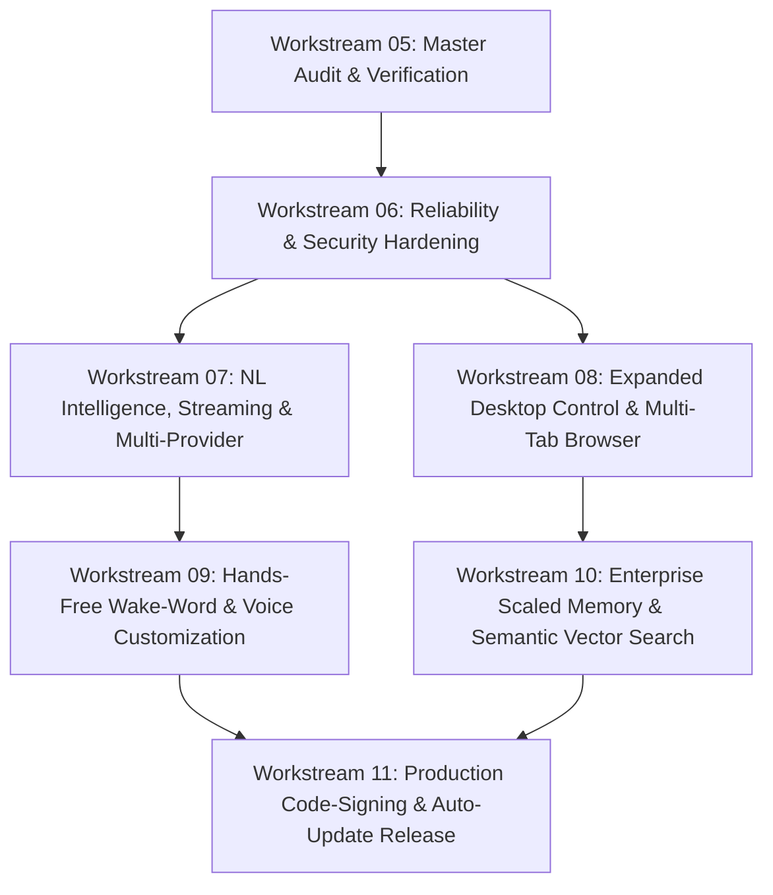

# L.U.C.Y. — Prioritized Remaining-Work Roadmap
**Learning, Understanding, and Creating Yourself**  
**Engineering Workstream 05: Master Dependency-Aware Implementation Plan**  

**Audit Date:** 2026-10-13  
**Auditor:** Antigravity Autonomous Engineering & Audit Agent  
**Roadmap Objective:** Guide all subsequent engineering workstreams from current verified baseline to full daily usability and commercial release readiness.  

---

## 1. Roadmap Overview & Dependency Graph

---

## 2. Detailed Workstream Specifications

### Workstream 06: Reliability, Process Lifecycle & Security Hardening
- **Priority:** **P0 (Immediate)**
- **Objective:** Eliminate process race conditions, prevent unhandled idle lockups, enforce secure protocols, and validate IPC input boundaries.
- **Requirement IDs Addressed:** `REQ-002`, `REQ-024` (and findings `SEC-004`, `SEC-005`, `SEC-007`, `SEC-008`).
- **Current State:**
  - `src/main/index.js` lacks `app.requestSingleInstanceLock()`, allowing multiple concurrent instances to collide over memory files.
  - Interactive permission gate in `PermissionAuthority` waits indefinitely without an auto-cancel timeout.
  - Custom OpenAI endpoint protocol does not enforce HTTPS for remote hosts.
  - IPC handlers lack defensive parameter type checks.
- **Exact Implementation Tasks:**
  1. Add `app.requestSingleInstanceLock()` in `src/main/index.js`; focus existing window and quit secondary instance if lock is denied (`SEC-004`).
  2. Implement a 60-second auto-cancel timeout in `permissionAuthority.setConfirmationHandler()`. Fail closed if user does not respond within 60s (`SEC-005`).
  3. Validate custom endpoint URLs in `ProviderAdapter`: require `https://` unless host is `127.0.0.1` or `localhost` (`SEC-007`).
  4. Add input type validation and length limits on all IPC channels (`SEC-008`).
- **Existing Modules to Reuse:** `src/main/index.js`, `src/security/permission-authority.js`, `src/providers/provider-adapter.js`.
- **Dependencies & Blockers:** None. Internal to workspace.
- **Security Implications:** Eliminates memory corruption risks from concurrent processes and prevents cleartext credential transmission.
- **Acceptance Criteria:**
  - Launching a second `LUCY.exe` focuses the existing window and immediately terminates the second process.
  - An unanswered consequential prompt auto-cancels after 60s and logs a security notice.
  - Insecure `http://` custom remote endpoints are rejected.
  - Automated tests pass with 100% pass rate.
- **Required Tests:** Unit tests in `tests/security/` for timeout and URL validation; subprocess launch test for single-instance lock.
- **Estimated Effort:** 1 engineering session (approx. 1.5–2 hours).
- **Manual Actions Required:** None.

---

### Workstream 07: Natural Language Intelligence, Streaming & Multi-Provider Expansion
- **Priority:** **P1**
- **Objective:** Add real-time token-by-token streaming response rendering, auto-discover local Ollama models, connect Hugging Face Inference API, and test semantic context compaction.
- **Requirement IDs Addressed:** `REQ-001`, `REQ-004`, `REQ-006`, `REQ-007`, `REQ-008`.
- **Current State:**
  - UI waits for complete LLM response before rendering; no typewriter effect or interim token stream (`ARCH-001`).
  - Ollama model name must be typed manually; `/api/tags` endpoint is not queried.
  - Hugging Face Inference API is missing from `ProviderAdapter`.
  - Context compaction is heuristic rather than LLM-assisted.
- **Exact Implementation Tasks:**
  1. Implement Server-Sent Events (SSE) streaming in `ProviderAdapter` for Gemini, OpenRouter, and Ollama.
  2. Add chunked IPC streaming (`lucy:streamChunk`, `lucy:streamEnd`) from main process to renderer.
  3. Implement responsive typewriter rendering in `src/ui/app.js` with speech synthesis synchronized to stream completion.
  4. Implement `/api/tags` auto-detection in `ProviderAdapter` to populate a dropdown of locally installed Ollama models in Settings.
  5. Add Hugging Face Inference API provider adapter (`https://api-inference.huggingface.co/models/...`).
  6. Test context budget compaction under simulated 50-turn conversation sessions.
- **Existing Modules to Reuse:** `src/providers/provider-adapter.js`, `src/core/context-budget.js`, `src/ui/app.js`.
- **Dependencies & Blockers:** Ollama installed locally for local testing; Hugging Face API token for HF testing.
- **Security Implications:** Streamed chunks must still mask secrets and redact API keys in error states.
- **Acceptance Criteria:**
  - LLM tokens appear incrementally in the UI activity feed as they arrive.
  - Available Ollama models automatically appear in Settings dropdown.
  - Hugging Face models can be queried successfully.
  - Context compaction preserves essential instructions in multi-turn history.
- **Required Tests:** Streaming mock tests in `tests/providers/`; compaction test suite in `tests/core/`.
- **Estimated Effort:** 1–2 engineering sessions (approx. 3–4 hours).
- **Manual Actions Required:** User must provide API keys or have local Ollama running.

---

### Workstream 08: Expanded Desktop Computer Control & Multi-Tab Browser Workflows
- **Priority:** **P1**
- **Objective:** Expand native desktop application control beyond static allowlist with interactive authorization, and support multi-tab browser automation and file downloads.
- **Requirement IDs Addressed:** `REQ-009`, `REQ-010`, `REQ-021`.
- **Current State:**
  - Desktop automation is restricted to hardcoded allowlist (`notepad.exe`, `calc.exe`, `mspaint.exe`, `wordpad.exe`, `explorer.exe`).
  - Browser automation is restricted to a single page; multi-tab switching and automated downloads are not implemented.
- **Exact Implementation Tasks:**
  1. Extend `DesktopAutomationManager` to allow launching arbitrary installed applications if the user explicitly grants permission via an interactive modal (`WORKSPACE_WRITE` gate with full executable path shown).
  2. Implement coordinate click fallback in `LucyUiaWorker.cs` for controls lacking UI Automation patterns, with visual cursor highlighting.
  3. Implement tab management in `BrowserManager` (`browser_new_tab`, `browser_switch_tab`, `browser_list_tabs`).
  4. Implement download handling in `BrowserManager` (`browser_download_file`) with strict workspace containment checking.
- **Existing Modules to Reuse:** `src/tools/native-uia/LucyUiaWorker.cs`, `src/tools/desktop-automation-manager.js`, `src/tools/browser-manager.js`.
- **Dependencies & Blockers:** None.
- **Security Implications:** Launching arbitrary applications requires strict path inspection to prevent launching malicious scripts or command interpreters (`cmd.exe /c`, `powershell.exe -enc`) without explicit consent.
- **Acceptance Criteria:**
  - Non-allowlisted safe applications (e.g. Paint 3D, Word, VS Code) can be launched after interactive confirmation.
  - Multi-tab browser tasks can switch between tabs and extract content.
  - Downloaded files are saved strictly within `%APPDATA%\lucy-desktop-assistant\workspace\` and checked for path traversal.
- **Required Tests:** Playwright multi-tab integration tests; desktop launch authorization tests.
- **Estimated Effort:** 2 engineering sessions (approx. 4–5 hours).
- **Manual Actions Required:** None.

---

### Workstream 09: Local Hands-Free Wake-Word & Voice Customization
- **Priority:** **P2**
- **Objective:** Enable hands-free voice activation ("Hey Lucy") using 100% local on-device wake-word detection with strict privacy toggles, and expose voice speed/pitch controls.
- **Requirement IDs Addressed:** `REQ-013`, `REQ-014`, `REQ-022`.
- **Current State:**
  - Wake-word is absent (`REQ-022`); only push-to-talk `#micBtn` is supported.
  - Speech synthesis uses default SAPI5 rate and pitch; no controls exposed in Settings.
- **Exact Implementation Tasks:**
  1. Evaluate lightweight local on-device wake-word engines (e.g. `openWakeWord` via ONNX runtime or Web Audio API feature extraction).
  2. Implement user privacy toggle: Wake-Word activation must be **OFF by default** and require explicit opt-in.
  3. When enabled, display a prominent glowing indicator on the floating companion when microphone listening is active.
  4. Expose speech synthesis voice pitch, playback rate, and preferred voice selection sliders in Settings UI.
- **Existing Modules to Reuse:** `src/voice/voice-controller.js`, `src/voice/speech-synthesis.js`, `src/ui/app.js`.
- **Dependencies & Blockers:** Audio input device (microphone) required on host.
- **Security Implications:** Zero audio streaming to external networks; local buffer processing only; explicit user consent toggle.
- **Acceptance Criteria:**
  - Saying the wake phrase activates the assistant and transitions companion to `listening` state.
  - Disabling wake-word completely halts audio stream capture.
  - Voice rate and pitch sliders adjust audio playback characteristics in real-time.
- **Required Tests:** Unit tests for wake-word buffer evaluation and privacy toggle state machine.
- **Estimated Effort:** 2 engineering sessions (approx. 4–6 hours).
- **Manual Actions Required:** User must grant microphone permission and speak test phrase.

---

### Workstream 10: Enterprise Scaled Persistent Memory & Semantic Dense Retrieval
- **Priority:** **P2**
- **Objective:** Upgrade memory storage to SQLite / DuckDB and introduce local dense semantic vector search alongside lexical BM25.
- **Requirement IDs Addressed:** `REQ-017`, `REQ-018`, `REQ-019`, `REQ-020`.
- **Current State:**
  - Backed by single atomic JSON file (`lucy-memory-store.json`); scales cleanly to ~10,000 entries but lacks indexing for 50,000+ entries (`ARCH-002`).
  - Search is lexical keyword BM25 only; queries without exact word overlap can miss conceptually relevant memories.
- **Exact Implementation Tasks:**
  1. Integrate an embedded SQLite store (`better-sqlite3` or pure JS `sql.js` / DuckDB WASM) for persistent memory indexing.
  2. Implement hybrid search: BM25 lexical score combined with cosine similarity from a local ONNX embedding model (e.g. `all-MiniLM-L6-v2` via `transformers.js` / ONNX runtime).
  3. Provide an automated migration script that imports existing `lucy-memory-store.json` entries without data loss.
  4. Retain JSON export/import for user backups.
- **Existing Modules to Reuse:** `src/memory/memory-store.js`, `src/memory/lexical-retriever.js`.
- **Dependencies & Blockers:** Ensure native add-on build does not break packaged distribution.
- **Security Implications:** Embedding generation must remain 100% on-device; secrets must remain redacted before embedding calculation.
- **Acceptance Criteria:**
  - Conceptual queries (e.g. "my favorite drink" finding "user prefers green tea") retrieve correct memories.
  - 50,000 memory entries query in $<25\text{ms}$.
  - Zero loss of existing user data during migration.
- **Required Tests:** Hybrid retrieval precision tests; migration verification tests.
- **Estimated Effort:** 2–3 engineering sessions (approx. 5–7 hours).
- **Manual Actions Required:** None.

---

### Workstream 11: Production Code-Signing, Auto-Update & Distribution Pipeline
- **Priority:** **P3**
- **Objective:** Eliminate Windows SmartScreen warnings via commercial Authenticode signing, establish GitHub Releases pipeline, and evaluate auto-update service.
- **Requirement IDs Addressed:** `REQ-023`.
- **Current State:**
  - Windows NSIS installer and portable executable are compiled and verified, but unsigned. SmartScreen prompts "Unknown Publisher".
  - Build scripts run locally; GitHub Actions CI/CD is not yet configured.
- **Exact Implementation Tasks:**
  1. Document and configure Authenticode signing via Azure Trusted Signing or hardware EV token in `electron-builder.yml`.
  2. Create GitHub Actions workflow (`.github/workflows/release.yml`) for automated builds on release tags.
  3. Configure `electron-updater` with differential updates, verifying signature before update staging.
- **Existing Modules to Reuse:** `electron-builder.yml`, `package.json`, `scripts/build-release.js`.
- **Dependencies & Blockers:** Requires user/organization to obtain an EV Code Signing Certificate or Azure Trusted Signing identity.
- **Security Implications:** Update payloads must be cryptographically signed and hash-verified before installation.
- **Acceptance Criteria:**
  - Signed installer launches on clean Windows without SmartScreen warning.
  - Release pipeline compiles and uploads signed artifacts to GitHub Releases.
- **Required Tests:** Clean-machine installer validation; updater hash verification test.
- **Estimated Effort:** 1–2 engineering sessions (approx. 2–3 hours).
- **Manual Actions Required:** User must acquire and configure code-signing credentials.
