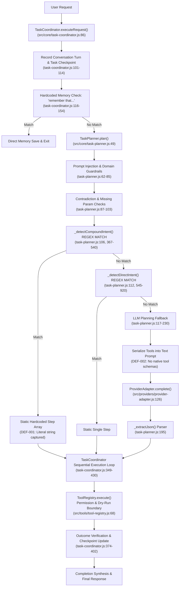
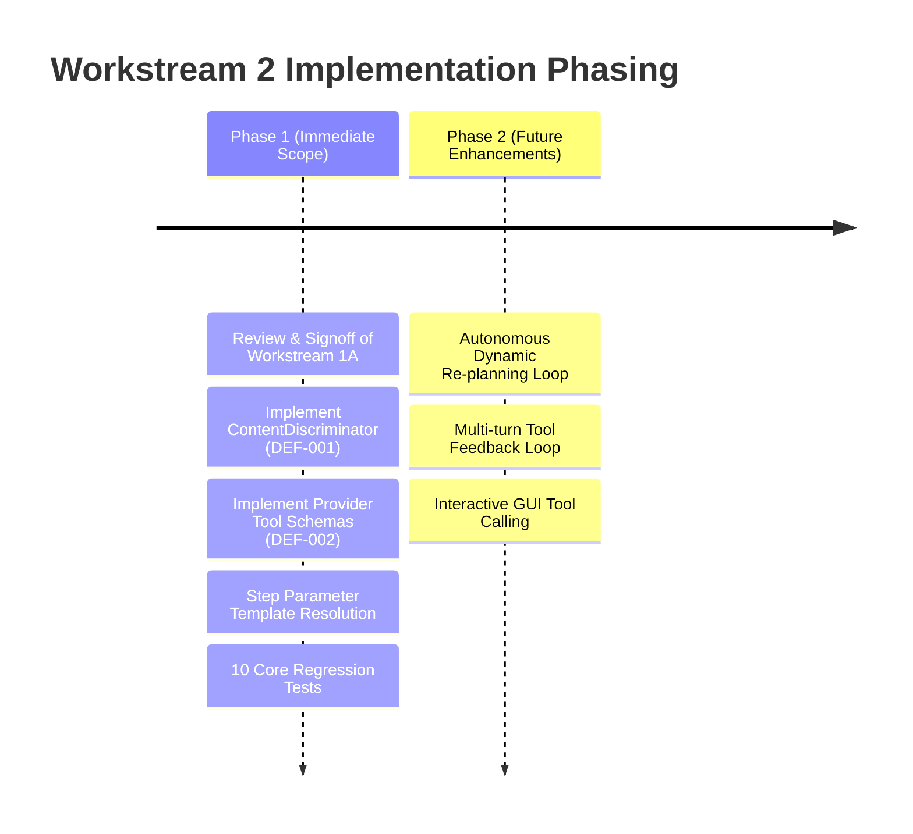

# L.U.C.Y. — Workstream 2 Proposal: AI Planning and Reliable Task Execution

> [!IMPORTANT]
> **GOVERNANCE STATUS: PROPOSAL AWAITING PREREQUISITE REVIEW & APPROVAL**  
> This engineering design document defines the proposed architecture for Workstream 2 (AI Planning and Reliable Task Execution).  
> **Prerequisite Constraint:** In accordance with repository change management directives, **no source code implementation changes or Git state mutations are permitted until Workstream 1A (Safe Baseline and Test Isolation) has received explicit review and approval.**

---

## 1. Executive Summary & Problem Statement

L.U.C.Y. is designed as an autonomous Windows personal desktop assistant and fantasy fairy companion. Her core mandate requires understanding natural-language instructions, decomposing multi-step workflows, invoking native tools safely, and verifying execution receipts before reporting outcomes.

The comprehensive audit of L.U.C.Y.'s current planning and execution system revealed two critical architectural defects:

1. **DEF-001 (Regex Precedence & Literal Content Extraction):**  
   In [`src/core/task-planner.js`](file:///c:/Users/admin/Desktop/LUCY/src/core/task-planner.js), hardcoded regular expressions in `_detectCompoundIntent` execute **before** the AI model is consulted. When given a request such as:
   > *"Open Notepad and type a thank-you letter to Bob."*  
   The planner treats `"a thank-you letter to Bob"` as literal keystrokes rather than a generative topic directive. L.U.C.Y. launches Notepad and types the literal words `"a thank-you letter to Bob"`, failing to generate the actual letter.
2. **DEF-002 (Absence of Native Tool/Function Calling Schemas):**  
   Although all tools registered with [`src/tools/tool-registry.js`](file:///c:/Users/admin/Desktop/LUCY/src/tools/tool-registry.js) define JSON Schemas, [`TaskPlanner`](file:///c:/Users/admin/Desktop/LUCY/src/core/task-planner.js) does not provide structured tool declarations to [`ProviderAdapter`](file:///c:/Users/admin/Desktop/LUCY/src/providers/provider-adapter.js). Instead, it serializes tool names and descriptions into an unstructured text prompt and asks the model to emit a custom JSON plan. Furthermore, Ollama and Hugging Face provider methods completely discard tools, preventing local and open-source models from invoking tools reliably.

This document presents the complete architectural proposal for **Workstream 2**, establishing:
- A rigorous **Literal vs. Generative Content Discriminator**;
- A multi-tiered **Unified Tool-Calling Architecture** supporting Gemini, OpenRouter/OpenAI, Ollama, and Hugging Face;
- A resilient **Multi-Step Execution Loop** with step dependency resolution, retry policies, and transparent failure handling;
- Comprehensive **Regression Test Matrices** and **Measurable Acceptance Criteria**.

---

## 2. Existing Execution-Flow Findings & Exact Source Locations

The current execution pipeline was traced from user request entry to final result delivery:



### Exact Code Findings

1. **Static Precedence Over AI Reasoning:**  
   In [`src/core/task-planner.js:105-115`](file:///c:/Users/admin/Desktop/LUCY/src/core/task-planner.js#L105-L115), `_detectCompoundIntent` and `_detectDirectIntent` execute before `this.providerAdapter.complete()`. When a user request matches any regular expression pattern, AI planning is completely bypassed.
2. **Hardcoded Notepad Regex Extraction:**  
   In [`src/core/task-planner.js:370-394`](file:///c:/Users/admin/Desktop/LUCY/src/core/task-planner.js#L370-L394):
   ```javascript
   const notepadTypeMatch = request.match(/(?:open|launch|start)\s+notepad\s+(?:and|then)\s+(?:type|enter|write)\s+['"]?([^'"]+?)['"]?(?:\s+(?:in|into)\s+notepad)?$/i);
   if (notepadTypeMatch) {
       const textToType = notepadTypeMatch[1].trim();
       return {
           objective: `Launch Notepad and enter text "${textToType}"`,
           type: 'plan',
           steps: [
               { index: 1, title: 'Launch Notepad application', toolId: 'desktop_launch_app', params: { executable: 'notepad.exe' } },
               { index: 2, title: `Type "${textToType}" into Notepad`, toolId: 'desktop_type_text', params: { target: 'Notepad', text: textToType } }
           ]
       };
   }
   ```
   For `"Open Notepad and type a thank-you letter to Bob"`, `notepadTypeMatch[1]` captures `"a thank-you letter to Bob"`. The plan creates a `desktop_type_text` step containing that exact string.
3. **Missing Tool Schema Passing:**  
   In [`src/core/task-planner.js:156-182`](file:///c:/Users/admin/Desktop/LUCY/src/core/task-planner.js#L156-L182), the planner creates `toolsPrompt` by mapping `id` and `description` to text. When calling `providerAdapter.complete()`, it passes:
   ```javascript
   const res = await this.providerAdapter.complete({
       messages: [
           { role: 'system', content: systemPrompt },
           { role: 'user', content: trimmedRequest }
       ],
       signal: context.signal
   });
   ```
   The `tools` argument is omitted entirely.
4. **Provider Implementation Inconsistencies:**  
   In [`src/providers/provider-adapter.js`](file:///c:/Users/admin/Desktop/LUCY/src/providers/provider-adapter.js):
   - `_callGemini` ([lines 237-245](file:///c:/Users/admin/Desktop/LUCY/src/providers/provider-adapter.js#L237-L245)) formats `body.tools = [{ functionDeclarations: ... }]` if tools are passed, and parses `contentPart.functionCall`.
   - `_callOpenAiCompatible` ([lines 348-355](file:///c:/Users/admin/Desktop/LUCY/src/providers/provider-adapter.js#L348-L355)) formats `body.tools = [...]` if tools are passed, and parses `msg.tool_calls`.
   - `_callOllama` ([lines 425-509](file:///c:/Users/admin/Desktop/LUCY/src/providers/provider-adapter.js#L425-L509)) completely ignores the `tools` parameter and always returns `toolCalls: []`, `hasToolCalls: false`.
   - `_callHuggingFace` ([lines 514-623](file:///c:/Users/admin/Desktop/LUCY/src/providers/provider-adapter.js#L514-L623)) completely ignores the `tools` parameter and always returns `toolCalls: []`, `hasToolCalls: false`.
5. **Static Parameter Forwarding Limitation:**  
   In [`src/core/task-coordinator.js:349-430`](file:///c:/Users/admin/Desktop/LUCY/src/core/task-coordinator.js#L349-L430), the step execution loop executes `toolRegistry.execute(step.toolId, step.params)`. There is no mechanism to pass the dynamic output of Step $N$ into Step $N+1$.

---

## 3. Root Cause Analysis & Reproduction Steps

### 3.1 Defect DEF-001: Literal vs. Generative Content Confusion
- **Root Cause:**  
  The parser conflates the grammatical direct object of the verb *"type"* with a literal string value. In natural language, *"type 'Hello World'"* provides literal content, whereas *"type a thank-you letter"* specifies an intent to compose a document whose content must first be synthesized. The regex parser lacks semantic classification to distinguish literal text from generative prompts, and its unquoted greedy match `([^'"]+?)` matches arbitrary phrases.
- **Reproduction Steps:**
  1. Call `planner.plan('Open Notepad and type a thank-you letter to Bob')`.
  2. Inspect `plan.steps[1].params.text`.
  3. **Observed Output:** `"a thank-you letter to Bob"`.
  4. **Expected Output:** An intent recognized as generative; either a plan containing a generative content drafting step followed by typing, or LLM-synthesized letter content passed to the typing step.

### 3.2 Defect DEF-002: Inability of Models to Call Registered Tools Natively
- **Root Cause:**  
  1. `TaskPlanner` does not pass the registered `ToolRegistry` schemas to `providerAdapter.complete({ tools })`.
  2. `ProviderAdapter` lacks normalized tool calling across all five supported providers (Gemini, OpenRouter, Custom-OpenAI, Ollama, Hugging Face).
  3. `TaskCoordinator` does not support a multi-turn agent execution loop (calling a tool, passing the observation back to the model, and receiving subsequent tool calls).
- **Reproduction Steps:**
  1. Configure Ollama (`qwen2.5:1.5b`) or Gemini with a multi-step query not covered by hardcoded regexes: e.g., *"Find all text files in the workspace, check their size, and summarize the biggest one."*
  2. Observe that the prompt relies on unconstrained text generation asking for JSON.
  3. Small local models frequently emit markdown blocks (e.g. ` ```json `), omit required schema fields, or emit hallucinated tool IDs, leading to `_extractJson` failures or plan validation rejections.

---

## 4. Proposed Design & Minimal Necessary Changes

To remediate DEF-001 and DEF-002 while maintaining L.U.C.Y.'s strict security, offline capabilities, and permission boundaries, the proposed architecture consists of four targeted modules:

### 4.1 Module A: Content Intent Discriminator (`ContentDiscriminator`)
Introduce a deterministic classification utility that categorizes requested text payloads before tool parameter assignment:

1. **Classification Rules:**
   - **LITERAL:**
     - Enclosed in explicit single or double quotation marks (e.g., `'Hello World'`, `"Meeting Agenda"`).
     - Explicitly designated by keyword syntax: `type exactly ...`, `type the literal text ...`, `type the characters ...`.
   - **GENERATIVE:**
     - Non-quoted phrases preceded by indefinite articles: `a letter to ...`, `an email to ...`, `a summary of ...`, `a thank-you note`, `a python script that ...`.
     - Non-quoted phrases containing composition verbs: `draft ...`, `compose ...`, `write an essay on ...`, `generate a report regarding ...`.
   - **AMBIGUOUS:**
     - Phrases lacking quotation marks and lacking clear generative markers (e.g., `type test`, `type notes`).
2. **Behavioral Branching:**
   - If **LITERAL**: Directly assign text to `desktop_type_text` or `file_write`.
   - If **GENERATIVE**:
     - If AI provider configured: Synthesize content via LLM prompt (`"Draft a concise thank-you letter to Bob"`) before executing the typing step, or inject a dynamic drafting step into the plan.
     - If AI provider NOT configured: Halt fail-closed with a polite clarification:  
       > *"I can open Notepad for you, but generating 'a thank-you letter to Bob' requires an active AI provider. Please configure an API key in Settings, or specify the exact text in quotation marks."*
   - If **AMBIGUOUS**: Clarify with the user or default to literal text if single-word identifier.

### 4.2 Module B: Unified Provider Tool-Calling Adapter
Normalize tool calling across all five providers within [`src/providers/provider-adapter.js`](file:///c:/Users/admin/Desktop/LUCY/src/providers/provider-adapter.js):

1. **Tool Schema Normalization:**
   Convert `ToolRegistry` definitions into the standard JSON Schema format:
   ```javascript
   function normalizeToolToOpenAi(tool) {
       return {
           type: 'function',
           function: {
               name: tool.id,
               description: tool.description,
               parameters: tool.schema || { type: 'object', properties: {} }
           }
       };
   }
   ```
2. **Provider-Specific Dispatch:**
   - **Gemini:** Format as `tools: [{ functionDeclarations: [...] }]`. Parse `contentPart.functionCall`.
   - **OpenRouter / Custom-OpenAI:** Format as `tools: [...]`. Parse `msg.tool_calls`.
   - **Ollama:** Add `tools` payload to `/api/chat`. For models that support tool calling (Qwen 2.5, Llama 3.1, Mistral), parse `message.tool_calls`.
   - **Hugging Face / Small Local Fallback:** When the provider endpoint or selected model does not support native tool calling, use structured system prompt instructions with JSON grammar constraints, parsing output safely.

### 4.3 Module C: Dynamic Step Dependency Resolution in `TaskCoordinator`
Enable plan steps to consume the output of prior steps:
- Support parameter references using a lightweight template pattern:
  ```json
  {
    "index": 2,
    "title": "Type generated letter into Notepad",
    "toolId": "desktop_type_text",
    "params": {
      "target": "Notepad",
      "text": "$step[1].output.content"
    }
  }
  ```
- Before executing Step $K$, `TaskCoordinator` evaluates parameter templates against the recorded receipts of completed steps $1 \dots K-1$.

### 4.4 Module D: Hardened Execution Lifecycle & Retry Policies
1. **Execution Gate:** Prior to each step, verify permission with `PermissionAuthority`. If the step requires interactive confirmation (`CONSEQUENTIAL`), invoke the confirmation handler with a 60-second fail-closed timeout.
2. **Retry Policy:**
   - Transient UI Automation timing errors (e.g. `desktop_launch_app` completed but top-level window handle takes 200ms to register) receive up to 2 automated polling retries (250ms backoff).
   - Security rejections, boundary violations, and user denials are strictly non-retryable and fail closed immediately.
3. **Partial Completion & Checkpointing:**
   - On step failure, the task is marked as `FAILED`, all completed steps are preserved in the checkpoint receipt, and the failure reason is reported truthfully without claiming success.

---

## 5. Test Cases & Measurable Acceptance Criteria

To ensure complete verification without relying on unverified claims, Workstream 2 will introduce a dedicated test suite: `tests/core/ai-planning-and-execution.test.js`.

### Test Matrix

| ID | Test Category | Input Request | Expected Behavior & Acceptance Criteria |
| :--- | :--- | :--- | :--- |
| **TC-PLAN-01** | Compound Intent + Generative | `"Open Notepad and type a thank-you letter to Bob"` | Planner identifies `"a thank-you letter to Bob"` as generative. When AI provider is mocked, synthesizes letter content and sets `desktop_type_text` params to synthesized letter. Does NOT type literal `"a thank-you letter to Bob"`. |
| **TC-PLAN-02** | Compound Intent + Literal Quotes | `"Open Notepad and type 'Hello World'"` | Planner identifies `'Hello World'` as literal. Immediately assigns `'Hello World'` to `desktop_type_text`. Zero unnecessary LLM generation calls. |
| **TC-PLAN-03** | Generative Request Without Provider | `"Open Notepad and type a poem about stars"` (API key unconfigured) | Planner does NOT type literal string. Halts fail-closed with clear clarification stating that text generation requires an AI provider or quoted literal text. |
| **TC-PLAN-04** | Structured Tool Selection (Gemini) | Multi-step request with mocked Gemini | Request sent with `functionDeclarations`. Provider parses `functionCall`. Correct tool selected and executed. |
| **TC-PLAN-05** | Structured Tool Selection (OpenAI/Ollama) | Multi-step request with mocked OpenAI | Request sent with `tools: [{ type: 'function' }]`. Provider parses `tool_calls`. Correct tool selected and executed. |
| **TC-PLAN-06** | Invalid Tool Arguments Rejection | Mocked model returns invalid schema params | Parameter validator catches schema mismatch before dispatching to `ToolRegistry`. Fails safely with diagnostic error. |
| **TC-PLAN-07** | Step Dependency Resolution | Step 2 references `$step[1].output.summary` | Step 2 receives resolved output of Step 1. Param is correctly substituted at runtime. |
| **TC-PLAN-08** | Mid-Task Failure & Non-Resumption of Side Effects | 3-step workflow where step 2 fails | Step 1 completes; Step 2 fails; Step 3 never runs. Task marked `FAILED`. Checkpoint records partial progress. |
| **TC-PLAN-09** | Consequential Confirmation Gate | Plan includes `desktop_click` on "Delete" | Permission evaluated as `CONSEQUENTIAL`. User confirmation handler called. When denied, execution halts fail-closed. |
| **TC-PLAN-10** | Prompt Injection in Tool Parameters | Model output attempts path escape in `file_read` | `createPathBoundaryChecker` denies path traversal. Task halts fail-closed. |

---

## 6. Provider Compatibility & Model Limitations

| Provider | Model Default | Native Function Calling Support | Fallback Strategy If Unsupported |
| :--- | :--- | :---: | :--- |
| **Gemini** | `gemini-2.0-flash` | **Native** (`functionDeclarations`) | Direct structured schema dispatch. |
| **OpenRouter** | `google/gemini-2.0-flash-001` | **Native** (`tools` array) | Standard OpenAI tool-calling contract. |
| **Custom OpenAI** | `gpt-4o-mini` | **Native** (`tools` array) | Standard OpenAI tool-calling contract. |
| **Ollama (Local)** | `qwen2.5:1.5b` | **Model Dependent** | Pass `tools` to `/api/chat` for tools-capable models. Fall back to constrained JSON schema system prompt for small models lacking tool-calling fine-tuning. |
| **Hugging Face** | `Llama-3.2-3B-Instruct` | **Prompt-Constrained** | Serverless router does not support OpenAI-style function execution cleanly across all models. Use constrained ReAct/JSON prompt with schema validation. |

> [!NOTE]
> **Zero Paid Provider Fallback Policy:**  
> The strict security constraint remains enforced: if a configured paid provider (Gemini, OpenRouter) fails or rate-limits, L.U.C.Y. **never** silently redirects requests to another paid provider. It fails closed with an honest error report.

---

## 7. Security, Permissions, and Boundaries

1. **Permission Authority Invariance:**  
   AI models generate *plans*, but models have **zero direct execution authority**. Every tool execution step must pass through `ToolRegistry.execute()`, which evaluates permissions via `PermissionAuthority`.
2. **Dry-Run Mechanical Isolation:**  
   When `dryRun` is enabled, all tool executions invoke `dryRunSimulate` rather than `handler`. AI reasoning and tool-calling plans must adhere strictly to dry-run mode without triggering real-world modifications.
3. **Workspace Boundary Containment:**  
   All file tools enforce `createPathBoundaryChecker`. AI-planned file operations attempting parent traversal (`../`), sibling collisions, or junction escapes fail closed immediately.
4. **Secret Redaction:**  
   Any API keys, authorization tokens, or sensitive values in tool outputs or error messages continue to be scrubbed via `redactSecrets()` before entering memory or UI presentation.

---

## 8. Dependencies, Risks, and Rollback Strategy

### Dependencies
- **Workstream 1A Approval (PREREQUISITE):** Requires formal signoff on the Git baseline commit (`16d88a86`) and test isolation verification (`1adb327`).
- Zero new external runtime npm dependencies required. Standard Node.js `node:assert`, `node:test`, and existing `ProviderAdapter` infrastructure are sufficient.

### Risks & Mitigations
1. **Risk: Local Model Hallucination of Parameter Schemas.**  
   *Mitigation:* Validate all tool call arguments against the tool's registered JSON schema using a lightweight validator before execution. If arguments are invalid, fail closed or request clarification.
2. **Risk: Latency in Multi-Turn Tool Calling.**  
   *Mitigation:* Keep simple, unambiguous single-step requests (e.g. `"open notepad"`, `"read file notes.txt"`) on fast deterministic routes; only invoke the LLM when generative composition, ambiguity resolution, or complex synthesis is required.
3. **Risk: Regression in Existing 244 Passing Tests.**  
   *Mitigation:* All existing evaluation sets in `tests/core/natural-language-eval.test.js` and `tests/flow/end-to-end-pipeline.test.js` must pass with 100% success rate alongside the new test suite.

### Rollback Strategy
Because Workstream 1A established Git tracking on the repository, any regression during Workstream 2 can be immediately and cleanly reverted via standard Git operations (`git restore` / `git revert`) without risk of unversioned state loss.

---

## 9. Phase Division & Recommended Sequencing



### Phase 1: Core Planning Remediation (Immediate Workstream 2 Scope)
1. **Task 2.1:** Implement `ContentDiscriminator` in [`src/core/content-discriminator.js`](file:///c:/Users/admin/Desktop/LUCY/src/core/content-discriminator.js) to classify literal vs. generative text.
2. **Task 2.2:** Update `TaskPlanner` compound intent handling to invoke the discriminator and draft generative text via LLM when required, eliminating DEF-001.
3. **Task 2.3:** Implement normalized tool schema formatting in `ProviderAdapter` and pass tools to Gemini, OpenRouter, and Ollama, eliminating DEF-002.
4. **Task 2.4:** Implement step output referencing (`$step[N].output`) in `TaskCoordinator`.
5. **Task 2.5:** Create `tests/core/ai-planning-and-execution.test.js` covering all 10 acceptance criteria test cases.
6. **Task 2.6:** Verify all 244 existing tests + new tests pass with zero user data mutations.

### Phase 2: Advanced Autonomous Capabilities (Deferred to Later Workstreams)
- Autonomous iterative re-planning when an external system environment state changes during task execution.
- Multi-turn conversation streaming with inline tool invocation.
- Multimodal visual feedback loops (DEF-003).
- Persistent browser user data profiles (DEF-004).

---

## 10. Summary of Files to be Created / Modified (Upon Workstream 2 Execution)

> [!NOTE]
> *No files listed below have been modified or created during this planning step, except for this design document.*

### Planned File Modifications in Workstream 2:
- `src/core/content-discriminator.js` *(New file — literal vs generative classifier)*
- `src/core/task-planner.js` *(Remediate regex precedence and integrate ContentDiscriminator)*
- `src/core/task-coordinator.js` *(Support step output referencing and retry policies)*
- `src/providers/provider-adapter.js` *(Add normalized tool declarations and Ollama tool support)*
- `tests/core/ai-planning-and-execution.test.js` *(New test suite with 10 test cases)*
- `docs/audit/DEFECT_REGISTER.md` *(Update DEF-001 and DEF-002 status upon verification)*

---

*End of Workstream 2 Proposal.*
