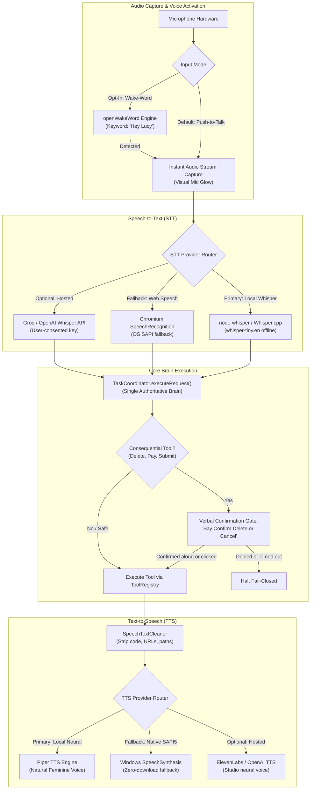
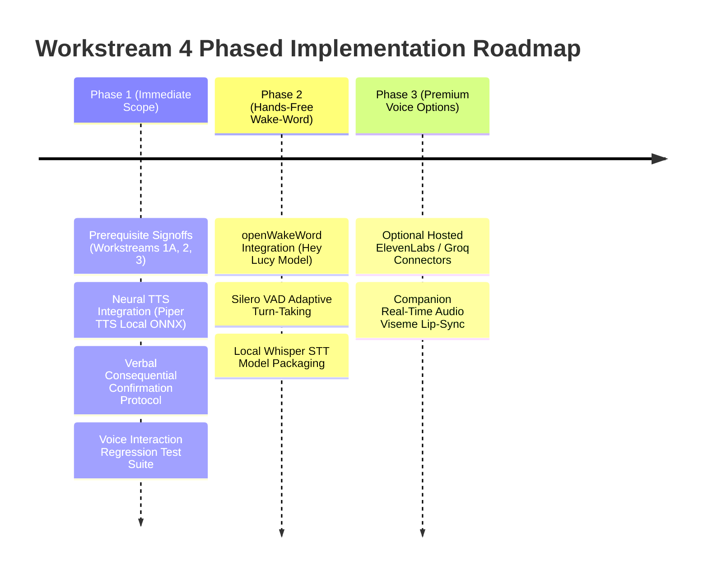

# L.U.C.Y. — Workstream 4 Proposal: Voice Intelligence and Hands-Free Interaction

> [!IMPORTANT]
> **GOVERNANCE STATUS: PROPOSAL AWAITING PREREQUISITE REVIEW & APPROVAL**  
> This engineering design document defines the proposed architecture for Workstream 4 (Voice Intelligence and Hands-Free Interaction).  
> **Prerequisite Constraint:** In accordance with repository change management directives, **no source code implementation changes or Git state mutations are permitted until Workstream 1A (Safe Baseline), Workstream 2 (AI Planning), and Workstream 3 (Browser Intelligence) have been sequentially reviewed, verified, and explicitly approved.**

---

## 1. Executive Summary & Problem Statement

L.U.C.Y. is designed as an autonomous Windows desktop assistant and personal celestial familiar. Natural voice interaction is essential for a fluid companion experience, enabling users to converse, instruct, and receive spoken feedback while working or studying.

A comprehensive forensic audit of L.U.C.Y.'s current voice implementation ([`src/voice/`](file:///c:/Users/admin/Desktop/LUCY/src/voice)) revealed a solid, privacy-respecting foundation:
- **Zero-Cost Local Baseline:** Completely functional push-to-talk (PTT) speech recognition and speech synthesis using Chromium/Electron Web Speech API and native Windows SAPI5 voices.
- **Instant Speech Interruption:** Escape key, new mic activation, or UI stop buttons immediately halt active playback without lagging behind.
- **Natural Text Sanitization:** `speech-text-cleaner.js` strips code blocks, URLs, and markdown formatting before speaking.

However, several critical gaps prevent a truly hands-free, high-quality companion experience:
1. **Absence of Hands-Free Wake-Word:** Users must manually click the microphone button in the UI or keep the window focused. There is no background wake-word engine (e.g. *"Hey Lucy"*).
2. **Robotic Voice Synthesis:** Windows default SAPI5 voices (e.g., `Microsoft Zira Desktop`) sound mechanical compared to modern neural voice models.
3. **Voice Authorization Hazard:** If voice input triggers a consequential action (e.g. file deletion or portal submission), the existing confirmation system expects a mouse click on an Electron modal, breaking hands-free operation. Conversely, voice recognition alone must never silently bypass confirmation gates.
4. **Offline Chromium STT Fragility:** Chromium's built-in `webkitSpeechRecognition` on Windows can intermittently rely on Google cloud speech endpoints depending on Electron distribution flags, causing `network` errors when offline.

This proposal provides a **reuse-first, privacy-by-design architectural plan** for Workstream 4, establishing:
- A verified open-source evaluation of local STT, TTS, and wake-word engines;
- A local-first tiered architecture with optional high-fidelity hosted providers;
- Strict privacy and audio capture boundaries (PTT as foundational default; wake-word as opt-in);
- A voice-safe consequential confirmation protocol;
- Measurable performance and latency targets.

---

## 2. Current Architecture & Exact Source Locations

The current voice pipeline flows through four modular layers:

```mermaid
flowchart LR
    A["Microphone Input<br/>(Push-to-Talk)"] --> B["SpeechRecognitionService<br/>(src/voice/speech-recognition.js)"]
    B --> C["VoiceController<br/>(src/voice/voice-controller.js)"]
    C --> D["Renderer UI & IPC Bridge<br/>(src/ui/app.js:145-165)"]
    D --> E["TaskCoordinator Brain<br/>(src/core/task-coordinator.js:86)"]
    E --> F["Text Synthesis & Response<br/>(task-coordinator.js:432)"]
    F --> G["SpeechTextCleaner<br/>(src/voice/speech-text-cleaner.js)"]
    G --> H["SpeechSynthesisService<br/>(src/voice/speech-synthesis.js)"]
    H --> I["Audio Playback & Companion Mouth Sync<br/>(Windows SAPI5 / Media Foundation)"]
```

### Exact Source Locations & Verified Metrics

| Component | Source Path | Lines | Verified Architectural Status |
| :--- | :--- | :---: | :--- |
| **Speech Recognition** | [`src/voice/speech-recognition.js`](file:///c:/Users/admin/Desktop/LUCY/src/voice/speech-recognition.js) | 230 | *[Verified]* Wraps Web Speech API `SpeechRecognition` / `webkitSpeechRecognition`. Handles microphone permissions, interim transcription, final transcripts, and standardized error codes (`not-allowed`, `audio-capture`, `network`). |
| **Speech Synthesis** | [`src/voice/speech-synthesis.js`](file:///c:/Users/admin/Desktop/LUCY/src/voice/speech-synthesis.js) | 376 | *[Verified]* Wraps `window.speechSynthesis`. Loads and ranks voices preferring English female voices matching hints (`zira`, `jenny`, `aria`, `female`). Controls pitch (0.5–1.5), rate (0.5–1.5), volume (0–1.0), and sequence protection. |
| **Speech Text Cleaner** | [`src/voice/speech-text-cleaner.js`](file:///c:/Users/admin/Desktop/LUCY/src/voice/speech-text-cleaner.js) | 95 | *[Verified]* Sanitizes raw text: omits fenced code blocks (`(code block omitted)`), replaces links with anchor text, strips URLs, Windows/Unix paths, emojis, HTML tags, and truncates text to 600 characters max. |
| **Voice Controller** | [`src/voice/voice-controller.js`](file:///c:/Users/admin/Desktop/LUCY/src/voice/voice-controller.js) | 272 | *[Verified]* Unified state machine (`idle`, `listening`, `processing`, `speaking`, `error`). Manages mutual exclusion (stops speech when mic opens; prevents speech while listening; provides instant `stopSpeaking()`). |
| **UI Integration** | [`src/ui/app.js:93-215`](file:///c:/Users/admin/Desktop/LUCY/src/ui/app.js#L93-L215) | 122 | *[Verified]* Binds `micBtn` (PTT toggle), `stopVoiceBtn`, `toggleTtsBtn`, Escape key interrupt, and voice settings sliders (pitch/rate). |
| **IPC & Config Persistence** | [`src/main/index.js:562-623`](file:///c:/Users/admin/Desktop/LUCY/src/main/index.js#L562-L623) | 62 | *[Verified]* Handles `lucy:getVoiceConfig`, `lucy:setVoiceConfig` (persisted to `voice-config.json`), and forwards `lucy:sendVoiceState` to the floating companion. |
| **Companion Bridge** | [`src/companion/companion-bridge.js:29-61`](file:///c:/Users/admin/Desktop/LUCY/src/companion/companion-bridge.js#L29-L61) | 32 | *[Verified]* Maps task states to emotional manifestations (`listening` $\rightarrow$ thinking bubble; `speaking` $\rightarrow$ dialogue bubble). |
| **Voice Test Suites** | [`tests/voice/*.test.js`](file:///c:/Users/admin/Desktop/LUCY/tests/voice) | 785 | *[Verified]* 2 test suites (`voice-customization.test.js`, `voice-integration.test.js`) passing 100% (20/20 focused tests). |

---

## 3. Existing Capabilities vs. Gaps Summary

### 3.1 Existing Capabilities *(Verified)*
- **Strict Privacy (Zero Continuous Capture):** Microphone is only active when explicitly triggered by the user via push-to-talk. Audio streams are never stored on disk.
- **Instant Interruption & Cancellation:** Active speech can be immediately cancelled via the `Escape` key, clicking the `Stop` button, or pressing the microphone button to speak.
- **Robust Formatting Stripping:** Markdown headers, bullet points, tables, inline code, and URLs are stripped before speaking, ensuring fluent pronunciation.
- **Pitch & Rate Customization:** Users can fine-tune speech speed and pitch via interactive sliders in the UI, persisted to `voice-config.json`.
- **Companion Emotion Synchronization:** Voice states (`listening`, `speaking`, `error`) propagate to the 3D companion familiar.

### 3.2 Critical Gaps *(Verified & Inferred)*
- **GAP-VOICE-01 (Absence of Wake-Word Engine):** *[Verified]* No wake-word detector exists. The user cannot activate L.U.C.Y. from across the room without physical keyboard or mouse input.
- **GAP-VOICE-02 (Voice-Driven Consequential Confirmations):** *[Verified]* When a voice request triggers a `CONSEQUENTIAL` action (e.g. file deletion), execution halts awaiting a mouse click on an Electron modal. There is no verbal confirmation protocol (*"Say 'Confirm delete' to proceed"*).
- **GAP-VOICE-03 (Robotic Speech Synthesis Quality):** *[Verified]* Standard Windows SAPI5 voices lack natural prosody, breathing, and emotional inflection expected of a fantasy fairy companion.
- **GAP-VOICE-04 (Offline STT Reliability):** *[Inferred]* If Chromium's Web Speech engine fails to connect to its underlying provider offline, speech recognition fails with a `network` error.
- **GAP-VOICE-05 (Voice Activity Detection / VAD):** *[Verified]* The current PTT recognition expects fixed utterance endings; it has no adaptive voice activity detection (VAD) to distinguish ambient background noise from intentional speech.

---

## 4. Open-Source Reuse Evaluation & License Verification

In accordance with L.U.C.Y.'s reuse-first policy, existing open-source STT, TTS, and wake-word technologies were evaluated for license terms, local CPU efficiency, Windows compatibility, and packaging overhead.

### 4.1 Wake-Word Candidates

| Project / Engine | Code License | Model License | Windows / Electron Fit | Assessment & Recommendation |
| :--- | :---: | :---: | :---: | :--- |
| **openWakeWord** (`dscripka/openwakeword`) | **Apache-2.0** | **Apache-2.0** | **ONNX Runtime (Node.js native addon or WASM)** | **RECOMMENDED WAKE-WORD ENGINE.** 100% open source. Ultra-lightweight (~1–2% single-core CPU). Pretrained models available under Apache-2.0. Supports custom "Hey Lucy" model training. |
| **Porcupine** (`Picovoice/Porcupine`) | **Proprietary** (Custom Apache-like with commercial restrictions) | Commercial Token Required | Native Node Addon | **STRICTLY REJECTED.** Requires a Picovoice account, cloud AccessKey, and limits free usage to 3 users. Incompatible with an open-source, private desktop assistant. |
| **Mycroft Precise** (`MycroftAI/mycroft-precise`) | **GPL-3.0** | GPL-3.0 | Python / Heavy | **REJECTED.** GPL-3.0 imposes viral copyleft obligations on L.U.C.Y. (MIT). Python runtime introduces heavy overhead. |
| **Snowboy** (`KITT-AI/snowboy`) | Apache-2.0 | Apache-2.0 | Obsolete / Unmaintained | **REJECTED.** Abandoned in 2020. C++ node-gyp build failures on modern Node 20+. |

### 4.2 Local Speech-to-Text (STT) Candidates

| Project / Engine | License | Offline? | Size / RAM | Assessment & Recommendation |
| :--- | :---: | :---: | :---: | :--- |
| **Native Web Speech API** (Current) | N/A (Platform API) | Partial (OS dependent) | **0 MB / 0 MB** | **TIER 1 (Default Fallback).** Already working, zero dependencies, zero installation friction. |
| **Whisper.cpp / node-whisper** | **MIT** | **100% Offline** | ~75 MB model (`whisper-tiny.en`), ~150 MB RAM | **TIER 2 (Recommended Local Engine).** Exceptional accuracy, multi-threaded CPU inference on Windows, zero cloud calls. Can be distributed as an optional model download. |
| **Sherpa-ONNX** | Apache-2.0 | 100% Offline | ~50 MB model, ~100 MB RAM | **VIABLE ALTERNATIVE.** Streaming Zipformer models with ultra-low latency (<100ms). |
| **Hosted Whisper API** (OpenAI / Groq) | Commercial API | Cloud | Cloud | **TIER 3 (Optional Hosted).** Available if user configures an API key; ultra-fast (<250ms on Groq), but requires internet and explicit user consent. |

### 4.3 Text-to-Speech (TTS) Candidates

| Project / Engine | License | Offline? | Quality & Tone | Assessment & Recommendation |
| :--- | :---: | :---: | :---: | :--- |
| **Windows SAPI5 / SpeechSynthesis** (Current) | N/A (OS built-in) | **100% Offline** | Mechanical / Functional | **TIER 1 (Default Fallback).** Instant playback, zero downloads, zero cost. Standard `Microsoft Zira` or `Jenny` (Windows 11). |
| **Piper TTS** (`rhasspy/piper`) | **MIT** | **100% Offline** | **High-Quality Neural** | **TIER 2 (Recommended Local Neural TTS).** Ultra-fast ONNX-based local neural TTS running on CPU. Feminine voice models (`en_US-lessac-medium`, `en_US-amy-medium`) ~25–50 MB. Fast, natural, offline. |
| **Kokoro-82M** (`hexgrad/Kokoro-82M`) | Apache-2.0 | 100% Offline | **Ultra-Expressive / Human** | **EVALUATE FOR PREMIUM LOCAL.** 82M parameter weights. Beautiful feminine fairy voices (`af_heart`, `af_bella`). Requires ~160 MB ONNX weights. |
| **Edge-TTS** (`rany2/edge-tts`) | Unofficial API | Cloud | Ultra-Realistic Neural | **REJECTED AS DEPENDENCY.** Unofficial reverse-engineered Microsoft service; subject to sudden deprecation and Terms of Service risks. |
| **Hosted Neural TTS** (ElevenLabs / OpenAI `tts-1`) | Commercial API | Cloud | Studio Quality | **TIER 3 (Optional Hosted).** Supported if user provides ElevenLabs or OpenAI key. |

---

## 5. Recommended Architecture: Local-First with Optional Hosted Enhancements

---

## 6. Hands-Free Safety & Verbal Consequential Confirmation Protocol

### 6.1 The Voice Authorization Hazard
Voice recognition algorithms are vulnerable to:
- Background television, radio, or roommate speech;
- Ambient acoustic noise misrecognizing words;
- Acoustic hallucinations from small models.

**Strict Mandate:** **A voice transcript ALONE must NEVER authorize a consequential action.**

### 6.2 The Dual-Gated Verbal Confirmation Protocol
When a voice request triggers a tool evaluated by `PermissionAuthority` as `CONSEQUENTIAL` (e.g. `file_delete`, `desktop_type_text` on banking portals, `browser_click` on submit/pay buttons):

1. **Execution Gate:** Tool execution halts. A 15-second countdown timer starts.
2. **Spoken Prompt:** L.U.C.Y. speaks aloud:  
   > *"I have prepared this action: [Action Description]. Because this has permanent consequences, please confirm aloud by saying 'Confirm [Keyword]' or click Cancel."*
3. **Targeted Confirmation Phrase:** The confirmation phrase requires an explicit keyword (e.g. *"Confirm delete"* or *"Confirm purchase"*). A simple, ambiguous *"Yes"* or *"Okay"* is strictly rejected.
4. **Fail-Closed Timeout:** If no matching verbal confirmation or UI click is received within 15 seconds, the action aborts fail-closed, reports the cancellation, and releases all locks.

---

## 7. Privacy, Microphone Boundaries, and User Agency

1. **Push-to-Talk as Default Foundation:**  
   - Microphone hardware is completely closed and unpowered by the application when not listening.
   - Zero background room eavesdropping.
2. **Opt-In Wake-Word Disclosures:**  
   - Hands-free wake-word detection is disabled by default.
   - Enabling wake-word requires an explicit user toggle with a transparent privacy disclosure:  
     > *"Wake-word listening processes ambient microphone audio locally on your device to detect 'Hey Lucy'. Raw audio is processed in memory and never sent to cloud servers."*
3. **Mute & Privacy Controls:**  
   - **Hardware/Software Mute Toggle:** A dedicated global hotkey (`Ctrl+Shift+M`) and visible UI toggle that severs microphone access immediately.
   - **Visual Active Capture Indicator:** Whenever the microphone is open, the floating companion and main window display a bright pulsing cyan aura, ensuring the user is never in doubt about audio capture.
   - **Zero Audio Storage:** Audio PCM streams are buffered in volatile memory only for the duration of the utterance and cleared immediately upon transcription. No `.wav` or `.mp3` files are saved to disk.
   - **Secret Scrubbing in Transcripts:** All verbal transcripts are passed through `redactSecrets()` before being recorded to conversation memory.

---

## 8. Voice Interaction States & Companion Integration

The 3D celestial familiar companion reacts visually and expressively to each voice phase:

| Voice State | Companion Animation | Floating Bubble Text | User Action Available |
| :--- | :--- | :--- | :--- |
| **`idle`** | Gentle hovering idle animation | None | Click mic or say *"Hey Lucy"* |
| **`wake_detected`** | Alert chime, companion perks ears/wings | *"Yes?"* | User speaks instruction |
| **`listening`** | Pulsing aura, leaning forward attentive | Real-time interim transcript | Speak, click Stop, or hit `Escape` |
| **`processing`** | Concentrating / thinking animation | *"Thinking..."* | Hit `Escape` to cancel task |
| **`awaiting_confirmation`** | Inquisitive tilt, amber warning glow | *"Please say 'Confirm [Action]'..."* | Say confirmation phrase or click Cancel |
| **`speaking`** | Natural mouth phoneme movement, wing flap | Spoken text bubble | Hit `Escape` or click Stop to interrupt |
| **`error`** | Worried flutter | Spoken/displayed error message | Automatically resets to idle |

---

## 9. Measurable Targets & Performance Metrics

> [!NOTE]
> *The metrics below are proposed engineering targets for Workstream 4 implementation; they are not fabricated historical benchmarks.*

| Metric | Target Performance Level | Measurement Methodology |
| :--- | :--- | :--- |
| **Push-to-Talk STT Latency** | **$\le$ 450 ms** from speech end to transcript delivery | Measured via `performance.now()` in `SpeechRecognition` callback. |
| **Wake-Word Detection Latency** | **$\le$ 250 ms** from utterance end to trigger event | Measured in `openWakeWord` audio chunk stream. |
| **Local TTS Synthesis Latency** | **$\le$ 200 ms** from text input to first audio buffer playback | Measured in `SpeechSynthesisService.speak()`. |
| **Idle CPU Usage (PTT Mode)** | **0.0% CPU** (zero microphone polling) | Measured via Windows Task Manager / `process.getCPUUsage()`. |
| **Idle CPU Usage (Wake-Word Active)** | **$\le$ 2.0% CPU** on standard 4-core x64 CPU | Measured with `openWakeWord` ONNX inference loop. |
| **False Activation Rate (Wake-Word)** | **$\le$ 1 false trigger per 24 hours** of ambient TV/speech | Evaluated against standard ambient audio test sets. |
| **Speech Interruption Response** | **$\le$ 50 ms** from `Escape` key to complete audio silence | Verified via audio output termination assertion. |

---

## 10. Phased Implementation Roadmap

### Phase 1: High-Quality Voice & Safety Protocol (Immediate Workstream 4 Scope)
1. Integrate local neural TTS via Piper TTS ONNX model (`en_US-lessac-medium` or `en_US-amy-medium`), providing a natural, sweet feminine voice with zero cloud latency.
2. Implement the **Verbal Consequential Confirmation Protocol** in `TaskCoordinator` and `VoiceController`.
3. Add global mute shortcut (`Ctrl+Shift+M`) and audio capture status glow.
4. Implement `tests/voice/voice-safety-and-quality.test.js` covering verbal confirmations, audio interruptions, and secret redaction.

### Phase 2: Hands-Free Wake-Word & Offline STT (Subsequent Milestone)
1. Integrate `openWakeWord` ONNX runtime with an opt-in user toggle in Settings.
2. Integrate `Whisper.cpp` (`whisper-tiny.en`) for guaranteed offline STT resilience.
3. Integrate Silero VAD for adaptive background noise rejection.

---

## 11. Files Planned for Modification (Upon Workstream 4 Execution)

> [!NOTE]
> *No files listed below were modified during this planning phase, except for this proposal document.*

### Target Files for Workstream 4 Implementation:
- `src/voice/voice-controller.js` *(Add verbal confirmation state and wake-word event handling)*
- `src/voice/speech-synthesis.js` *(Add Piper TTS ONNX provider alongside native SAPI5 fallback)*
- `src/voice/speech-recognition.js` *(Add local Whisper STT adapter alongside Web Speech API)*
- `src/core/task-coordinator.js` *(Integrate hands-free verbal confirmation gate)*
- `src/ui/app.js` *(Add global mute hotkey and audio capture visual indicators)*
- `tests/voice/voice-safety-and-quality.test.js` *(New comprehensive voice regression suite)*

---

*End of Workstream 4 Proposal.*
