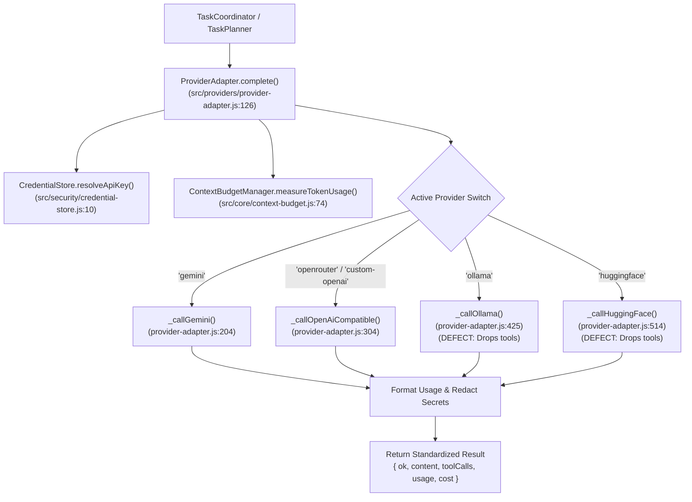
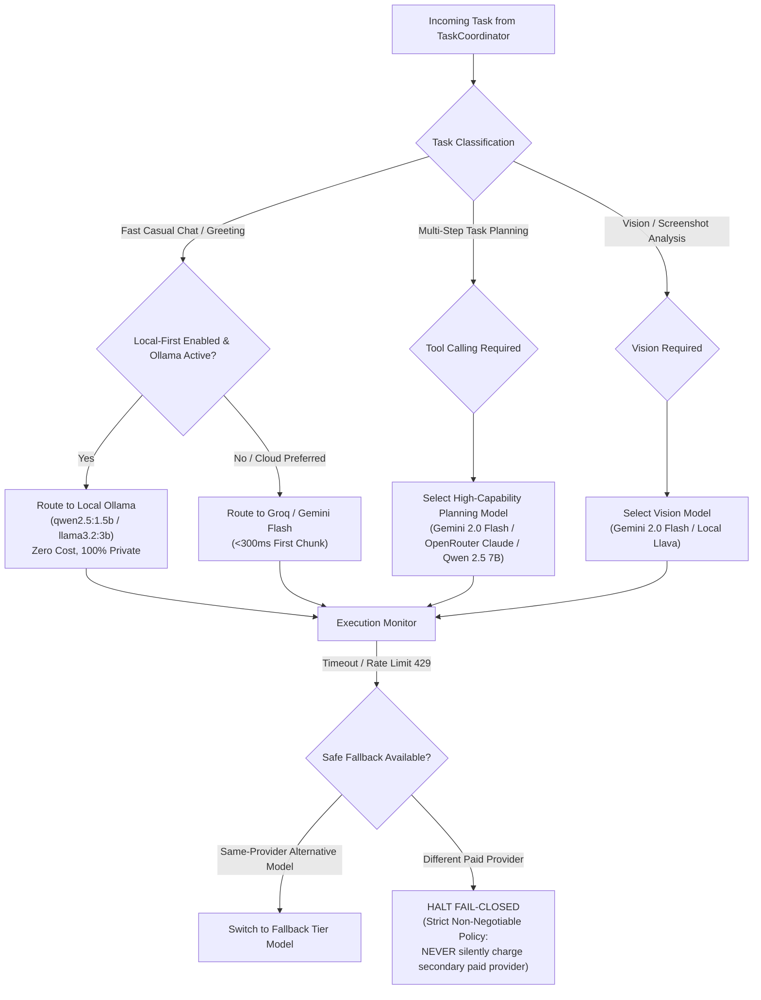
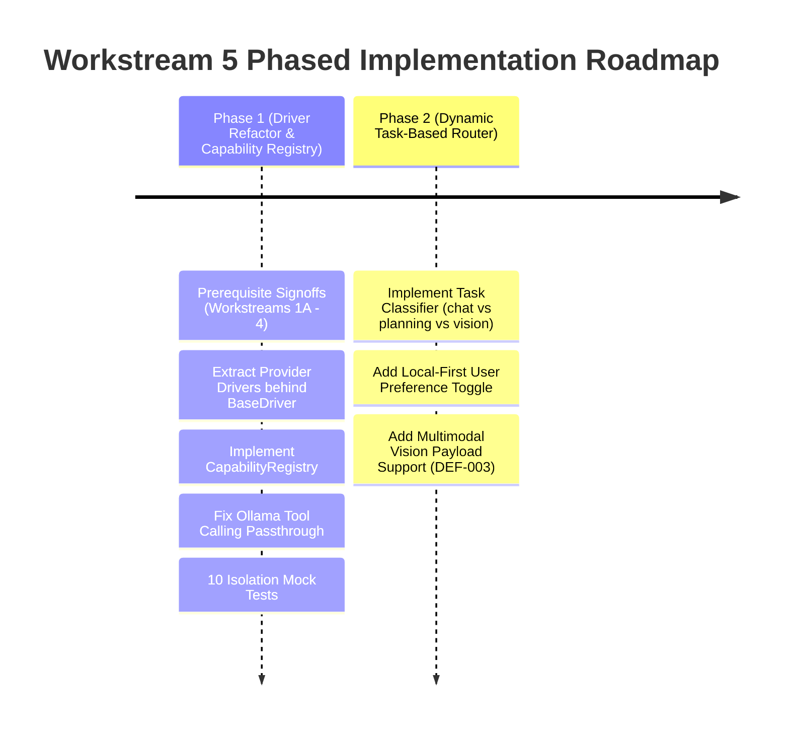

# L.U.C.Y. — Workstream 5 Proposal: Unified AI Model and Provider Orchestration

> [!IMPORTANT]
> **GOVERNANCE STATUS: PROPOSAL AWAITING PREREQUISITE REVIEW & APPROVAL**  
> This engineering design document defines the proposed architecture for Workstream 5 (Unified AI Model and Provider Orchestration).  
> **Prerequisite Constraint:** In accordance with repository change management directives, **no source code implementation changes or Git state mutations are permitted until Workstreams 1A, 2, 3, and 4 have been sequentially reviewed, verified, and explicitly approved.**

---

## 1. Executive Summary & Objective

L.U.C.Y. is designed as an intelligent Windows desktop assistant and personal celestial familiar. Her cognitive abilities must balance responsiveness, accuracy, privacy, offline independence, and financial cost.

The current AI provider layer in [`src/providers/provider-adapter.js`](file:///c:/Users/admin/Desktop/LUCY/src/providers/provider-adapter.js) establishes robust foundational policies:
- **Zero Paid-Provider Fallback:** Strictly prevents silent, unauthorized billing across paid providers.
- **Fail-Closed Credential Validation:** Missing API keys fail immediately before network dispatch.
- **Secret Redaction:** Scrubbing of API keys from error messages, URLs, and stack traces.
- **Windows DPAPI Integration:** Keys encrypted at rest using user logon credentials.

However, several architectural gaps limit multi-model orchestration:
1. **Monolithic ProviderAdapter:** All provider logic (Gemini, OpenRouter, Custom OpenAI, Ollama, Hugging Face) is conflated into a single 904-line class rather than modular, pluggable provider drivers.
2. **Missing Capability Intelligence:** Model features (tool calling, vision, streaming, context limits) are assumed by provider name rather than queried from an empirical Capability Registry.
3. **Rigid Static Model Selection:** The active model is locked globally (e.g. `gemini-2.0-flash` or `qwen2.5:1.5b`); there is no task-based routing (e.g. routing simple chat to fast local models while routing complex multi-step planning or vision tasks to high-capacity models).
4. **Ollama & Hugging Face Tool Omission:** In [`src/providers/provider-adapter.js:425-623`](file:///c:/Users/admin/Desktop/LUCY/src/providers/provider-adapter.js#L425-L623), tool definitions are completely dropped when calling Ollama and Hugging Face, crippling local open-source tool execution.

This proposal establishes a **Unified Model & Provider Orchestration Layer** featuring:
- A pluggable **Driver Architecture** behind a unified contract;
- An empirical **Model Capability Registry**;
- **Task-Based Intelligent Routing** (local-first for privacy; high-reasoning for planning);
- Official-source-verified evaluation of providers (Gemini, OpenRouter, Groq, Cerebras, Hugging Face, Ollama);
- Safe, transparent fallback and cost containment rules.

---

## 2. Current Architecture & Exact Source Locations



### Exact Source Locations & Verified Metrics

| Component | Source File & Lines | Lines | Verified Architectural Status |
| :--- | :--- | :---: | :--- |
| **Provider Adapter Core** | [`src/providers/provider-adapter.js`](file:///c:/Users/admin/Desktop/LUCY/src/providers/provider-adapter.js) | 904 | *[Verified]* Single unified adapter managing Gemini, OpenRouter, Custom OpenAI, Ollama, and Hugging Face. Enforces zero paid fallback. |
| **Context Budget Manager** | [`src/core/context-budget.js`](file:///c:/Users/admin/Desktop/LUCY/src/core/context-budget.js) | 294 | *[Verified]* Token estimation (`estimateTokenCount`), soft (70%) and hard (85%) compaction ratios, conservative BPE modeling. |
| **Credential Store** | [`src/security/credential-store.js`](file:///c:/Users/admin/Desktop/LUCY/src/security/credential-store.js) | 288 | *[Verified]* DPAPI CurrentUser encryption (`credentials.dpapi`) with AES-256-GCM fallback on non-Windows. |
| **Endpoint Validator** | [`src/security/ipc-validator.js:18-85`](file:///c:/Users/admin/Desktop/LUCY/src/security/ipc-validator.js#L18-L85) | 68 | *[Verified]* Enforces HTTPS for remote APIs; permits HTTP exclusively for loopback addresses (`127.0.0.1`, `localhost`). |
| **Provider Streaming Tests** | [`tests/providers/multi-provider-streaming.test.js`](file:///c:/Users/admin/Desktop/LUCY/tests/providers/multi-provider-streaming.test.js) | 431 | *[Verified]* Comprehensive SSE/NDJSON streaming tests passing 100% across all 5 providers. |
| **Provider Security Tests** | [`tests/security/provider-adapter.test.js`](file:///c:/Users/admin/Desktop/LUCY/tests/security/provider-adapter.test.js) | 89 | *[Verified]* Asserts fail-closed missing key behavior, non-fallback between paid providers, and honest usage reporting. |

---

## 3. Verified Existing Integrations vs. Known Gaps

### 3.1 Working Integrations *(Verified)*
- **Google Gemini API:** Native HTTPS POST to `generativelanguage.googleapis.com`. SSE streaming via `streamGenerateContent?alt=sse`. API key transmitted safely via `x-goog-api-key` header (SEC-002).
- **OpenRouter & Custom OpenAI:** Full SSE streaming with `[DONE]` termination. Token usage and cost representation. Strict rejection of remote HTTP endpoints (SEC-007).
- **Local Ollama Integration:** Discovers models via `/api/tags`. Consumes line-delimited NDJSON streams. Reports `$0.00` cost truthfully (`local_zero_cost`).
- **Hugging Face Inference Router:** Integrates with `router.huggingface.co`. Handles HTTP 429 (rate limit) and HTTP 503 (model loading) cleanly.

### 3.2 Known Gaps *(Verified & Inferred)*
- **GAP-AI-01 (Ollama Tool Calling Omission):** *[Verified]* `_callOllama` does not pass `tools` to Ollama's `/api/chat` API, preventing local models from performing tool calls.
- **GAP-AI-02 (Hugging Face Tool Omission):** *[Verified]* `_callHuggingFace` completely discards `tools`.
- **GAP-AI-03 (Static Model Selection):** *[Verified]* Switching models requires global reconfiguration; cannot route chat to Ollama while routing multi-step planning to Gemini.
- **GAP-AI-04 (No Multimodal / Vision Input):** *[Verified]* `ProviderAdapter` accepts only text messages; cannot accept image buffers for visual verification (DEF-003).
- **GAP-AI-05 (Hardcoded Context Windows):** *[Inferred]* `MODEL_CONTEXT_LIMITS` in `context-budget.js` uses a static table; dynamic models discovered from Ollama or OpenRouter have to fall back to the conservative 8,192 default.

---

## 4. Official-Source-Backed Provider Comparison

Information verified from official provider documentation (as of October 2026 local context):

| Provider | Official Endpoint & Protocol | Key Models Available | Structured Tool Calling | Multimodal Vision | Context Window | Free Tier / Pricing (Official Terms) | Strengths & Best Use in L.U.C.Y. |
| :--- | :--- | :--- | :---: | :---: | :---: | :--- | :--- |
| **Local Ollama** | `http://127.0.0.1:11434`<br/>(Local REST) | `qwen2.5:1.5b`<br/>`qwen2.5:7b`<br/>`llama3.2:3b`<br/>`llama3.1:8b` | **Yes** (on tools-capable models) | **Yes** (via `llava`, `moondream`) | 4K–128K (VRAM dependent) | **100% Free**<br/>(Local hardware) | **Primary Local-First Engine.** 100% private, offline, zero data transmission. Ideal for conversational chat and simple automation. |
| **Google AI Studio (Gemini API)** | `https://generativelanguage.googleapis.com`<br/>(HTTPS REST) | `gemini-2.0-flash`<br/>`gemini-1.5-pro`<br/>`gemini-1.5-flash` | **Native** (`functionDeclarations`) | **Native** (High-res image/audio) | **1M–2M tokens** | Free tier: 15 RPM / 1M TPM / 1500 RPD.<br/>Paid: ~$0.10/$0.40 per 1M tokens | **Primary Planning & Vision Engine.** Unmatched 1M+ context window, native tool-calling reliability, and rapid reasoning. |
| **GroqCloud** | `https://api.groq.com/openai/v1`<br/>(OpenAI Compatible) | `llama-3.3-70b-versatile`<br/>`llama-3.1-8b-instant` | **Native** (`tools` array) | **Yes** (`llama-3.2-11b-vision`) | 8K–128K | Free tier: 30 RPM / generous TPM.<br/>Paid: ~$0.05–$0.59 per 1M tokens | **Ultra-Low Latency Engine.** 300–800 tokens/sec on LPU hardware. Exceptional for instant voice responses. |
| **Cerebras Inference** | `https://api.cerebras.ai/v1`<br/>(OpenAI Compatible) | `llama-3.3-70b`<br/>`llama3.1-8b` | **Native** (`tools` array) | No | 8K–128K | Free tier available.<br/>Paid: ~$0.10–$0.60 per 1M tokens | **Extreme Speed Text Engine.** 1,800+ tokens/sec on Llama 3.1 8B. Ideal for rapid code generation and draft synthesis. |
| **OpenRouter** | `https://openrouter.ai/api/v1`<br/>(OpenAI Compatible) | Multi-vendor gateway (Claude 3.5, GPT-4o, DeepSeek R1) | Model-dependent | Model-dependent | Model-dependent | Pass-through pricing with zero-markup options.<br/>Privacy: `data_collection: 'deny'` | **Universal Hosted Fallback.** Gives user freedom to bring keys for Claude, DeepSeek, or OpenAI without bespoke adapters. |
| **Hugging Face Serverless** | `https://router.huggingface.co`<br/>(OpenAI Compatible) | `Llama-3.2-3B`<br/>`Qwen2.5-7B` | Variable | Variable | 8K–32K | Free tier with rate limits.<br/>Pro: $9/mo | **Secondary Open-Source Cloud.** Good for users without local GPUs who want open weights hosted remotely. |

---

## 5. Model Capability Registry Architecture

Instead of hardcoding model limits and features inside individual functions, Workstream 5 introduces a centralized **Model Capability Registry** ([`src/providers/capability-registry.js`](file:///c:/Users/admin/Desktop/LUCY/src/providers/capability-registry.js)):

```javascript
class ModelCapabilityRegistry {
    constructor() {
        this.models = new Map();
        this._loadBuiltinDefinitions();
    }

    registerModel(definition) {
        // Enforce required capability metadata
        const required = ['id', 'provider', 'contextWindow', 'capabilities'];
        for (const req of required) {
            if (definition[req] === undefined) throw new Error(`Missing ${req}`);
        }
        this.models.set(definition.id, definition);
    }

    supportsCapability(modelId, capability) {
        const model = this.models.get(modelId);
        return Boolean(model && model.capabilities.includes(capability));
    }

    getContextWindow(modelId) {
        return this.models.get(modelId)?.contextWindow || 8192;
    }

    recommendModelForTask(taskType, availableProviders = []) {
        // Returns highest-ranked accessible model for: 'chat' | 'planning' | 'vision' | 'code' | 'fast_voice'
    }
}
```

### Capability Definitions
- `chat`: Basic instruction-following and conversation.
- `tool_calling`: Validated JSON Schema function/tool dispatch.
- `vision`: Multi-modal image buffer input for screen analysis.
- `streaming`: Incremental SSE/NDJSON chunk generation.
- `offline`: Capable of running locally with zero network access.
- `fast_response`: Capable of generation speed $>150\text{ tokens/second}$ for voice feedback.

---

## 6. Task-Based Routing & Fallback Policies



### Strict Non-Negotiable Fallback Boundaries
1. **Never Silently Cross Paid Provider Boundaries:**  
   If Gemini API fails, L.U.C.Y. **never** automatically reroutes to OpenRouter or OpenAI. Doing so violates user financial consent. She reports the failure and lets the user decide.
2. **Local-to-Local Fallback Permitted:**  
   If a local Ollama model (e.g. `qwen2.5:7b`) runs out of memory, falling back to a smaller local model (`qwen2.5:1.5b`) on the same local instance is permitted because cost remains $0.00.
3. **Graceful Offline Degradation:**  
   If the network disconnects, L.U.C.Y. detects offline status immediately and routes all tasks to the local Ollama instance, gracefully informing the user if capabilities (like remote browsing) are restricted.

---

## 7. Security, Privacy, and Cost Containment Safeguards

1. **Windows DPAPI Storage:**  
   All provider API keys are encrypted at rest using Windows DPAPI (`CurrentUser` scope) in [`src/security/credential-store.js`](file:///c:/Users/admin/Desktop/LUCY/src/security/credential-store.js). Keys are never stored in plaintext JSON or environment configuration files.
2. **Credential Redaction Invariance:**  
   All outgoing URLs, HTTP headers, and error messages are filtered through `redactSecrets()`. Even if an HTTP call throws with a stack trace, keys are scrubbed before reaching logs.
3. **Sensitive Local Data Disclosure:**  
   Before sending user workspace files or code to a hosted cloud provider (Gemini, OpenRouter), L.U.C.Y. verifies whether the current workspace mode allows cloud processing. If set to `LOCAL_ONLY`, cloud dispatch is blocked fail-closed.
4. **Honest Usage & Cost Tracking:**  
   In compliance with REQ-026: If usage metrics are omitted by a provider, L.U.C.Y. explicitly records `{ status: 'unknown' }`. She **never** reports $0.00 unless the execution was genuinely local and free.

---

## 8. Proposed Interface Changes & Driver Architecture

Refactor the monolithic `ProviderAdapter` into a clean **Driver Pattern**:

```
src/providers/
├── provider-orchestrator.js     (Central router, capability matching, budget coordination)
├── capability-registry.js       (Verified feature registry for all known models)
├── base-provider-driver.js      (Abstract base class with standard complete() contract)
└── drivers/
    ├── gemini-driver.js         (Google AI Studio REST + SSE streaming)
    ├── openai-driver.js         (OpenRouter, Groq, Cerebras, Custom OpenAI)
    ├── ollama-driver.js         (Local Ollama REST + NDJSON + tool calling)
    └── huggingface-driver.js    (Hugging Face Inference Router)
```

Each driver implements the exact same minimal contract:
```javascript
async complete({ messages, tools, options, signal, onChunk }) -> { ok, content, toolCalls, usage, cost }
```

---

## 9. Test Plan with Measurable Acceptance Criteria

A comprehensive test suite (`tests/providers/unified-orchestration.test.js`) will verify the architecture using isolated mocks:

| Test ID | Scenario | Expected Behavior & Acceptance Criteria |
| :--- | :--- | :--- |
| **TC-ORCH-01** | Capability Registry Lookup | Registry accurately reports capabilities (tools, vision, streaming) for known models. |
| **TC-ORCH-02** | Local-First Routing | When local-first is active and Ollama is online, chat routes to local driver; zero external network calls. |
| **TC-ORCH-03** | Task-Based Model Selection | Complex multi-step planning request selects model with verified `tool_calling` capability. |
| **TC-ORCH-04** | Ollama Tool Calling Passthrough | Ollama driver correctly serializes `tools` into `/api/chat` payload and parses returned `tool_calls`. |
| **TC-ORCH-05** | No Paid Provider Fallback | Gemini HTTP 429 fails closed; does NOT dispatch to OpenRouter. |
| **TC-ORCH-06** | Honest Cost Accounting | Local Ollama returns `{ status: 'local_zero_cost', amount: 0.0 }`. Cloud providers return reported tokens. |
| **TC-ORCH-07** | Secret Redaction on Error | Simulated network error containing API key is completely scrubbed of the secret. |
| **TC-ORCH-08** | Dynamic Context Budgeting | Registry feeds exact model context limits into `ContextBudgetManager`. |
| **TC-ORCH-09** | Multimodal Vision Schema | Driver accepts image buffer and packages it according to provider specifications. |
| **TC-ORCH-10** | Offline Auto-Detection | When network is unreachable, orchestrator automatically directs requests to local Ollama. |

---

## 10. Implementation Phasing & Risks



### Dependencies
- **Workstream 1A Signoff:** Complete Git tracking and real user data isolation verified.
- **Workstream 2 Signoff:** AI Planning and Tool Calling unified across providers.

### Rollback Strategy
Because the proposed `ProviderOrchestrator` maintains 100% backward compatibility with the existing `ProviderAdapter.complete()` method signature, the existing test suite (`multi-provider-streaming.test.js`) runs unchanged, and any issues can be reverted cleanly via Git.

---

## 11. Files Planned for Modification (Upon Workstream 5 Execution)

> [!NOTE]
> *No files listed below were modified during this planning phase, except for this proposal document.*

### Target Files for Workstream 5 Implementation:
- `src/providers/capability-registry.js` *(New file — model capabilities and token boundaries)*
- `src/providers/base-provider-driver.js` *(New file — abstract provider driver contract)*
- `src/providers/drivers/gemini-driver.js` *(Extracted modular Gemini driver)*
- `src/providers/drivers/openai-driver.js` *(Extracted OpenRouter, Groq, Cerebras driver)*
- `src/providers/drivers/ollama-driver.js` *(Extracted Ollama driver with tool-calling fix)*
- `src/providers/drivers/huggingface-driver.js` *(Extracted Hugging Face driver)*
- `src/providers/provider-adapter.js` *(Refactored to orchestrate drivers)*
- `tests/providers/unified-orchestration.test.js` *(New 10-scenario regression test suite)*

---

*End of Workstream 5 Proposal.*
