# L.U.C.Y. — PHASE 0: DEPENDENCY MAP & SEQUENCING ARCHITECTURE
**Critical Dependency Chains, Foundational Blockers, and Safe Parallel Work**

- **Audit Date:** October 19, 2026
- **Auditor:** Antigravity Autonomous Engineering & Forensic Audit Agent
- **Target Repository:** `c:\Users\admin\Desktop\LUCY`
- **Current Git Revision:** `4e96e144e2f94beb0b34dc22a6e6207bb1918e8a` (`4e96e14`)

---

## 1. System Authority & Call Graph Hierarchy

```mermaid
graph TD
    UserRequest([User Request: Typed / Spoken / Drag]) --> Preload[src/main/preload.js <br> lucyIpc ContextBridge]
    Preload --> Main[src/main/index.js <br> Electron Main Process & IPC Router]
    
    subgraph CoreBrain ["Sole Authoritative Brain (Single Authority Model)"]
        Main --> TaskCoord[src/core/task-coordinator.js <br> TaskCoordinator]
        TaskCoord --> StatusMgr[src/core/task-status.js <br> Execution State Machine]
        TaskCoord --> Planner[src/core/task-planner.js <br> TaskPlanner]
        TaskCoord --> BudgetMgr[src/core/context-budget.js <br> ContextBudgetManager]
        TaskCoord --> Verifier[src/core/result-verifier.js <br> ResultVerifier]
        TaskCoord --> Recovery[src/core/recovery-engine.js <br> TaskRecoveryEngine]
    end

    subgraph SecurityGate ["Security & Permission Layer"]
        TaskCoord --> PermAuth[src/security/permission-authority.js <br> PermissionAuthority]
        PermAuth --> CredStore[src/security/credential-store.js <br> Windows DPAPI]
        PermAuth --> PathVal[src/tools/file-tools.js <br> PathBoundaryChecker]
        Main --> IPCVal[src/security/ipc-validator.js <br> Payload & URL Validator]
    end

    subgraph IntelligenceLayer ["AI Provider Routing"]
        Planner --> Router[src/providers/model-router.js <br> ModelRouter]
        Router --> ConnMgr[src/providers/connection-manager.js <br> ConnectionManager]
        Router --> Catalogue[src/providers/model-catalogue.js <br> ModelCatalogue]
        Router --> Adapter[src/providers/provider-adapter.js <br> ProviderAdapter]
        Adapter --> Gemini[Google Gemini API]
        Adapter --> OpenRouter[OpenRouter / OpenAI]
        Adapter --> Ollama[Local Ollama /api/chat]
        Adapter --> HuggingFace[Hugging Face Router]
    end

    subgraph ToolExecution ["Tool Registry & Action Execution"]
        TaskCoord --> ToolReg[src/tools/tool-registry.js <br> ToolRegistry]
        ToolReg --> TierPolicy[src/tools/automation-tier-policy.js <br> Tier Classifier]
        ToolReg --> DesktopMgr[src/tools/desktop-automation-manager.js <br> DesktopAutomationManager]
        DesktopMgr --> UiaWorker[src/tools/native-uia/LucyUiaWorker.exe <br> Native C# UIA Worker]
        ToolReg --> BrowserMgr[src/tools/browser-manager.js <br> Playwright Chromium]
        ToolReg --> FileTools[src/tools/file-tools.js <br> Workspace File Operations]
        ToolReg --> VisionTools[src/tools/visual-tools.js <br> visual_inspect]
        ToolReg --> MemoryTools[src/tools/memory-tools.js <br> memory_search/get/list]
    end

    subgraph MemoryContinuity ["Persistence & Continuity"]
        TaskCoord --> MemStore[src/memory/memory-store.js <br> MemoryStore]
        MemStore --> SqliteAdapter[src/memory/sqlite-adapter.js <br> sql.js WebAssembly]
        MemStore --> LexicalRetriever[src/memory/lexical-retriever.js <br> BM25 Lexical Ranking]
        TaskCoord --> ContinuityStore[src/memory/task-continuity-store.js <br> TaskContinuityStore]
    end

    subgraph PresentationLayer ["Strictly Reactive Presentation Layer"]
        TaskCoord -. State Broadcast .-> Bridge[src/companion/companion-bridge.js <br> CompanionBridge]
        Bridge -. Events .-> Renderer2D[src/ui/companion-renderer.js <br> CelestialFamiliarRenderer]
        Bridge -. IPC .-> FloatingWindow[src/companion/floating-companion-window.js <br> Resizable Desktop Shell]
        Main --> MainUI[src/ui/app.js <br> Main Window & Settings Center]
    end
```

---

## 2. Critical Dependency Chains

### Chain 1: User Request $\rightarrow$ Action Execution (The Sole Authority Path)
- **Chain:** `User Input` $\rightarrow$ `preload.js` $\rightarrow$ `ipcMain (main/index.js)` $\rightarrow$ `TaskCoordinator.executeRequest()` $\rightarrow$ `TaskPlanner.plan()` $\rightarrow$ `PermissionAuthority.evaluate()` $\rightarrow$ `ToolRegistry.executeTool()` $\rightarrow$ `ResultVerifier.verify()` $\rightarrow$ `TaskRecoveryEngine` $\rightarrow$ `TaskContinuityStore` $\rightarrow$ `UI Response`.
- **Invariants:**
  1. The renderer is strictly reactive and never executes tools directly.
  2. Consequential operations (`WORKSPACE_WRITE`, `CONSEQUENTIAL`) unconditionally block until interactive user approval or 60s timeout fail-closed.
  3. `ResultVerifier` must confirm post-conditions before the task state transitions to `completed`.
  4. Inconclusive or absent evidence transitions to `partially_completed` or `failed`, never false success.

### Chain 2: AI Planning & Structured Tool Calling
- **Chain:** `TaskPlanner` $\rightarrow$ `ModelRouter` $\rightarrow$ `ConnectionManager` $\rightarrow$ `ProviderAdapter` $\rightarrow$ `Gemini / OpenRouter / Ollama / HF` $\rightarrow$ Native Structured Tool Output $\rightarrow$ `SchemaValidator` $\rightarrow$ `ToolRegistry`.
- **Invariants:**
  1. `freeOnly: true` is enforced by default; paid fallbacks are blocked fail-closed (`allowPaidFallback: false`).
  2. All tool declarations conform to JSON schema definitions. Invalid arguments fail closed before tool dispatch.
  3. Model outputs cannot bypass `PermissionAuthority`.

### Chain 3: Desktop Automation & Process Safety
- **Chain:** `ToolRegistry.desktop_*` $\rightarrow$ `PermissionAuthority` $\rightarrow$ `DesktopAutomationManager` $\rightarrow$ `LucyUiaWorker.exe (WinSta0\default)` $\rightarrow$ Windows Accessibility Tree $\rightarrow$ Readback Verification.
- **Invariants:**
  1. Only applications in `SAFE_APP_ALLOWLIST` can be launched.
  2. Only PIDs tracked in `trackedProcesses` can be terminated on task completion. External user windows are never killed.
  3. Physical mouse/keyboard inputs are gated behind tier 4 non-intrusive automation policy.

### Chain 4: Persistent Memory & Continuity
- **Chain:** `TaskCoordinator` $\rightarrow$ `MemoryStore` $\rightarrow$ `SqliteMemoryAdapter (sql.js WASM)` $\rightarrow$ `lucy-memory.sqlite` $\rightarrow$ `LexicalRetriever (BM25)`.
- **Invariants:**
  1. 5 categories strictly isolated: `conversation`, `user_approved`, `task_continuity`, `project`, `working_data`.
  2. Untrusted external inputs are barred from writing into `user_approved`.
  3. Secrets and API keys are redacted as `[REDACTED_SECRET]` before disk writes.
  4. Targeted deletion removes records by exact ID without collateral damage to other rows.

---

## 3. Foundational Blockers & Immediate Bottlenecks

| Blocker ID | Affected Subsystems | Root Cause | Impact | Blocking Workstream |
|:---|:---|:---|:---|:---|
| **BLK-001** | Packaging / Distribution / Smoke Testing | `dist-release/win-unpacked` contains outdated Oct 17 build missing `sql.js` ASAR inclusion | `npm run smoke:packaged` times out on default run | Blocks automated release verification and clean pipeline pass |
| **BLK-002** | Cloud AI Multi-Turn Testing | DPAPI Google Gemini key returned HTTP 400 during live network testing; Ollama offline | Cannot perform live end-to-end cloud tool calls in CI without user-provided key | Limits live verification to offline deterministic tools and mock providers |
| **BLK-003** | Physical Sound Pressure Verification | Headless / containerized development environment lacks physical acoustic microphone and decibel meter | Speech synthesis and MFCC wake-word algorithms pass, but physical room audibility cannot be measured programmatically | Requires manual user verification on live Windows workstation |

---

## 4. Sequencing Constraints & Safe Parallel Work

### Strict Sequential Dependencies:
1. **Task 1: Package Synchronization (`npm run package:dir`)**
   - *Prerequisite:* Clean git working tree at commit `4e96e14`.
   - *Action:* Rebuild `dist-release/win-unpacked` with updated `electron-builder.yml`.
   - *Blocks:* `npm run smoke:packaged` without flags, release packaging verification.
2. **Task 2: Automated Release Smoke Test**
   - *Prerequisite:* Completion of Task 1.
   - *Action:* Execute `npm run smoke:packaged`.
   - *Verify:* All 12 smoke tests pass with 0 timeouts.
3. **Task 3: Production Release Manifest Regeneration**
   - *Prerequisite:* Completion of Tasks 1 & 2.
   - *Action:* Re-run `node scripts/generate-release-manifest.js` and `npm run release:verify`.
   - *Verify:* Exact SHA-256 hashes recorded and confirmed.

### Safe Parallel Work Streams (Independent of Blocker 1):
- **Stream A — Advanced Memory & Semantic Indexing:**
  - Optimization of `LexicalRetriever` or evaluation of dense vector embeddings.
  - Can proceed entirely within `src/memory/` and `tests/memory/`.
- **Stream B — Companion Animation & Stunts:**
  - Addition of new procedural tricks or animation flourishes to `CelestialFamiliarRenderer`.
  - Can proceed entirely within `src/ui/companion-renderer.js` and `tests/companion/`.
- **Stream C — Skill & Workflow Expansion:**
  - Authoring new student, coding, or research skills in `src/workflows/` and registering via `SkillRegistry`.
  - Fully sandboxed by `ToolRegistry` and `PermissionAuthority`.
- **Stream D — Accessibility & A11y Polish:**
  - WCAG AA contrast enhancements, keyboard navigation shortcuts, and focus indicators in `src/ui/style.css` and `src/ui/index.html`.
